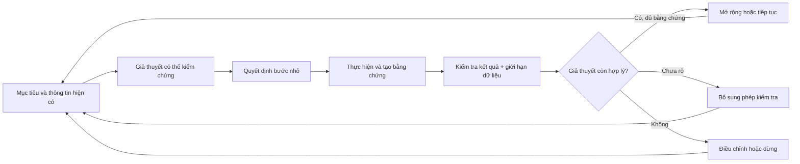

# Ra quyết định khi thông tin chưa đầy đủ và khả năng thay đổi còn cao

## 1. Vấn đề thường gặp: phải quyết định trước khi biết đủ

Trong phát triển phần mềm, nhóm hiếm khi có đủ dữ liệu để biết chắc người dùng sẽ thích tính năng nào, khối lượng truy cập sẽ tăng đến đâu hoặc một giải pháp kỹ thuật có hoạt động tốt trong mọi tình huống hay không. Đồng thời, nhu cầu khách hàng, quy định, công nghệ, ngân sách và bối cảnh kinh doanh có thể thay đổi ngay trong quá trình thực hiện.

Ví dụ, một nền tảng học trực tuyến nhận thấy nhiều người bắt đầu đăng ký khóa học nhưng không hoàn tất. Nhóm có thể đưa ra nhiều lời giải thích: biểu mẫu quá dài, người học chưa hiểu lợi ích, lỗi kết nối, hoặc họ chỉ muốn xem nội dung. Nếu lập tức xây lại toàn bộ quy trình đăng ký chỉ dựa trên một ý kiến, nhóm đang biến **giả định** thành **quyết định đầu tư lớn**.

**Tư duy thực nghiệm (empirical mindset)** giúp ra quyết định trong tình huống này: làm rõ điều đã biết và điều chưa biết, đưa ra giả thuyết, lựa chọn bước nhỏ đủ an toàn để thu thập bằng chứng, rồi kiểm tra và điều chỉnh hướng đi. Đây là một năng lực nền tảng của **Agile**: giao sản phẩm tăng dần, nhận phản hồi sớm và cải tiến liên tục. Nhóm không phải đợi đến khi hết bất định mới hành động, nhưng cũng không coi linh cảm hoặc số liệu rời rạc là sự thật chắc chắn.

> Câu hỏi thực hành: **“Với bằng chứng hiện có, bước tiếp theo nào tạo ra giá trị hoặc giúp chúng ta học được điều quan trọng nhất với rủi ro chấp nhận được?”**

## 2. Hiểu đúng về bất định và tính thay đổi

Không phải mọi thứ “chưa rõ” đều giống nhau. Nhận diện loại bất định giúp chọn cách ứng phó phù hợp.

| Loại bất định | Ví dụ | Cách tìm hiểu phù hợp |
| --- | --- | --- |
| **Nhu cầu và giá trị** | Người học có thật sự muốn đăng ký ngay hay cần học thử? | Phỏng vấn, quan sát hành vi, prototype, bản phát hành nhỏ |
| **Hành vi sử dụng** | Người dùng bỏ dở vì biểu mẫu hay vì chưa tin tưởng? | Phân tích hành trình, kiểm tra dữ liệu sự kiện, thử nghiệm có đối chứng khi phù hợp |
| **Kỹ thuật** | Hệ thống hiện có chịu được lượng truy cập dự kiến không? | Proof of concept, spike có giới hạn thời gian, thử tải, kiểm tra tích hợp |
| **Phối hợp và tiến độ** | Nhiều story bị chặn vì review hay vì phụ thuộc nhóm khác? | Quan sát bảng công việc, tuổi hạng mục, cycle time, trao đổi về nguyên nhân |
| **Môi trường bên ngoài** | Đối tác thanh toán hoặc quy định mới có thay đổi không? | Theo dõi thông báo chính thức, chuẩn bị phương án dự phòng và mốc xem xét lại |

Có hai nguồn bất định thường được phân biệt: **thiếu hiểu biết có thể giảm bằng tìm hiểu** (chẳng hạn chưa biết vì sao người dùng rời bỏ) và **biến động vốn có của thực tế** (chẳng hạn lưu lượng truy cập thay đổi theo thời điểm). Thu thập dữ liệu có thể giảm loại thứ nhất; với loại thứ hai, cần thiết kế hệ thống và kế hoạch có khả năng chịu dao động, thay vì đòi một dự báo tuyệt đối chính xác.

Một yêu cầu có thể **chưa rõ** nhưng ít thay đổi, hoặc **đã rõ hôm nay** nhưng dễ thay đổi vào tháng sau. Vì vậy, nhóm cần quan sát cả mức độ hiểu biết lẫn tốc độ thay đổi của bối cảnh.

### Phân loại bốn thành phần trước một quyết định

1. **Sự kiện quan sát được:** dữ liệu hoặc hành vi đã được ghi nhận với nguồn và phạm vi cụ thể; ví dụ “trong tuần thử nghiệm, 76/200 lượt bắt đầu biểu mẫu đi đến xác nhận thành công”.
2. **Giả thuyết:** cách giải thích có thể đúng hoặc sai; ví dụ “nhiều người bỏ dở vì trường số điện thoại xuất hiện quá sớm”.
3. **Điều chưa biết:** thông tin còn thiếu ảnh hưởng đến lựa chọn; ví dụ “trong những người rời bỏ, bao nhiêu người gặp lỗi mạng?”.
4. **Ràng buộc:** điều phải tuân thủ dù chưa biết kết quả; ví dụ yêu cầu bảo vệ dữ liệu cá nhân, xác thực và tính toàn vẹn đăng ký.

Nếu một câu có vẻ là sự kiện nhưng không chỉ ra được cách đo hoặc nguồn dữ liệu, hãy xem lại trước khi đưa vào quyết định. Tách bốn nhóm trên giúp tránh lập luận vòng tròn kiểu “biểu mẫu quá dài vì tỷ lệ hoàn tất thấp, và tỷ lệ hoàn tất thấp chắc chắn vì biểu mẫu quá dài”.

## 3. Minh bạch – kiểm tra – thích ứng: nhịp ra quyết định thực nghiệm

Scrum dùng ba trụ cột **transparency, inspection, adaptation** để kiểm soát quy trình thực nghiệm. Tinh thần đó cũng hữu ích ngoài Scrum: thông tin liên quan cần đủ minh bạch; nhóm thường xuyên xem xét sản phẩm và cách làm; khi phát hiện khác biệt có ý nghĩa, nhóm điều chỉnh kịp thời.



Ba trụ cột không đòi nhóm phải thống kê mọi chỉ số hay họp liên tục. **Minh bạch** đòi cùng hiểu định nghĩa “xong”, rủi ro và nguồn số liệu; **kiểm tra** đòi đối chiếu kết quả thực tế với kỳ vọng; **thích ứng** đòi có hành động cụ thể sau khi học được điều mới. Nếu báo cáo đẹp nhưng backlog và cách làm không thay đổi dù có bằng chứng mới, vòng thực nghiệm chưa thực sự khép kín.

Trong Agile, vòng này hiện diện ở nhiều mức:

- **Mức sản phẩm:** kiểm tra user story, increment và phản hồi người dùng; cập nhật thứ tự Product Backlog.
- **Mức kỹ thuật:** kiểm tra giải pháp qua test, tích hợp liên tục, đo hiệu năng và quan sát sự cố; sửa giả định thiết kế.
- **Mức quy trình:** kiểm tra WIP, thời gian chờ, cycle time và trở ngại; thử cải tiến rồi đo lại.
- **Mức chiến lược:** xem lại giả định về thị trường, nhu cầu và hiệu quả đầu tư theo mốc quyết định phù hợp.

## 4. Chọn mức độ phân tích dựa trên tác động và khả năng đảo ngược

Không phải mọi quyết định đều cần cùng một lượng nghiên cứu. Đổi câu chữ trên nút có thể được điều chỉnh nhanh, nhưng thay nhà cung cấp thanh toán hoặc cấu trúc lưu dữ liệu cá nhân có hậu quả lớn và khó hoàn tác.

| Tính chất quyết định | Ví dụ | Cách tiếp cận đề xuất |
| --- | --- | --- |
| **Tác động thấp, dễ đảo ngược** | Sửa nhãn nút, đổi thứ tự các thông tin không quan trọng | Thử nhanh, đo phản hồi, quay lại khi cần |
| **Tác động cao nhưng có cách hoàn tác an toàn** | Bật luồng đăng ký mới sau feature flag | Kiểm tra điều kiện an toàn, mở dần, giám sát, chuẩn bị rollback |
| **Tác động thấp nhưng khó đảo ngược** | Cam kết với bên thứ ba về một định dạng tích hợp ít dùng | Kiểm tra phụ thuộc và chi phí thay đổi trước khi chốt |
| **Tác động cao, khó đảo ngược** | Chuyển dữ liệu khách hàng sang nền tảng khác | Thu thập bằng chứng sâu hơn, đánh giá rủi ro, thẩm định chuyên môn và kế hoạch chuyển đổi |

**Khả năng đảo ngược** phải được kiểm tra thực tế, không chỉ giả định rằng có thể “rollback”. Một thay đổi giao diện có thể bật/tắt bằng cờ, nhưng dữ liệu được ghi theo định dạng mới có thể không chuyển ngược được; thông báo đã gửi đến người dùng cũng không thể thu hồi như một lần deploy.

Nhóm cần cân nhắc đồng thời:

- **Chi phí chờ đợi:** mất bao nhiêu cơ hội hoặc phát sinh bao nhiêu rủi ro nếu chưa quyết định?
- **Giá trị thông tin bổ sung:** nếu biết thêm một điều, liệu nhóm có chọn phương án khác không?
- **Mức thiệt hại nếu sai:** người dùng bị ảnh hưởng thế nào, có liên quan tiền, dữ liệu hay nghĩa vụ pháp lý không?
- **Thời gian và chi phí phục hồi:** mất bao lâu để dừng, sửa hoặc đảo ngược hậu quả?

**Nguyên tắc vận dụng:** quyết định dễ thay đổi có thể được đưa ra với bằng chứng vừa đủ rồi kiểm tra nhanh; quyết định có hậu quả khó đảo ngược cần ngưỡng chắc chắn và cơ chế phê duyệt tương xứng. “Thực nghiệm” không cho phép đem quyền riêng tư, sự an toàn hoặc tiền của người dùng ra thử một cách tùy tiện.

## 5. Quy trình bảy bước để quyết định với thông tin chưa đầy đủ

### Bước 1 – Xác định kết quả cần đạt, không bắt đầu từ giải pháp

Viết mục tiêu bằng tác động có thể quan sát: “giúp nhiều người hoàn tất đăng ký hợp lệ và bắt đầu học” rõ hơn “phải xây lại trang đăng ký”. Chỉ rõ đối tượng, mốc thời gian xem xét và các ràng buộc không thể bỏ qua. Nếu các bên chưa thống nhất mục tiêu, rất khó so sánh những phương án khác nhau.

### Bước 2 – Ghi rõ sự kiện, giả định và khoảng trống bằng chứng

Ví dụ: dữ liệu ghi nhận có 200 lượt bắt đầu đăng ký, 76 lượt hoàn tất; nhóm **chưa biết** có bao nhiêu người bỏ vì khó dùng, lỗi kỹ thuật hoặc chủ động đổi ý. Nên kiểm tra chất lượng dữ liệu trước: định nghĩa “bắt đầu”, cách đếm người hay phiên, sự kiện có bị gửi trùng không, khoảng thời gian nào được xét.

### Bước 3 – Đề xuất vài lựa chọn thực tế, bao gồm không thay đổi ngay

Nhóm có thể (A) sửa nội dung hướng dẫn và đo lại, (B) đơn giản hóa một bước biểu mẫu, (C) nghiên cứu một phương thức đăng nhập mới hoặc (D) giữ nguyên và điều tra lỗi vận hành trước. Với mỗi phương án, ghi tác động kỳ vọng, rủi ro, công sức và điều sẽ học được. Phương án “thu thập thêm bằng chứng” cũng là một quyết định, miễn có câu hỏi cụ thể và giới hạn thời gian.

### Bước 4 – Ưu tiên kiểm tra giả định rủi ro nhất bằng bước nhỏ

Nếu nguyên nhân chưa rõ, một số buổi quan sát người dùng kết hợp kiểm tra lỗi có thể giúp loại trừ giả định sai trước khi đầu tư phát triển. Nếu có tín hiệu đủ mạnh, nhóm chọn một **vertical slice** chạy trọn luồng, ví dụ chỉ thay đổi cách trình bày trường không bắt buộc trong đăng ký khóa miễn phí; giữ nguyên xác thực và cơ chế lưu đăng ký.

### Bước 5 – Đặt thước đo, điều kiện dừng và khoảng quan sát trước khi thử

Định nghĩa chỉ số kết quả (ví dụ tỷ lệ hoàn tất đăng ký hợp lệ), tín hiệu chẩn đoán (lỗi biểu mẫu, điểm rời bỏ), và **guardrail** (tỷ lệ lỗi máy chủ, đăng ký trùng, sự cố bảo mật). Xác định ai theo dõi, trong bao lâu, và dấu hiệu nào khiến phải tạm dừng thử nghiệm. Chỉ báo tăng không đủ nếu chức năng gây tác động xấu ở mặt khác.

### Bước 6 – Xem bằng chứng một cách có phê phán

So sánh kết quả với mục tiêu và điều kiện ban đầu. Phân biệt **tương quan** với **nguyên nhân**: một tỷ lệ chuyển đổi tăng có thể đến từ nhóm người dùng, thời vụ, thay đổi nguồn truy cập hoặc lỗi đo lường. Quan sát định tính giúp giải thích vì sao, dữ liệu định lượng giúp biết mức độ và xu hướng. Nếu mẫu nhỏ hoặc sai lệch, mô tả kết quả là tín hiệu sơ bộ.

### Bước 7 – Ra quyết định tiếp theo và ghi lại lý do

Chọn tiếp tục, mở rộng, điều chỉnh, kiểm tra thêm hoặc dừng. Cập nhật Product Backlog, người chịu trách nhiệm và thời điểm xem lại; ghi ngắn gọn bằng chứng dẫn đến lựa chọn. **Không thay đổi hướng đi** vẫn là quyết định cần lý do, nhất là khi bằng chứng mới không đủ mạnh để đảo ngược phương án đã chọn.

## 6. Ví dụ xuyên suốt: giảm bỏ dở khi đăng ký khóa học

### 6.1. Bối cảnh và giả thuyết

Một nhóm phát triển nền tảng học trực tuyến muốn tăng tỷ lệ học viên bắt đầu học sau khi chọn khóa miễn phí. Từ một tuần thử nghiệm giả định, hệ thống có **200 lượt bắt đầu** và **76 lượt đăng ký thành công**, tương ứng `76 / 200 = 38%`. Đây là **số liệu minh họa** cho cách ra quyết định, không phải kết quả thực địa.

Một cuộc quan sát cho thấy một số người do dự ở trường số điện thoại. Nhóm nêu giả thuyết:

> “Với khóa miễn phí không cần liên hệ qua điện thoại, giải thích rõ mục đích và chuyển trường số điện thoại không bắt buộc sang bước bổ sung hồ sơ sẽ làm nhiều người hoàn tất đăng ký hơn, trong khi vẫn giữ an toàn tài khoản và chất lượng dữ liệu cần thiết.”

Nhóm chưa kết luận tất cả trường hợp bỏ dở đều do số điện thoại. Trước khi sửa, Product Owner và bộ phận liên quan kiểm tra xem trường này có phải dữ liệu bắt buộc vì lý do nghiệp vụ, pháp lý hay vận hành không. Nếu bắt buộc, cần đổi phương án; không tự ý bỏ kiểm soát.

### 6.2. So sánh phương án

| Phương án | Giá trị học được | Chi phí/rủi ro chính | Quyết định ban đầu |
| --- | --- | --- | --- |
| **Chỉ sửa giải thích dưới trường** | Kiểm tra ảnh hưởng của cách truyền đạt | Thấp, nhưng chưa kiểm tra nỗi lo cung cấp dữ liệu | Ứng viên thử nhanh |
| **Chuyển trường tùy chọn sang hồ sơ sau đăng ký** | Kiểm tra tác động của giảm ma sát | Cần xác nhận yêu cầu dữ liệu và kiểm tra toàn luồng | Ứng viên cho lát sản phẩm |
| **Xây hệ thống đăng nhập và hồ sơ mới** | Có thể giải quyết nhiều vấn đề hơn | Phạm vi lớn, rủi ro tích hợp và mất thời gian | Chưa đủ bằng chứng để ưu tiên |
| **Giữ nguyên và phân tích lỗi trước** | Phân biệt lỗi kỹ thuật với khó khăn trải nghiệm | Chưa trực tiếp cải thiện giao diện | Cần làm song song ở phạm vi hợp lý |

Nhóm quyết định thử một thay đổi nhỏ sau khi xác nhận trường điện thoại là tùy chọn với trường hợp đang xét. Story có thể là:

> Là học viên đăng ký khóa miễn phí, tôi muốn biết rõ thông tin nào bắt buộc ở bước đăng ký để hoàn tất và bắt đầu học mà không phải cung cấp dữ liệu chưa cần thiết.

Tiêu chí chấp nhận của story bao gồm: luồng hoạt động với học viên hợp lệ; người đã đăng ký không có bản ghi trùng; dữ liệu bắt buộc được kiểm tra ở máy chủ; không có quyền truy cập khóa học nếu đăng ký thất bại; màn hình lỗi và thành công phản ánh đúng trạng thái. Đây là phần công việc **hoàn chỉnh xuyên giao diện, API và lưu trữ**, thay vì những task riêng lẻ chỉ có thể kiểm chứng khi ghép lại.

### 6.3. Thiết kế một phép kiểm tra phù hợp

Nếu hệ thống có đủ lưu lượng và khả năng phân nhóm công bằng, nhóm có thể thực hiện thử nghiệm có đối chứng:

- **Nhóm A:** quy trình hiện có.
- **Nhóm B:** phiên bản giải thích rõ dữ liệu và tối giản trường tùy chọn theo thiết kế mới.
- **Chỉ số chính:** tỷ lệ hoàn tất = số người bắt đầu quy trình rồi đăng ký hợp lệ / số người bắt đầu quy trình theo định nghĩa thống nhất.
- **Chỉ số bổ sung:** tỷ lệ mở bài đầu sau đăng ký; lỗi kiểm tra dữ liệu; thời gian hoàn tất; phản hồi người dùng.
- **Điều kiện an toàn:** không tăng đăng ký trùng, lỗi phân quyền, lỗi máy chủ hoặc xử lý sai dữ liệu cá nhân.

Người tham gia cần được phân nhóm nhất quán và đo trong cùng bối cảnh; không nên cho một người liên tục nhìn thấy hai phiên bản và bị đếm vào cả hai. Với mẫu nhỏ, nhóm có thể ưu tiên phỏng vấn/quan sát trước hoặc chấp nhận rằng kết quả định lượng chưa đủ chắc chắn. Việc lựa chọn phương pháp phải dựa trên tính khả thi và mức độ rủi ro, không phải cứ có hai giao diện là phải chạy A/B test.

### 6.4. Đọc kết quả mà không khẳng định quá mức

Giả sử trong một khoảng thử nghiệm minh họa:

| Nhóm | Bắt đầu đăng ký | Hoàn tất hợp lệ | Tỷ lệ hoàn tất |
| --- | ---: | ---: | ---: |
| A – hiện tại | 200 | 70 | 35% |
| B – thay đổi nhỏ | 200 | 88 | 44% |

Chênh lệch quan sát được là **9 điểm phần trăm** (`44% - 35%`), tương đương mức tăng tương đối khoảng **25,7%** so với nhóm A (`9 / 35`). Hai cách diễn đạt này khác nhau; không được gọi mức tăng 9 điểm phần trăm là “tăng 9%”.

Kết quả trên **chưa đủ để tuyên bố B chắc chắn tốt hơn**. Cần xem tính ngẫu nhiên của phân nhóm, kích thước mẫu, khoảng tin cậy/độ bất định, thời gian chạy, sai lệch đo và các guardrail. Đặc biệt, tránh liên tục xem số rồi dừng đúng lúc B dẫn đầu mà không có quy tắc phân tích phù hợp. Nếu tín hiệu còn yếu, nhóm có thể bổ sung quan sát, thu thập dữ liệu đủ theo thiết kế đã định hoặc quyết định triển khai giới hạn nếu tác động thấp và có phương án hoàn tác an toàn.

Nếu dữ liệu cho thấy tỷ lệ đăng ký tăng nhưng tỷ lệ thực sự mở bài đầu giảm, nhóm cần xem liệu mình đã tối ưu sai bước trong hành trình hay chưa. **Chỉ số đầu ra của một màn hình không thay thế kết quả giá trị đối với người học.**

### 6.5. Cập nhật backlog sau khi học

Nhóm có thể ưu tiên sửa nội dung gợi ý, tinh chỉnh giao diện, điều tra lỗi chỉ xuất hiện trên một trình duyệt hoặc bổ sung khả năng xem lại khóa đã đăng ký. Lựa chọn phụ thuộc bằng chứng mới. Một tính năng ban đầu nằm đầu backlog như “đăng nhập bằng mạng xã hội” có thể được đẩy xuống nếu dữ liệu không cho thấy đó là điểm nghẽn quan trọng.

## 7. Đọc bằng chứng: đủ tốt cho quyết định nào?

Không có một ngưỡng dữ liệu dùng được cho mọi tình huống. Bằng chứng “đủ tốt” phụ thuộc vào **rủi ro, chi phí quyết định, khả năng phục hồi và chất lượng cách đo**.

| Nguồn thông tin | Giúp trả lời | Hạn chế cần ghi rõ |
| --- | --- | --- |
| Phỏng vấn người dùng | Người dùng nghĩ, cảm thấy, kỳ vọng điều gì? | Điều họ nói không phải lúc nào cũng là hành vi thật; dễ lệch mẫu |
| Quan sát phiên dùng thử | Người dùng bị vướng ở bước nào và biểu hiện ra sao? | Mẫu nhỏ, bối cảnh quan sát có thể ảnh hưởng hành vi |
| Nhật ký sự kiện và funnel | Tình trạng bỏ dở tập trung ở đâu, tần suất bao nhiêu? | Sự kiện có thể thiếu/trùng; chưa lý giải được nguyên nhân |
| Thử nghiệm có đối chứng | Hai lựa chọn khác nhau thế nào trong điều kiện kiểm soát? | Cần thiết kế phép đo, mẫu, thời gian và cách phân nhóm phù hợp |
| Log lỗi, giám sát hệ thống | Có lỗi kỹ thuật, quá tải hay bất thường nào? | Không giải thích đầy đủ mong muốn và cảm nhận người dùng |
| Nhận định chuyên gia | Ràng buộc, chi phí ẩn và rủi ro kỹ thuật/pháp lý là gì? | Vẫn có thể dựa trên giả định chưa được thử nghiệm |

### Những sai lệch nhận thức thường xuất hiện

- **Confirmation bias – chỉ tìm bằng chứng ủng hộ:** nếu tin biểu mẫu quá dài, nhóm chỉ hỏi “vì sao biểu mẫu dài gây khó chịu?”. Hãy hỏi cả người hoàn tất thành công và những người bỏ dở vì lý do khác.
- **Hiệu ứng người dùng nói nhiều:** vài ý kiến rất mạnh có thể hữu ích để tạo giả thuyết nhưng chưa đại diện cho mọi người dùng. Đối chiếu với dữ liệu theo nhóm.
- **Survivorship bias – chỉ nghe người ở lại:** nếu chỉ hỏi học viên đăng ký thành công, nhóm sẽ thiếu tiếng nói của người bỏ dở.
- **Đánh đồng tương quan với nhân quả:** tỷ lệ đăng ký tăng vào cùng thời điểm thay giao diện không tự chứng minh giao diện là nguyên nhân.
- **Sunk cost – tiếc công đã đầu tư:** đã xây nhiều tháng không phải lý do tiếp tục nếu bằng chứng cho thấy sản phẩm không giải quyết nhu cầu.
- **Tự tin giả tạo vì số chính xác:** phép đo `38%` có thể có lỗi định nghĩa sự kiện hoặc thiên lệch đối tượng; viết nhiều chữ số không làm dữ liệu đáng tin hơn.

Một thói quen có ích là chỉ định một người trình bày **phương án thay thế và bằng chứng có thể khiến nhóm đổi ý**. Người này giúp kiểm tra lập luận, không phải giữ vai trò phản đối mọi quyết định.

## 8. Quyết định trong Scrum, Kanban và XP

Tư duy thực nghiệm không đồng nghĩa phải dùng Scrum; Agile có thể vận dụng với các cách phối hợp khác nhau. Mỗi cách cung cấp nhịp kiểm tra và cơ chế điều chỉnh riêng.

| Thực hành | Thời điểm/nguồn bằng chứng | Quyết định được hỗ trợ |
| --- | --- | --- |
| **Product Backlog Refinement** | Nhu cầu mới, tiêu chí chấp nhận, phụ thuộc, rủi ro của story | Chia nhỏ, làm rõ, sắp xếp lại công việc trước khi bắt đầu |
| **Sprint Planning (Scrum)** | Product Goal, thứ tự backlog, năng lực thực tế, kết quả Sprint trước | Đặt Sprint Goal và chọn kế hoạch khả thi cho Sprint |
| **Daily Scrum (Scrum)** | Tiến độ hướng tới Sprint Goal, trở ngại mới | Developers điều chỉnh kế hoạch ngày để tiến gần mục tiêu |
| **Sprint Review (Scrum)** | Increment, phản hồi stakeholder, thay đổi thị trường | Xem lại kết quả và điều chỉnh Product Backlog |
| **Sprint Retrospective (Scrum)** | Sự cố, chất lượng, phối hợp, tốc độ và cảm nhận của nhóm | Thử cải tiến cách làm trong chu kỳ tiếp theo |
| **Kanban** | WIP, throughput, cycle time, work item age, blocker | Điều chỉnh giới hạn WIP, luồng ưu tiên và cách xử lý việc bị kẹt |
| **XP** | Test, phản hồi tích hợp, pair programming, chất lượng thiết kế | Thay đổi thiết kế, refactoring và kỹ thuật thực hiện sớm |

Trong Scrum, nhóm không cần chờ hết Sprint mới trao đổi khi phát hiện rủi ro. Sprint Backlog được thích ứng trong Sprint nhằm hướng tới Sprint Goal, còn Product Backlog là danh sách luôn có thể được sắp xếp lại khi thông tin mới xuất hiện. Trong Kanban, các điều chỉnh có thể thực hiện theo dòng công việc liên tục; không bắt buộc có Sprint để ra quyết định.

### Dùng số liệu dòng công việc để phát hiện bất định của kế hoạch

Các chỉ số hữu ích gồm:

- **WIP (Work in Progress):** có bao nhiêu hạng mục đã bắt đầu nhưng chưa hoàn thành; WIP cao có thể đi kèm tắc nghẽn và chuyển ngữ cảnh nhiều.
- **Throughput:** số hạng mục hoàn thành trong một khoảng thời gian, với cách định nghĩa hạng mục nhất quán.
- **Cycle time:** thời gian từ lúc bắt đầu thực hiện đến khi hoàn tất theo quy tắc của nhóm.
- **Work item age:** thời gian một hạng mục đang mở đã ở trạng thái thực hiện đến hiện tại.
- **Lead time:** thời gian từ mốc nhu cầu được ghi nhận hoặc yêu cầu được cam kết đến khi bàn giao, tùy định nghĩa đã công bố.

**Ví dụ:** ba story đang bị chặn ở bước review nhiều ngày liên tiếp trong khi developer liên tục bắt đầu story mới. Nhóm không cần đợi dự án trễ mới hành động; có thể thử chính sách “ưu tiên xử lý hạng mục đang chờ review trước khi kéo thêm việc”, rồi quan sát tuổi hạng mục và cycle time vài chu kỳ. Nếu thời gian chờ không cải thiện, nhóm kiểm tra xem nguyên nhân nằm ở năng lực review, phạm vi thay đổi quá lớn hay quy trình kiểm thử.

Số liệu luồng công việc mô tả **hệ thống làm việc**, không tự cho biết năng suất hay giá trị của từng con người. Đừng dùng số story hoặc số dòng code làm thước đo duy nhất để đánh giá cá nhân; điều đó có thể khuyến khích chia ticket vô nghĩa hoặc né việc khó.

## 9. Công cụ giảm rủi ro khi phải quyết định sớm

**Spike có giới hạn thời gian:** dùng để trả lời một câu hỏi kỹ thuật cụ thể trước khi cam kết kiến trúc. Ví dụ: “Trong một ngày, kiểm tra xem dịch vụ thanh toán hiện có có hỗ trợ xác nhận bất đồng bộ và xử lý retry an toàn không”. Đầu ra là phát hiện, lựa chọn và rủi ro còn lại; spike không tự động là increment có giá trị sử dụng.

**Prototype hoặc kiểm tra ý tưởng:** thích hợp để kiểm tra cách người dùng hiểu thông tin mà chưa cần hoàn thiện toàn bộ hệ thống. Phải gọi đúng mức độ sẵn sàng của mô hình; không suy từ prototype đẹp rằng hệ thống thật đã đáp ứng tính toàn vẹn hay hiệu năng.

**Vertical slice và incremental delivery:** chọn luồng hẹp nhưng vận hành trọn vẹn để kiểm chứng hành vi, tích hợp và chất lượng kỹ thuật sớm. Cách chia theo backend/frontend đơn lẻ có thể là task thực hiện, nhưng khó tạo phản hồi giá trị nếu từng phần chưa hoạt động cùng nhau.

**Feature flag và phát hành giới hạn:** giúp mở tính năng cho một nhóm nhỏ, quan sát rồi mở rộng theo điều kiện đã định. Cần kiểm soát ai được thấy tính năng, dữ liệu mới phát sinh và cách khôi phục; không giả định tắt cờ là hoàn tác mọi hậu quả.

**Decision log ngắn:** lưu thông tin đủ để người đến sau hiểu vì sao một lựa chọn được thực hiện và khi nào phải xem xét lại. Đặc biệt hữu ích khi nhóm hoặc bối cảnh thay đổi nhanh.

Mẫu nhật ký quyết định:

```text
Ngày: <ngày quyết định>
Người chịu trách nhiệm: <vai trò/người quyết định>
Mục tiêu: <kết quả mong muốn>
Bằng chứng hiện có: <nguồn, thời gian, phạm vi, giới hạn>
Giả thuyết và điều chưa biết: <các câu cần kiểm chứng>
Lựa chọn cân nhắc: <A / B / giữ nguyên>
Quyết định và lý do: <chọn gì, đánh đổi nào được chấp nhận>
Giới hạn an toàn: <điều kiện không được vi phạm>
Tín hiệu kiểm tra: <chỉ số hoặc quan sát, ngưỡng/điều kiện>
Thời điểm xem lại: <ngày hoặc mốc có bằng chứng mới>
Hành động tiếp theo: <ai làm gì>
```

Đây là công cụ giao tiếp và học hỏi, không phải một biểu mẫu phê duyệt bắt buộc cho mọi chỉnh sửa nhỏ. Cần ghi đủ để thay đổi quyết định khi có thông tin mới, tránh biến việc ghi chép thành công việc hành chính kéo dài.

## 10. Các phản mẫu khi đối mặt với bất định

| Phản mẫu | Hệ quả | Cách điều chỉnh |
| --- | --- | --- |
| **Chờ mọi yêu cầu rõ 100% mới bắt đầu** | Trì hoãn phản hồi, mất cơ hội học từ sản phẩm | Nêu giả thuyết quan trọng, chọn bước nhỏ an toàn để kiểm chứng |
| **Quyết quá nhanh chỉ bằng trực giác** | Dễ đầu tư lớn vào nguyên nhân chưa đúng | Tách sự kiện khỏi giả định, tìm phép kiểm tra có chi phí phù hợp |
| **Tổ chức nhiều cuộc họp nhưng không nêu ai quyết định** | Vòng tranh luận kéo dài, trách nhiệm mơ hồ | Chỉ rõ chủ quyết định, thời hạn và tiêu chí lựa chọn |
| **Chọn phép đo sau khi đã thấy kết quả** | Dễ chọn chỉ số thuận lợi để biện minh | Đặt chỉ số chính, guardrail và quy tắc đọc kết quả trước khi thử |
| **Xem từng biến động nhỏ như bằng chứng chắc chắn** | Đổi hướng liên tục, khó đánh giá tác động | Kiểm tra độ tin cậy, độ lớn tác động và bối cảnh mẫu |
| **Coi thay đổi kế hoạch là thất bại** | Nhóm che giấu thông tin trái kỳ vọng | Đánh giá quyết định bằng chất lượng lý do và khả năng thích ứng |
| **Tối ưu số lượng ticket thay vì kết quả** | Nhiều đầu việc đóng nhưng ít giá trị thực | Kết hợp chỉ số sản phẩm, chất lượng và luồng công việc |
| **Dùng thử nghiệm làm cớ bỏ kiểm soát** | Lộ dữ liệu, mất tiền, giảm tin cậy | Đặt ràng buộc bảo mật, pháp lý và ngưỡng dừng từ đầu |

## 11. Bài thực hành: có nên xây ngay hệ thống gợi ý khóa học?

**Tình huống.** Người phụ trách sản phẩm đề xuất triển khai một hệ thống gợi ý khóa học dùng mô hình học máy trong ba tháng. Lý do là nhiều học viên xem danh mục nhưng chưa đăng ký. Dữ liệu hiện có chỉ cho thấy tỷ lệ chuyển từ trang danh mục sang trang chi tiết thấp; chưa biết nguyên nhân do tìm kiếm, danh mục ít khóa phù hợp, cách đặt tên khóa hay thuật toán đề xuất.

Hãy thử trả lời bốn câu hỏi:

1. **Sự kiện, giả thuyết và điều chưa biết** trong tình huống này là gì?
2. Trước khi cam kết ba tháng, nhóm có thể thực hiện **phép kiểm tra nhỏ nhất** nào để giảm rủi ro chọn sai giải pháp?
3. Cần đặt **chỉ số kết quả, chất lượng và guardrail** nào?
4. Khi có kết quả, những dấu hiệu nào khiến nhóm tiếp tục, đổi hướng hoặc tạm dừng?

**Gợi ý phương án:**

- Ghi sự kiện hiện có với định nghĩa phiên/người và khoảng thời gian; đừng suy ngay rằng thiếu thuật toán là nguyên nhân.
- Phỏng vấn/quan sát một số người tìm khóa; đối chiếu từ khóa tìm kiếm không có kết quả, tỷ lệ nhấn vào trang chi tiết và nội dung mô tả khóa.
- Thử một lát đơn giản như “khóa học liên quan” dựa trên chủ đề hoặc cải thiện cách hiển thị/tìm kiếm trước khi đầu tư mô hình phức tạp, nếu kết quả khám phá cho thấy giả thuyết đó phù hợp.
- Đo tỷ lệ người tìm được khóa phù hợp và bắt đầu học; đồng thời theo dõi lỗi, thời gian phản hồi, khả năng tiếp cận và tác động tới nhóm người dùng khác nhau.
- Quyết định mở rộng khi có bằng chứng đủ tin cậy rằng giải pháp cải thiện kết quả có ý nghĩa mà vẫn thỏa ràng buộc; nếu không, ưu tiên lại backlog và ghi rõ điều đã học.

Không có một đáp án duy nhất. Một quyết định tốt phải nêu **vì sao bước hiện tại hợp lý với bằng chứng và rủi ro đang có**, cùng dấu hiệu nào sẽ khiến nhóm đổi quyết định.

## 12. Checklist trước khi chốt một quyết định khó

- [ ] Tôi có thể mô tả **mục tiêu và tác động mong muốn** mà không nhắc tên giải pháp không?
- [ ] Tôi đã phân biệt **sự kiện, giả thuyết, điều chưa biết và ràng buộc** chưa?
- [ ] Tôi đã xem ít nhất một **phương án thay thế**, kể cả kiểm tra thêm hoặc chưa thay đổi chưa?
- [ ] Tôi hiểu quyết định **có dễ đảo ngược không**, và thiệt hại nếu sai là gì chưa?
- [ ] Có **bước nhỏ, an toàn và đủ giá trị học hỏi** trước khi cam kết lớn hơn không?
- [ ] Tôi đã xác định **thước đo, chất lượng dữ liệu, guardrail và điều kiện dừng** chưa?
- [ ] Tôi đã xem xét **bằng chứng trái chiều**, các sai lệch có thể xảy ra và giới hạn kết luận chưa?
- [ ] Ai **chịu trách nhiệm quyết định**, ai thực hiện và khi nào xem lại đã rõ chưa?
- [ ] Kết quả mới có được dùng để **thích ứng backlog, kỹ thuật hoặc cách phối hợp** không?

**Ghi nhớ:** Trong môi trường thay đổi nhanh, chất lượng ra quyết định không đồng nghĩa với khả năng dự đoán đúng mọi việc. Chất lượng nằm ở việc **nhìn rõ giới hạn hiểu biết, giảm hậu quả của lựa chọn sai, thu nhận phản hồi thực tế và sẵn sàng điều chỉnh**. Nhờ vậy, user story, backlog, Scrum, Kanban, XP và số liệu dòng công việc trở thành các công cụ để học và thích ứng, thay vì những quy trình chỉ nhằm thực hiện một kế hoạch cố định.
