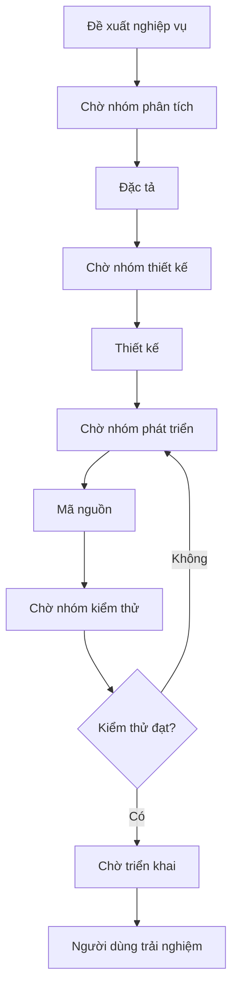
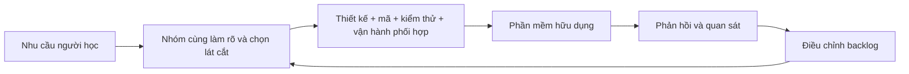

# Nhóm đa chức năng và khả năng tạo kết quả xuyên suốt

## Mục tiêu học tập

Sau bài học, bạn có thể:

- Giải thích **nhóm đa chức năng (cross-functional team)** là gì và vì sao Agile cần nhóm có khả năng tạo ra một phần sản phẩm có giá trị từ đầu đến cuối.
- Phân biệt **có đủ năng lực trong nhóm** với yêu cầu **mỗi cá nhân phải biết làm mọi việc**.
- Nhận diện những điểm bàn giao, hàng đợi, phụ thuộc và cách tổ chức theo chuyên môn khiến việc giao sản phẩm chậm, dù từng bộ phận đều làm việc hiệu quả.
- Xây dựng một lát cắt chức năng xuyên suốt từ nhu cầu người dùng đến phần mềm có thể kiểm chứng; làm rõ trách nhiệm chất lượng và tiêu chí hoàn thành.
- Vận dụng backlog, Scrum, Kanban và các thực hành XP để tổ chức cộng tác, hạn chế công việc dở dang và cải tiến dòng giá trị.
- Đề xuất cách lãnh đạo tạo điều kiện cho nhóm tự quản, xử lý phụ thuộc bên ngoài và đánh giá kết quả bằng giá trị người dùng cùng các thước đo dòng công việc.

## 1. Kết quả xuyên suốt là gì?

Trong phát triển phần mềm, một công việc chỉ thật sự có ý nghĩa với khách hàng khi họ có thể sử dụng hoặc kiểm chứng **một kết quả đủ hoàn chỉnh**. Việc riêng lẻ hoàn tất bản thiết kế, API, giao diện hay bộ kiểm thử chưa bảo đảm khách hàng đạt được mục đích.

Xét một nền tảng học trực tuyến. Người học muốn **đăng ký một khóa học**. Để đáp ứng nhu cầu đó, sản phẩm có thể cần:

1. Làm rõ điều kiện đăng ký và các trường hợp ngoại lệ của nghiệp vụ.
2. Thiết kế thao tác chọn khóa học, hiển thị thông báo và xử lý lỗi.
3. Lưu dữ liệu đăng ký đúng cách, bảo vệ dữ liệu cá nhân và tránh đăng ký trùng.
4. Kết nối giao diện, xử lý phía máy chủ và hệ thống dữ liệu.
5. Kiểm thử luồng chính, tình huống lỗi, phân quyền và hành vi trên thiết bị cần hỗ trợ.
6. Cung cấp một bản phần mềm sử dụng được, đồng thời có cách quan sát và khắc phục sự cố thích hợp.

Nếu các bước được thực hiện bởi những bộ phận riêng biệt và chỉ được nối lại ở cuối, nhóm rất dễ phát hiện muộn rằng màn hình không phản ánh quy tắc nghiệp vụ, API thiếu dữ liệu hay luồng đăng ký chưa xử lý tình huống lỗi. Mỗi bộ phận có thể báo “đã xong”, nhưng **khả năng đăng ký khóa học chưa sẵn sàng**.

**Kết quả xuyên suốt (end-to-end outcome)** là một kết quả phục vụ nhu cầu người dùng hoặc mục tiêu kinh doanh, đi qua những công việc cần thiết để được kiểm chứng và sử dụng trong bối cảnh thực tế. Khái niệm này khác với “hoàn thành một tác vụ kỹ thuật”: tác vụ là phần việc; kết quả là điều sản phẩm cho phép người dùng làm được hoặc thay đổi có thể quan sát được.

Cần phân biệt ba mức:

| Mức | Ví dụ | Câu hỏi kiểm chứng |
| --- | --- | --- |
| **Hoạt động** | Viết mã cho API đăng ký; tạo mẫu giao diện; soạn test case. | Nhóm đã thực hiện công việc gì? |
| **Đầu ra (output)** | Hoàn tất một chức năng đăng ký chạy được và đạt tiêu chí chất lượng. | Sản phẩm đã tạo ra khả năng nào? |
| **Kết quả (outcome)** | Người học đăng ký đúng khóa, ít gặp lỗi hoặc phải nhờ hỗ trợ hơn. | Cuộc sống người dùng hay hiệu quả kinh doanh thay đổi ra sao? |

Một đầu ra dùng được tạo điều kiện để kiểm chứng kết quả, nhưng **không tự chứng minh kết quả kinh doanh đã tốt hơn**. Nhóm phải quan sát phản hồi và dữ liệu sau khi người dùng tiếp cận sản phẩm.

## 2. Nhóm đa chức năng là gì?

**Nhóm đa chức năng** tập hợp hoặc có quyền chủ động huy động **những năng lực cần thiết để cùng tạo ra giá trị**, từ hiểu bài toán đến xây dựng, kiểm chứng và hỗ trợ sản phẩm. Thay vì chỉ sở hữu một công đoạn, nhóm phối hợp để hoàn thành một đơn vị công việc có ý nghĩa đối với người dùng.

Trong **Scrum Guide 2020**, Scrum Team được mô tả là *cross-functional*: các thành viên, xét như một tập thể, có những kỹ năng cần để tạo giá trị trong mỗi Sprint. Nhóm cũng *self-managing*: tự quyết định ai làm gì, khi nào và làm như thế nào trong phạm vi trách nhiệm của mình. Hai đặc tính hỗ trợ nhau nhưng không đồng nghĩa:

- **Đa chức năng:** nhóm có đủ khả năng xử lý những công việc cần thiết để tạo ra một Increment hữu dụng.
- **Tự quản:** nhóm chủ động tổ chức công việc, điều chỉnh cách phối hợp và ra quyết định chuyên môn trong những giới hạn minh bạch.

Một nhóm có đủ người thiết kế, viết mã và kiểm thử nhưng mọi quyết định phải đi qua các quản lý chức năng có thể **chưa tự quản**. Ngược lại, một nhóm được tự tổ chức nhưng thiếu khả năng kiểm thử hoặc không có cách tiếp cận chuyên gia bảo mật cần thiết vẫn **chưa đủ năng lực** để hoàn tất kết quả một cách an toàn.

### 2.1. Không phải ai cũng phải trở thành “người làm được mọi thứ”

Một hiểu lầm phổ biến là nhóm đa chức năng đòi hỏi mỗi lập trình viên đều phải thành thạo UX, phân tích nghiệp vụ, cơ sở dữ liệu, vận hành, bảo mật và kiểm thử. Điều đó không thực tế.

Nhóm có thể gồm những người có chuyên môn sâu khác nhau. Ví dụ:

| Năng lực | Đóng góp vào kết quả chung | Cách phối hợp cần có |
| --- | --- | --- |
| Khám phá sản phẩm và nghiệp vụ | Xác định vấn đề, giá trị mong muốn, quy tắc và thứ tự ưu tiên. | Trao đổi liên tục với người triển khai và người dùng. |
| Thiết kế trải nghiệm | Làm rõ hành trình, khả năng tiếp cận và tình huống tương tác. | Kiểm chứng luồng với nghiệp vụ, kỹ thuật và người dùng. |
| Phát triển giao diện và phía máy chủ | Hiện thực hóa hành vi, dữ liệu và các tích hợp cần thiết. | Cùng làm rõ hợp đồng dữ liệu và kiểm thử luồng đầy đủ. |
| Kiểm thử và kỹ thuật chất lượng | Nhận diện rủi ro, xây dựng chiến lược kiểm thử, hỗ trợ tự động hóa. | Tham gia sớm khi xác định ví dụ và tiêu chí chấp nhận. |
| Hạ tầng và vận hành | Bảo đảm môi trường, khả năng triển khai, quan sát và khôi phục. | Phối hợp từ lúc thiết kế thay vì chỉ ở ngày phát hành. |
| Bảo mật, dữ liệu và tuân thủ | Làm rõ ràng buộc, bảo vệ dữ liệu và đánh giá trường hợp rủi ro cao. | Cung cấp hướng dẫn, tiêu chuẩn và điểm tham vấn kịp thời. |

**Một người có thể đảm nhiệm nhiều năng lực; một năng lực có thể do nhiều người cùng phát triển.** Chuyên gia không mất đi vai trò chuyên môn. Sự thay đổi quan trọng là họ cùng chịu trách nhiệm với kết quả sản phẩm, chủ động giúp nhau hoàn tất phần việc còn thiếu và không dùng ranh giới chức danh để đẩy trách nhiệm cho người khác.

Ví dụ, người thiên về kiểm thử có thể giúp nhóm viết ví dụ nghiệp vụ trước khi lập trình; lập trình viên có thể học cách chạy kiểm thử giao diện; người thiết kế có thể cùng theo dõi việc người dùng sử dụng tính năng sau phát hành. Những hoạt động này mở rộng năng lực phối hợp, không xóa bỏ chuyên môn sâu.

### 2.2. Kỹ năng hình chữ T và năng lực tập thể

Mô hình **kỹ năng hình chữ T (T-shaped skills)** giúp diễn giải một cách phát triển năng lực: chiều dọc là chuyên môn sâu; chiều ngang là khả năng hiểu và hỗ trợ những lĩnh vực gần kề. Chẳng hạn, một lập trình viên backend chuyên về thanh toán vẫn có thể hiểu kiểm thử giao diện, giao tiếp API, logging và hành trình người dùng.

Mục tiêu không phải buộc mọi người thành “full-stack” như nhau. Mục tiêu là tạo đủ **năng lực tập thể và khả năng hỗ trợ chéo** để nhóm không bị tê liệt chỉ vì một cá nhân vắng mặt hoặc một công đoạn đang quá tải.

Dùng ma trận kỹ năng đơn giản để thấy chỗ cần hỗ trợ:

| Năng lực | Người có thể làm độc lập | Người có thể hỗ trợ | Rủi ro hiện tại |
| --- | --- | --- | --- |
| Nghiệp vụ ghi danh | Đại diện sản phẩm, phân tích nghiệp vụ | Lập trình viên, kiểm thử viên | Quy tắc mới chỉ một người biết. |
| Kiểm thử hồi quy | Kỹ sư chất lượng, một lập trình viên | Các thành viên khác | Bộ kiểm thử chạy thủ công mất nhiều thời gian. |
| Triển khai và quan sát | Kỹ sư vận hành, lập trình viên backend | Nhóm phát triển | Phụ thuộc một người để xử lý sự cố. |

Ma trận chỉ có ích khi dẫn đến hành động: ghép cặp để chuyển giao kiến thức, lưu tài liệu vừa đủ, tự động hóa thao tác lặp lại, cải thiện quyền truy cập và thiết kế cách hỗ trợ khi người phụ trách vắng mặt. Không nên dùng nó để chấm điểm cá nhân hoặc áp đặt mọi người phải học tất cả kỹ năng.

## 3. Vì sao làm theo phòng ban dễ tạo nhiều chờ đợi?

Cách tổ chức theo chuyên môn thường gom các nhà phân tích vào một nhóm, thiết kế vào một nhóm, backend vào một nhóm, kiểm thử vào một nhóm và vận hành vào một nhóm khác. Mỗi nhóm có lịch ưu tiên riêng, vì vậy một tính năng phải chờ để đi qua nhiều hàng đợi.

Một chuỗi bàn giao điển hình:



Sơ đồ này minh họa một **nguy cơ tổ chức**, không phải định nghĩa bắt buộc của phòng ban chức năng. Các phòng ban vẫn có thể phối hợp hiệu quả nếu thống nhất mục tiêu, giảm chờ đợi và làm việc đồng thời ở mức phù hợp.

Các vấn đề thường xuất hiện:

1. **Tối ưu cục bộ:** nhóm thiết kế tối đa số mẫu hoàn thành; nhóm backend tối đa số API; nhóm kiểm thử tối đa số test case. Không chỉ số nào bảo đảm tính năng dùng được sớm.
2. **Hàng đợi giữa các công đoạn:** việc chuyển giao sang bộ phận kế tiếp phụ thuộc lịch ưu tiên riêng, làm tăng thời gian chờ.
3. **Phản hồi đến muộn:** hiểu sai nghiệp vụ chỉ được phát hiện khi đã thực hiện nhiều bước và việc sửa chữa ảnh hưởng rộng.
4. **Chi phí chuyển ngữ cảnh:** chuyên gia phải xử lý yêu cầu từ nhiều dự án cùng lúc, khó tập trung để hoàn thành một kết quả.
5. **Trách nhiệm phân mảnh:** khi sự cố xảy ra, các bộ phận có thể cho rằng “phần của tôi đã xong”, nhưng không ai nhìn thấy toàn bộ hành trình.

Điểm quan trọng là **thời gian làm việc thực tế chỉ chiếm một phần của thời gian từ lúc yêu cầu được nhận đến lúc khách hàng có giá trị**. Rút ngắn chờ đợi, làm rõ quyết định sớm và giảm số lần bàn giao có thể cải thiện tốc độ hơn việc yêu cầu từng cá nhân làm nhanh hơn.

### 3.1. Nhóm đa chức năng thay đổi dòng chảy thế nào?

Khi những người có năng lực cần thiết cùng hướng tới một kết quả, họ có thể trao đổi các chi tiết ngay lúc cần, phát hiện rủi ro sớm và kết hợp phần việc theo một lát cắt nhỏ:



Tính đa chức năng **không tự động tạo ra năng suất**. Nếu nhóm vẫn duy trì nhiều hàng đợi nội bộ, chờ một người ký duyệt mọi chi tiết, làm quá nhiều việc cùng lúc hoặc chỉ tích hợp mã ở cuối chu kỳ, các vấn đề ban đầu vẫn tồn tại. Cần thay đổi cả cách cộng tác và chính sách công việc.

## 4. Từ user story đến lát cắt giá trị xuyên suốt

Một cách thực hành cụ thể là tổ chức backlog quanh **nhu cầu người dùng**, thay vì chỉ có các nhóm việc “thiết kế UI”, “xây API”, “viết test” tách rời nhau.

### 4.1. Ví dụ: người học ghi danh khóa học

**User story**:

> Là một học viên đã đăng nhập, tôi muốn ghi danh một khóa học đang mở để có thể bắt đầu học mà không cần gửi yêu cầu thủ công.

**Giá trị mong muốn:** học viên chủ động ghi danh hợp lệ và nhìn thấy khóa học trong danh sách đang học.

**Tiêu chí chấp nhận minh họa:**

```gherkin
Tính năng: Ghi danh một khóa học đang mở

Tình huống: Ghi danh thành công
  Cho trước học viên đã đăng nhập
  Và khóa học còn mở ghi danh
  Và học viên chưa ghi danh khóa học đó
  Khi học viên xác nhận ghi danh
  Thì hệ thống ghi nhận một lượt ghi danh hợp lệ
  Và hiển thị xác nhận thành công
  Và khóa học xuất hiện trong danh sách đang học

Tình huống: Tránh ghi danh trùng
  Cho trước học viên đã ghi danh khóa học
  Khi học viên gửi lại yêu cầu ghi danh
  Thì hệ thống không tạo bản ghi ghi danh trùng
  Và cho biết học viên đã ghi danh
```

Các ví dụ này là điểm khởi đầu để thảo luận; nhóm vẫn phải làm rõ khóa học có mất phí không, có giới hạn chỗ hay yêu cầu tiên quyết không, quyền truy cập được cấp khi nào và hành vi khi mạng lỗi ra sao. Nếu có thanh toán, nhóm cần tách một lát cắt xử lý thanh toán an toàn với phạm vi kiểm chứng phù hợp.

### 4.2. Cắt theo chiều ngang và chiều dọc

Cách chia **theo tầng kỹ thuật** có thể tạo ra các hạng mục:

- Sprint hoặc giai đoạn 1: thiết kế toàn bộ cơ sở dữ liệu.
- Giai đoạn 2: xây toàn bộ API cho việc ghi danh.
- Giai đoạn 3: xây toàn bộ giao diện.
- Giai đoạn 4: kiểm thử và tích hợp.

Sau ba giai đoạn, người dùng có thể **vẫn chưa ghi danh được khóa học nào**.

Cách chia **theo lát cắt dọc (vertical slice)** sẽ tạo một luồng nhỏ nhưng đi qua đủ các lớp liên quan:

| Lát cắt | Kết quả người dùng có thể kiểm chứng | Giới hạn chủ đích |
| --- | --- | --- |
| 1. Ghi danh khóa miễn phí, đang mở | Người học ghi danh và thấy khóa trong danh sách của mình. | Chưa có thanh toán, chưa hỗ trợ khóa có điều kiện đặc biệt. |
| 2. Xử lý điều kiện tiên quyết | Người học đủ điều kiện được ghi danh; người không đủ điều kiện nhận giải thích. | Áp dụng cho tập điều kiện đã làm rõ. |
| 3. Xử lý số lượng chỗ hoặc danh sách chờ | Người học biết khóa đã đầy và được xử lý đúng quy tắc. | Chỉ triển khai nếu có nhu cầu thực tế. |
| 4. Ghi danh khóa có phí | Người học hoàn tất luồng thanh toán và có quyền truy cập theo trạng thái giao dịch. | Yêu cầu bổ sung kiểm soát bảo mật và xử lý giao dịch. |

**Lát cắt dọc không có nghĩa chất lượng bị bỏ qua**. Mỗi lát cắt đã chọn phải tuân thủ tiêu chí hoàn thành, bảo mật và các ràng buộc bắt buộc trong phạm vi chức năng đó. Nó cũng không đồng nghĩa tất cả lát cắt đều phải được phát hành ra toàn bộ người dùng ngay khi hoàn tất.

### 4.3. Cộng tác từ lúc làm rõ yêu cầu

Để hạn chế sai lệch giữa ý tưởng và sản phẩm, đại diện nghiệp vụ, lập trình viên và người quan tâm đến kiểm thử có thể cùng thảo luận **ba góc nhìn**: nhu cầu, cách hiện thực và các ví dụ chứng minh hành vi đúng. Cách làm thường được gọi là *Three Amigos* trong thực hành phát triển dựa trên ví dụ.

Cuộc trao đổi nên trả lời:

- Người dùng muốn đạt mục đích nào? Trường hợp nào thực sự tạo giá trị?
- Hành vi đúng là gì khi đầu vào hợp lệ, không hợp lệ, thiếu quyền hoặc có sự cố?
- Ràng buộc kiến trúc, dữ liệu và bảo mật nào ảnh hưởng giải pháp?
- Ví dụ tối thiểu nào đủ để nhóm triển khai, kiểm thử và trình diễn một luồng hoàn chỉnh?
- Sau phát hành, nhóm cần quan sát tín hiệu nào để biết giả thuyết sản phẩm có đúng?

Một buổi làm rõ kéo dài vừa đủ có thể tránh nhiều ngày sửa sai ở giai đoạn tích hợp. Không cần tổ chức một cuộc họp lớn với mọi người cho mọi chi tiết; chỉ mời những góc nhìn thực sự cần thiết để quyết định.

## 5. Trách nhiệm chung đối với chất lượng và trạng thái hoàn thành

Trong nhóm đa chức năng, chất lượng là **trách nhiệm của cả nhóm**, dù từng người có thế mạnh riêng. Kiểm thử viên không phải “cửa kiểm soát cuối cùng” để sửa toàn bộ lỗi do nhóm khác để lại; vận hành không phải nơi tiếp nhận một sản phẩm không thể theo dõi; nhà thiết kế không chỉ bàn giao một tệp giao diện rồi rời khỏi công việc.

### 5.1. Definition of Done

**Definition of Done (DoD)** là mô tả minh bạch về trạng thái cần đạt để một phần công việc được xem là hoàn thành theo tiêu chuẩn chất lượng của sản phẩm. Trong Scrum, Increment phải đáp ứng DoD để được coi là hoàn thành; công việc chưa đạt DoD chưa được tính vào Increment.

Với tính năng ghi danh, một DoD minh họa có thể gồm:

- Hành vi đáp ứng tiêu chí chấp nhận đã thỏa thuận, bao gồm tình huống lỗi quan trọng.
- Mã đã được tích hợp; kiểm thử tự động và kiểm thử bổ sung phù hợp với rủi ro đều đạt.
- Quyền truy cập, kiểm soát ghi danh trùng và dữ liệu nhạy cảm được xử lý theo yêu cầu.
- Hợp đồng API, hướng dẫn vận hành hoặc tài liệu nghiệp vụ quan trọng đã cập nhật khi cần.
- Có log/metric và hướng xử lý sự cố tương xứng với bối cảnh triển khai.
- Bản phần mềm có thể sử dụng được và không còn lỗi nghiêm trọng ngăn cản mục tiêu của lát cắt.

Đây chỉ là ví dụ; DoD thực tế phải phù hợp tiêu chuẩn tổ chức và tính chất sản phẩm. **“Done” không luôn đồng nghĩa “đã phát hành ra production”**. Scrum cho phép có Increment hữu dụng trước một quyết định phát hành; cách triển khai thực tế phụ thuộc chính sách sản phẩm. Tuy vậy, một hạng mục “code xong” nhưng chưa tích hợp hoặc chưa kiểm thử cần thiết không nên được báo là đã tạo xong Increment hữu dụng.

### 5.2. Phát hiện lỗi càng sớm càng tốt

Thay vì có chuỗi “dev giao cho QA kiểm tra → QA trả lại → dev sửa → QA kiểm tra lại” kéo dài, nhóm có thể:

- Thảo luận ví dụ kiểm thử ngay khi làm rõ yêu cầu.
- Viết kiểm thử ở cấp phù hợp trước hoặc cùng lúc hiện thực hành vi.
- Tích hợp mã thường xuyên và chạy kiểm tra tự động trên nhánh tích hợp.
- Ghép cặp để giải quyết phần khó hoặc truyền hiểu biết giữa các vai trò.
- Xem xét thiết kế, an toàn và khả năng vận hành trước khi các quyết định trở nên khó đảo ngược.
- Thực hiện đánh giá sau phát hành dựa trên dữ liệu thật và xử lý phản hồi.

Những thực hành của **Extreme Programming (XP)** như TDD, lập trình cặp, tích hợp liên tục, tái cấu trúc mã và thiết kế đơn giản đặc biệt hữu ích khi nhóm cần thường xuyên điều chỉnh theo phản hồi. Chúng giúp giảm nguy cơ rằng mỗi thay đổi nhỏ lại gây lỗi dây chuyền.

## 6. Tổ chức cộng tác hằng ngày

Nhóm đa chức năng vẫn cần làm rõ ai chịu trách nhiệm quyết định sản phẩm, ai làm công việc kỹ thuật và làm sao giải quyết bất đồng. **Trách nhiệm chung với kết quả không có nghĩa trách nhiệm cá nhân và quyền quyết định bị xóa nhòa**.

### 6.1. Một số thực hành hữu ích

| Thực hành | Khi nào hữu ích? | Tác dụng chính |
| --- | --- | --- |
| Cùng làm rõ backlog | Trước khi chọn và triển khai hạng mục. | Giảm hiểu sai nhu cầu, nhìn thấy phụ thuộc và chọn lát cắt nhỏ. |
| Trao đổi ngắn về tiến độ hướng tới mục tiêu | Khi công việc đã bắt đầu, có khó khăn hoặc cần phối hợp. | Phát hiện việc bị chặn, điều chỉnh kế hoạch của nhóm. |
| Ghép cặp hoặc cùng giải quyết việc khó | Khi thay đổi chạm nhiều chuyên môn hoặc có rủi ro cao. | Chia sẻ kiến thức và phát hiện vấn đề sớm. |
| Đánh giá bản chạy được với người liên quan | Khi có phần sản phẩm đủ để kiểm chứng. | Xác nhận giá trị và điều chỉnh backlog. |
| Nhìn lại cách làm của nhóm | Sau một chu kỳ hoặc khi có vấn đề kéo dài. | Chọn một cải tiến cụ thể và kiểm tra tác động. |
| Trực quan hóa luồng và giới hạn WIP | Khi nhiều việc cùng mở hoặc thường xuyên mắc kẹt. | Tập trung hoàn thành và giảm thời gian chờ. |

Những hoạt động này không phải càng nhiều càng tốt. Nhóm cần chọn hình thức phối hợp giúp giải quyết trở ngại thực tế, đồng thời bảo vệ thời gian tập trung.

### 6.2. Scrum: cùng tạo một Increment hữu dụng

Trong Scrum, **Product Owner** chịu trách nhiệm tối đa hóa giá trị sản phẩm và quản lý hiệu quả Product Backlog. **Developers** chịu trách nhiệm tạo ra các khía cạnh của Increment hữu dụng mỗi Sprint, bảo đảm chất lượng qua DoD, điều chỉnh kế hoạch hằng ngày hướng tới Sprint Goal và chịu trách nhiệm với nhau với tư cách đồng đội. **Scrum Master** chịu trách nhiệm về hiệu quả của Scrum Team, hỗ trợ nhóm và tổ chức áp dụng Scrum.

Ba trách nhiệm này thuộc cùng một **Scrum Team**, không phải ba bộ phận chuyển giao việc theo từng giai đoạn. Một thành viên có thể có chuyên môn UX, kiểm thử hoặc vận hành trong nhóm Developers; Scrum không đòi hỏi chức danh “Developer” phải đồng nghĩa chỉ viết mã.

Một Sprint Goal minh họa:

> Người học có thể tự ghi danh một khóa miễn phí và bắt đầu học mà không cần hỗ trợ thủ công.

Để đạt mục tiêu này, nhóm có thể cùng chọn và triển khai các Product Backlog Items như hiển thị điều kiện ghi danh, thực hiện hành vi ghi danh, xử lý trùng và hiển thị trạng thái. Điều quyết định Sprint thành công là giá trị và Increment đạt mục tiêu, không phải từng vai trò đều hoàn thành “phần của mình” trên bảng công việc.

### 6.3. Kanban: tối ưu dòng công việc của cả nhóm

Kanban giúp nhìn thấy đường đi của công việc qua hệ thống. Nhóm thống nhất **workflow**, chính sách chuyển trạng thái và giới hạn **WIP (work in progress)** phù hợp. Một bảng minh họa:

```text
Sẵn sàng → Đang thực hiện → Đang kiểm chứng → Hoàn thành
                 WIP <= 3        WIP <= 2
```

Các giới hạn chỉ là ví dụ, cần được thiết lập và điều chỉnh theo thực tế. Nếu cột “Đang kiểm chứng” chạm giới hạn, thay vì mọi người tiếp tục kéo thêm hạng mục mới, nhóm có thể cùng hỗ trợ kiểm thử hoặc làm rõ nguyên nhân tắc nghẽn.

Các câu hỏi nên cùng trả lời trong buổi xem dòng công việc:

- Công việc nào đang bị chặn lâu nhất và ai cần giúp để mở chặn?
- Có hạng mục nào gần hoàn thành mà nhóm có thể cùng dứt điểm?
- Vì sao yêu cầu thường chờ tại cùng một trạng thái?
- Chính sách nhận việc mới có làm tăng quá nhiều WIP không?
- Có phụ thuộc bên ngoài nào cần giải quyết ở cấp nhóm hoặc tổ chức?

**Kanban không yêu cầu các thành viên phải đổi chuyên môn**; nó làm cho giới hạn của hệ thống trở nên rõ ràng để nhóm đưa ra lựa chọn cải tiến.

## 7. Lãnh đạo tạo điều kiện cho nhóm đa chức năng

Chỉ ghép nhân sự từ nhiều phòng ban vào cùng một nhóm chưa đủ. Nếu mục tiêu vẫn bị chia theo từng bộ phận, quyền quyết định mơ hồ, thành viên phải liên tục phục vụ dự án khác hoặc mọi thay đổi đều cần nhiều cấp phê duyệt, nhóm khó tạo kết quả xuyên suốt.

### 7.1. Vai trò của người lãnh đạo

Người lãnh đạo có thể hỗ trợ bằng những quyết định cụ thể:

1. **Làm rõ mục tiêu sản phẩm:** mô tả kết quả mong muốn và ràng buộc, tránh chỉ giao một danh sách tính năng cố định.
2. **Trao quyền có giới hạn minh bạch:** đội tự chọn giải pháp và cách thực hiện trong giới hạn bảo mật, ngân sách, kiến trúc hoặc tuân thủ đã xác định.
3. **Bố trí năng lực tương đối ổn định:** giảm việc điều chuyển người liên tục và giúp nhóm có thời gian xây dựng hiểu biết về sản phẩm.
4. **Tạo đường tiếp cận chuyên gia:** có cơ chế hỗ trợ nhanh cho lĩnh vực hiếm, như bảo mật chuyên sâu hoặc pháp chế.
5. **Đo thành công theo kết quả chung:** không khuyến khích các chỉ tiêu khiến từng vai trò tối ưu riêng nhưng luồng giá trị bị tắc.
6. **Bảo vệ môi trường trao đổi an toàn:** khuyến khích nêu sớm rủi ro, bất đồng và điều chưa biết, tránh quy trách nhiệm cá nhân vội vàng.

### 7.2. Tự quản không phải tự quyết mọi thứ

Tự quản tập trung vào cách **nhóm tổ chức công việc cần làm**. Quyết định về chiến lược sản phẩm, pháp lý, phân bổ nguồn lực hoặc chấp nhận rủi ro vượt thẩm quyền vẫn cần người có trách nhiệm phù hợp. Nhóm nên biết rõ:

- **Quyết định nhóm được tự đưa ra:** cách phân chia công việc, lựa chọn kỹ thuật trong chuẩn chung, phối hợp kiểm thử, cải tiến workflow.
- **Quyết định cần người chịu trách nhiệm sản phẩm:** mục tiêu giá trị, thứ tự ưu tiên backlog, đánh đổi phạm vi sản phẩm.
- **Quyết định cần tham vấn hoặc phê duyệt ngoài nhóm:** ngoại lệ bảo mật trọng yếu, chính sách dữ liệu, hợp đồng đối tác, yêu cầu pháp lý hoặc ngân sách vượt quyền.

Tránh rơi vào hai cực đoan: mọi việc đều chờ cấp quản lý, hoặc “tự quản” bị hiểu là ai cũng có quyền thay đổi các ràng buộc của tổ chức.

### 7.3. Xử lý bất đồng giữa các chuyên môn

Giả sử người thiết kế muốn bỏ bước xác nhận để giảm thao tác, còn kỹ sư bảo mật nhận thấy thao tác đó giúp ngăn hành vi ghi danh trái phép. Thay vì để một bộ phận “thắng” bộ phận còn lại, nhóm nên làm rõ:

- Nguy cơ cần ngăn chặn là gì, xác suất và mức ảnh hưởng ra sao?
- Bước xác nhận có phải phương án duy nhất không?
- Có thể dùng phiên đăng nhập hiện tại, kiểm tra quyền hoặc cơ chế an toàn khác để đạt cả hai mục tiêu không?
- Ai có thẩm quyền chấp nhận rủi ro còn lại?

Quyết định cuối cần dựa trên **giá trị người dùng và các ràng buộc bắt buộc**, có ghi nhận lý do để tránh tranh luận lặp lại.

## 8. Khi năng lực cần thiết nằm ngoài nhóm

Không tổ chức nào có thể đưa mọi chuyên gia vào từng nhóm sản phẩm toàn thời gian. Các kỹ năng như rà soát pháp lý, đánh giá an ninh chuyên sâu hoặc vận hành hạ tầng dùng chung có thể được cung cấp bởi nhóm chuyên trách bên ngoài. Điều này không tự làm một nhóm mất tính đa chức năng; điểm cần xem là **nhóm có thể tiếp cận năng lực cần thiết kịp thời để tạo ra Increment hữu dụng hay không**.

Ví dụ một nhóm làm chức năng chứng chỉ học tập cần rà soát chính sách dữ liệu người học. Nếu phải chờ hai tuần mới được xem xét, hạng mục có thể bị chặn dù nhóm đã hoàn thành mọi công việc khác. Các biện pháp hữu ích:

- Mời chuyên gia tham gia sớm khi xác định phạm vi và rủi ro thay vì chỉ ở bước duyệt cuối.
- Thống nhất **tiêu chuẩn, checklist và ví dụ quyết định được phê duyệt sẵn** cho trường hợp thường gặp.
- Công khai thời gian phản hồi và kênh xử lý trường hợp khẩn cấp.
- Tự động hóa các kiểm tra phù hợp, như kiểm tra phụ thuộc bảo mật hoặc quy tắc dữ liệu.
- Theo dõi thời gian chờ phụ thuộc, định kỳ cùng bộ phận liên quan cải thiện giao diện phối hợp.
- Cân nhắc đưa một năng lực vào nhóm hoặc đào tạo chéo nếu nhu cầu lặp lại thường xuyên và gây tắc nghẽn đáng kể.

Đừng giải quyết phụ thuộc chỉ bằng cách “xin chuyên gia làm nhanh hơn”. Cần hỏi liệu cách phân chia trách nhiệm, chính sách ưu tiên và quyền tự phục vụ của nhóm có đang tạo ra hàng đợi không cần thiết hay không.

### 8.1. Ranh giới nhóm theo giá trị sản phẩm

Một nhóm thường dễ chịu trách nhiệm xuyên suốt hơn khi có **phạm vi sản phẩm hoặc luồng giá trị tương đối rõ**. Nếu cùng lúc sở hữu quá nhiều hệ thống không liên quan, nhu cầu thay đổi liên tục giữa các bên có thể khiến nhóm không thể tập trung.

Ngược lại, nếu một hành trình người dùng luôn phải trải qua năm nhóm sản phẩm với các lịch ưu tiên khác nhau, tổ chức cần xem lại ranh giới trách nhiệm và cách cộng tác giữa các nhóm. Có thể cần giao diện kỹ thuật ổn định, hợp đồng tích hợp rõ ràng, cách phối hợp có thời hạn hoặc điều chỉnh trách nhiệm sản phẩm. Không có một cấu trúc tổ chức duy nhất phù hợp với mọi quy mô.

## 9. Đo khả năng tạo giá trị xuyên suốt

Khi chuyển sang nhóm đa chức năng, đừng chỉ hỏi từng người có bận rộn không. Hãy đo **dòng công việc**, **chất lượng** và **kết quả sản phẩm**.

| Góc nhìn | Chỉ số hoặc tín hiệu | Ý nghĩa và giới hạn |
| --- | --- | --- |
| Dòng công việc | **Lead time** từ mốc đã thống nhất tới khi hoàn thành; **cycle time** từ khi bắt đầu xử lý tới khi hoàn thành. | Cho thấy thời gian khách hàng hoặc nhóm phải chờ. Cần thống nhất rõ các mốc đo. |
| Lượng việc | **WIP**, throughput (số hạng mục hoàn thành trong kỳ), tuổi công việc đang làm. | Giúp phát hiện dàn trải, tồn đọng và tắc nghẽn; không tự nói lên giá trị. |
| Phụ thuộc | Thời gian bị chặn, số lần bàn giao, nguyên nhân chờ. | Cho biết hệ thống phối hợp có đang làm giảm tốc độ hay không. |
| Chất lượng | Lỗi lọt ra môi trường dùng thực, sự cố, thời gian khôi phục, mức độ kiểm thử có ý nghĩa. | Ngăn việc tăng tốc bằng cách đánh đổi độ tin cậy. |
| Giá trị người dùng | Tỷ lệ ghi danh thành công, thời gian ghi danh, tỷ lệ phải nhờ hỗ trợ, tỷ lệ bắt đầu học sau ghi danh. | Kiểm tra giả thuyết sản phẩm; cần phân tích theo ngữ cảnh thực tế. |
| Khả năng cộng tác | Mức độ chia sẻ kiến thức, điểm nghẽn chỉ một người có thể giải quyết, phản hồi từ nhóm. | Là tín hiệu cải tiến, tránh dùng làm bảng xếp hạng cá nhân. |

**Lead time và cycle time có nhiều quy ước đo**. Một nhóm cần ghi rõ trạng thái bắt đầu/kết thúc của mình và giữ nhất quán qua thời gian; không nên lấy số từ những nhóm có cách định nghĩa khác nhau để kết luận nhóm nào làm việc tốt hơn.

### 9.1. Một ví dụ đánh giá thay đổi

Giả sử nhóm đặt mục tiêu rút ngắn thời gian giao một lát cắt sản phẩm. Trước khi thay đổi cách làm, họ ghi nhận rằng phần lớn thời gian hạng mục nằm ở trạng thái chờ thiết kế và chờ kiểm thử. Nhóm thử phối hợp từ khi làm rõ yêu cầu, giảm số lượng việc mở cùng lúc và đưa kiểm thử vào quá trình phát triển.

Sau vài chu kỳ, họ so sánh **phân bố lead time**, thời gian bị chặn, số lỗi sau phát hành và mức độ hoàn thành mục tiêu người dùng. Nếu thời gian giảm nhưng lỗi tăng mạnh, nhóm chưa thể coi thử nghiệm thành công. Nếu số hạng mục hoàn thành tăng nhưng không cải thiện trải nghiệm người học, nhóm cần xem lại thứ tự ưu tiên sản phẩm.

Không nên biến số lượng story points, số dòng mã hoặc thời gian từng cá nhân online thành thước đo kết quả của nhóm đa chức năng. Những con số này dễ thúc đẩy tối ưu cục bộ và làm giảm chia sẻ kiến thức.

## 10. Các tình huống thường gặp và lựa chọn xử lý

### Tình huống A: “Backend đã xong, việc tiếp theo là của frontend”

**Dấu hiệu:** hạng mục bị chuyển qua nhiều cột, một nhóm tiếp tục mở API mới trong khi phần giao diện cũ còn chờ tích hợp.

**Cách xử lý:** xác định lại hạng mục theo luồng người dùng; cùng cam kết hoàn thành một lát cắt dọc; hỗ trợ tích hợp và kiểm thử phần đang dở trước khi bắt đầu quá nhiều việc mới. Vẫn có thể tạo các tác vụ con backend/frontend, nhưng **trạng thái hạng mục gốc chỉ hoàn thành khi luồng đạt điều kiện chung**.

### Tình huống B: “Chỉ kiểm thử viên mới được kiểm thử”

**Dấu hiệu:** kiểm thử trở thành hàng đợi cuối, lỗi nghiệp vụ được phát hiện rất muộn.

**Cách xử lý:** cùng xây tiêu chí chấp nhận trước khi viết mã; lập trình viên tự động hóa kiểm tra phù hợp; kiểm thử viên tập trung vào rủi ro, tình huống biên và hỗ trợ chất lượng trong toàn bộ quá trình. Tránh hiểu rằng kỹ sư chất lượng không còn cần thiết; chuyên môn kiểm thử sâu vẫn có giá trị.

### Tình huống C: “Nhóm tự quản nhưng không thể triển khai”

**Dấu hiệu:** mọi phiên bản phải chờ một nhóm vận hành hoặc một người quản trị, kể cả thay đổi đã qua kiểm tra.

**Cách xử lý:** cùng vận hành xác định chính sách phát hành, quyền hạn, tự động hóa pipeline và khả năng quay lui. Trao quyền triển khai trong phạm vi an toàn, đồng thời giữ các điểm phê duyệt có căn cứ với hệ thống rủi ro cao.

### Tình huống D: “Một chuyên gia phục vụ năm đội”

**Dấu hiệu:** mọi hạng mục liên quan tới dữ liệu, bảo mật hoặc UX đều xếp hàng đợi cùng một người.

**Cách xử lý:** phân loại nhu cầu nào cần chuyên gia trực tiếp; tạo hướng dẫn để nhóm tự xử lý trường hợp thông thường; ghép cặp và truyền kiến thức; thảo luận ưu tiên và năng lực cung cấp với quản lý liên quan. Nếu nhu cầu liên tục lớn, xem xét thay đổi cách phân bổ nhân sự.

### Tình huống E: “Mọi người đều làm đủ việc nhưng không thấy giá trị”

**Dấu hiệu:** rất nhiều tác vụ hoàn thành, nhưng tính năng ít được sử dụng hoặc mục tiêu kinh doanh không cải thiện.

**Cách xử lý:** đưa người dùng và người phụ trách sản phẩm vào vòng phản hồi; chọn lát cắt để kiểm chứng giả thuyết; xem lại tác động sau phát hành. **Đa chức năng là phương tiện tạo giá trị, không phải thành tích tổ chức nhân sự.**

## 11. Lộ trình thực hành cho một nhóm Agile

Một nhóm đang quen làm theo các bộ phận chức năng có thể cải tiến từng bước:

1. **Chọn một hành trình giá trị cụ thể.** Ví dụ: từ lúc học viên chọn khóa đến lúc ghi danh thành công và có thể bắt đầu học.
2. **Vẽ luồng công việc hiện tại.** Ghi trạng thái, người/nhóm tham gia, chỗ chờ, bước phê duyệt, tác vụ quay lại vì lỗi và khoảng thời gian bị chặn.
3. **Xác định năng lực cần thiết.** Liệt kê ai có thể hỗ trợ nghiệp vụ, UX, dữ liệu, mã, kiểm thử, bảo mật và vận hành; nhận diện phụ thuộc khó xử lý.
4. **Chọn một lát cắt dọc nhỏ và DoD chung.** Làm rõ ví dụ chấp nhận, giới hạn phạm vi, rủi ro và cách quan sát kết quả.
5. **Thử cộng tác xuyên vai trò.** Cùng làm rõ trước, ghép cặp khi cần, tích hợp và kiểm thử sớm, hạn chế WIP, hỗ trợ hoàn thành việc đang dở.
6. **Đánh giá và cải tiến.** Xem phản hồi người dùng, lead time, chỗ chờ và chất lượng; chọn một thay đổi thực tế cho vòng tiếp theo.

Không cần tái tổ chức toàn bộ doanh nghiệp trong một lần. Có thể bắt đầu với **một hành trình người dùng, một nhóm, một thử nghiệm** để hiểu nút thắt, sau đó mở rộng cách làm có bằng chứng.

### Bảng tự đánh giá nhanh

| Câu hỏi | Dấu hiệu cần lưu ý |
| --- | --- |
| Nhóm có tự tạo được một phần mềm hữu dụng từ backlog item đã chọn không? | Nếu không, thiếu năng lực nào hoặc đang chờ ai? |
| Nhóm có một mục tiêu sản phẩm chung và DoD minh bạch không? | Nếu không, mỗi người sẽ báo hoàn thành theo tiêu chuẩn nào? |
| Có nhiều hạng mục “gần xong” nhưng ít hạng mục thực sự xong không? | Có thể đang quá nhiều WIP hoặc vướng hàng đợi. |
| Phản hồi nghiệp vụ, UX, kiểm thử và vận hành đến vào lúc nào? | Đến cuối mới phát hiện vấn đề thường dẫn tới sửa lại. |
| Khi có thay đổi, nhóm chủ động trao đổi và điều chỉnh được không? | Quyền quyết định hoặc trách nhiệm sản phẩm có rõ không? |
| Nhóm có biết kết quả sau khi người dùng trải nghiệm không? | Thiếu dữ liệu có thể khiến nhóm chỉ tối ưu đầu ra. |

## 12. Bài tập vận dụng

**Bối cảnh:** Một nền tảng học trực tuyến đang bổ sung tính năng “Tiếp tục học từ bài học đang dở”. Tổ chức có nhóm phân tích nghiệp vụ, nhóm frontend, nhóm backend, nhóm kiểm thử và nhóm vận hành riêng. Các nhóm báo cáo tiến độ độc lập. Sau ba tuần, backend hoàn thành API, frontend hoàn thành màn hình mẫu, nhưng chưa có bản tích hợp; kiểm thử viên chưa biết chính xác “bài đang dở” được xác định thế nào.

Hãy thảo luận:

1. Người học mong đợi **kết quả xuyên suốt** gì? Có thể tách thành lát cắt nhỏ nào đủ để kiểm chứng?
2. Những hiểu lầm nghiệp vụ nào cần làm rõ trước khi viết tiếp mã? Ai nên tham gia cuộc trao đổi?
3. Những loại công việc nào đang chờ, và vì sao việc “từng bộ phận hoàn thành” chưa tạo được giá trị?
4. Bạn sẽ tổ chức cộng tác như thế nào để có một bản chạy được sớm? Phần việc nào có thể làm chung hoặc hỗ trợ chéo?
5. DoD cho lát cắt đầu tiên nên bao gồm những gì về hành vi, kiểm thử, dữ liệu và khả năng vận hành?
6. Sau khi phát hành thử nghiệm, bạn muốn xem **thước đo dòng công việc** và **tín hiệu người dùng** nào?
7. Nếu một chuyên gia bảo mật ngoài nhóm phải phê duyệt cách lưu tiến độ học, bạn sẽ xử lý phụ thuộc ấy như thế nào?

**Gợi ý hướng giải:** Bắt đầu với một khóa học và một người học đã đăng nhập; hiển thị đúng bài chưa hoàn tất gần nhất theo quy tắc nghiệp vụ đã thỏa thuận. Mời đại diện nghiệp vụ, người phát triển và người kiểm thử cùng xác định ví dụ, kể cả trường hợp chưa có tiến độ hoặc nhiều bài được xem trên các thiết bị khác nhau. Kết nối giao diện, API, dữ liệu và kiểm thử trong cùng lát cắt. Đưa yêu cầu bảo mật vào cuộc trao đổi từ đầu. Theo dõi thời gian chờ, lỗi và tỷ lệ người dùng quay lại bài thành công; mở rộng trường hợp phức tạp dựa trên phản hồi.

## 13. Tổng kết

**Nhóm đa chức năng** có đủ năng lực tập thể để biến nhu cầu thành một phần sản phẩm hữu dụng; **khả năng tạo kết quả xuyên suốt** thể hiện ở việc nhóm cùng chịu trách nhiệm từ hiểu bài toán đến kiểm chứng giá trị. Chuyên môn sâu vẫn quan trọng, nhưng các chuyên môn cần phối hợp theo một mục tiêu chung thay vì chỉ giao sản phẩm trung gian cho nhau.

Agile khuyến khích nhóm giao sản phẩm tăng dần, nhận phản hồi sớm và cải tiến liên tục. **Scrum** tạo khung cộng tác hướng tới Sprint Goal và Increment; **Kanban** giúp nhìn thấy và cải thiện dòng công việc; **XP** củng cố chất lượng kỹ thuật để nhóm thay đổi an toàn. Lãnh đạo hỗ trợ bằng mục tiêu rõ ràng, quyền chủ động phù hợp, năng lực ổn định và cơ chế xử lý phụ thuộc.

Câu hỏi đáng đặt sau mỗi chu kỳ là: **“Người dùng đã nhận được và kiểm chứng giá trị gì, còn điều gì đang ngăn nhóm tạo ra giá trị tiếp theo?”** Câu trả lời thực tế hơn nhiều so với việc chỉ đếm mỗi vai trò đã hoàn thành bao nhiêu tác vụ.

## Nguồn tham khảo

- [Manifesto for Agile Software Development](https://agilemanifesto.org/) — các giá trị Agile về con người, phần mềm chạy được, cộng tác với khách hàng và thích ứng.
- [Principles behind the Agile Manifesto](https://agilemanifesto.org/principles.html) — các nguyên tắc về cộng tác, giao phần mềm thường xuyên, thiết kế tốt, nhóm tự tổ chức và cải tiến.
- [The Scrum Guide (2020)](https://scrumguides.org/scrum-guide.html) — Scrum Team đa chức năng và tự quản, các trách nhiệm, Sprint Goal, Increment, Definition of Done.
- [The Kanban Guide](https://kanbanguides.org/the-kanban-guide/) — định nghĩa workflow, WIP và đo lường dòng công việc.
