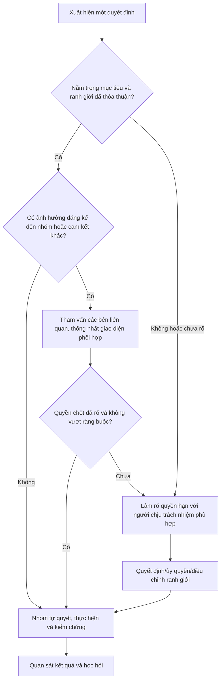

# Tự tổ chức, tự quản và ranh giới quyền quyết định

Trong một nhóm phát triển phần mềm, ai nên quyết định **cách triển khai một tính năng**, **thứ tự công việc**, **thời điểm phát hành** hoặc **có chấp nhận một rủi ro bảo mật hay không**? Nếu mọi quyết định đều phải chờ quản lý phê duyệt, nhóm khó phản ứng nhanh với thông tin mới. Ngược lại, nếu mỗi cá nhân tự ý quyết định bất kỳ điều gì, sản phẩm có thể mất định hướng, các nhóm phụ thuộc lẫn nhau có thể xung đột và rủi ro vượt khỏi phạm vi được phép.

Tư duy **Agile** đặt niềm tin vào những người trực tiếp làm công việc, đồng thời yêu cầu cộng tác chặt chẽ, phản hồi sớm và chịu trách nhiệm về kết quả. Để điều đó vận hành, nhóm cần hiểu đúng ba khái niệm: **tự tổ chức**, **tự quản** và **ranh giới quyền quyết định**.

Trong module **AGILE_DEVELOPMENT**, bài học này kết nối giá trị và nguyên tắc Agile với việc thực hành user story, backlog, Scrum, Kanban, XP và đo lường dòng công việc. Những công cụ này chỉ phát huy hiệu quả khi nhóm có đủ quyền đưa ra quyết định phù hợp, biết khi nào cần phối hợp với người khác và có cơ chế cải tiến liên tục.

## 1. Phân biệt tự tổ chức, tự quản và tự chủ

Ba thuật ngữ thường được dùng gần nghĩa nhau nhưng nên tách ra để tránh hiểu sai.

| Khái niệm | Câu hỏi cốt lõi | Biểu hiện trong nhóm phát triển |
| --- | --- | --- |
| **Tự tổ chức** (*self-organizing*) | Nhóm tự hình thành cách phối hợp hiệu quả như thế nào? | Thành viên chủ động trao đổi, chia sẻ kiến thức, điều chỉnh cách cộng tác, phân chia việc theo năng lực và tình hình thực tế |
| **Tự quản** (*self-managing*) | Nhóm có quyền tự quyết định và điều phối công việc hằng ngày trong phạm vi nào? | Nhóm chọn ai làm gì, khi nào và bằng cách nào để đạt mục tiêu đã thống nhất; tự theo dõi và xử lý trở ngại trong quyền hạn |
| **Tự chủ** (*autonomy*) | Nhóm có không gian hành động độc lập tới mức nào? | Có quyền chọn giải pháp kỹ thuật, tổ chức thực hiện và đề xuất cải tiến mà không cần phê duyệt mọi bước nhỏ |
| **Trách nhiệm giải trình** (*accountability*) | Ai chịu trách nhiệm cuối cùng về kết quả của quyết định? | Có mục tiêu, vai trò, tiêu chuẩn chất lượng, cách kiểm tra và người nhận trách nhiệm rõ ràng |

**Tự tổ chức** nhấn mạnh cách trật tự và hình thức hợp tác xuất hiện từ chính nhóm. **Tự quản** nhấn mạnh quyền điều phối, ra quyết định về công việc. **Tự chủ** là mức quyền hạn được trao để thực hiện những điều đó. Cả ba cần đi kèm trách nhiệm, mục tiêu chung và khả năng học hỏi.

Không nên diễn giải “tự quản” là “không ai lãnh đạo”, “không cần thống nhất” hoặc “mỗi thành viên được làm theo ý mình”. Một nhóm tự quản tốt có thể phối hợp rất chặt, tuân thủ tiêu chuẩn nghiêm ngặt và chủ động xin hỗ trợ khi gặp giới hạn quyền quyết định.

### 1.1. Liên hệ với Agile Manifesto và Scrum

Các [nguyên tắc hỗ trợ Tuyên ngôn Agile](https://agilemanifesto.org/principles.html) đề cao việc xây dựng dự án quanh những người có động lực, cung cấp môi trường và sự hỗ trợ cần thiết, tin tưởng họ hoàn thành công việc; đồng thời đề cập vai trò của các nhóm tự tổ chức trong việc tạo ra kiến trúc, yêu cầu và thiết kế tốt.

[Scrum Guide 2020](https://scrumguides.org/scrum-guide.html) dùng thuật ngữ **self-managing Scrum Teams**: nhóm Scrum tự quyết định bên trong nhóm **ai làm gì, khi nào và bằng cách nào**. Điều này đi cùng các trách nhiệm cụ thể của Product Owner, Scrum Master và Developers; không có nghĩa toàn bộ quyền quyết định của tổ chức đều chuyển vào Scrum Team.

Kanban không bắt buộc một bộ vai trò riêng, nhưng khuyến khích chính sách vận hành rõ ràng, quản lý dòng công việc và cải thiện dựa trên quan sát. XP nhấn mạnh năng lực kỹ thuật và cộng tác để nhóm có thể thay đổi giải pháp một cách an toàn. Vì thế, **tự quản là năng lực tổ chức công việc**, còn các framework và thực hành cung cấp những cách hỗ trợ năng lực ấy.

## 2. Vì sao nhóm cần quyền tự quyết trong môi trường nhiều biến động?

Trong phát triển phần mềm, thông tin thay đổi liên tục: người dùng phản hồi, một API bên ngoài trả lỗi, nhóm phát hiện nguy cơ mất dữ liệu hoặc một user story hóa ra lớn hơn dự tính. Người trực tiếp xử lý thường nắm chi tiết mới nhất.

Khi quyền quyết định quá xa nơi có thông tin, nhóm phải liên tục đưa vấn đề lên một cấp phê duyệt. Điều đó có thể dẫn tới:

1. **Chờ đợi kéo dài:** Công việc dừng để xin ý kiến cho những điều có thể giải quyết an toàn tại chỗ.
2. **Mất ngữ cảnh:** Người phê duyệt nhận bản tóm tắt nên dễ bỏ sót chi tiết kỹ thuật hoặc trải nghiệm người dùng.
3. **Trách nhiệm mờ nhạt:** Thành viên chỉ làm theo chỉ đạo, khó chủ động phát hiện và sửa vấn đề.
4. **Phản hồi chậm:** Quyết định để thử một giả thuyết hoặc điều chỉnh nhỏ mất nhiều bước.
5. **Ít cải tiến:** Nhóm quen làm theo quy trình sẵn có, ít đề xuất điều chỉnh cách làm dù dữ liệu cho thấy điểm nghẽn.

Tuy nhiên, trao quyền rộng mà thiếu ranh giới cũng gây rủi ro: hai nhóm thay đổi cùng một hợp đồng API mà không phối hợp, một kỹ sư tự bỏ kiểm tra bảo mật để kịp hạn, hoặc nhóm tự thêm tính năng chưa được ưu tiên khiến ngân sách bị phân tán.

**Mục tiêu là đưa quyền quyết định tới gần nơi có thông tin và năng lực phù hợp, đồng thời giữ cơ chế bảo vệ những lợi ích và cam kết chung.**

## 3. Quyền quyết định cần đi cùng phạm vi, trách nhiệm và ràng buộc

Một quyết định không chỉ có câu hỏi “ai được quyết?”. Nên xác định đủ năm thành phần:

| Thành phần | Câu hỏi cần làm rõ | Ví dụ |
| --- | --- | --- |
| **Mục tiêu** | Quyết định nhằm đạt kết quả gì? | Giúp học viên đăng ký workshop nhanh, chính xác |
| **Người có quyền quyết định** | Ai có quyền chốt cuối cùng cho phạm vi này? | Developers chọn cách triển khai kỹ thuật trong phạm vi tiêu chuẩn đã có |
| **Người cần tham vấn** | Quyết định ảnh hưởng tới ai, cần chuyên môn nào? | Product Owner về giá trị, nhóm bảo mật về chính sách, nhóm phụ thuộc về API |
| **Giới hạn/điều kiện** | Điều gì bắt buộc phải được giữ? | Không xác nhận vượt số chỗ, không lộ dữ liệu học viên, không phá hợp đồng API |
| **Cách kiểm chứng và leo thang** | Làm sao biết quyết định đúng? Nếu vượt quyền thì làm gì? | Kiểm thử, theo dõi dữ liệu, trao đổi với chủ sở hữu chính sách hoặc cấp có thẩm quyền |

**Ranh giới** không chỉ là “điều cấm”, mà còn định rõ vùng **nhóm được tự chủ hoàn toàn**. Khi ranh giới đủ rõ, thành viên không cần xin phép lặp lại cho những lựa chọn đã nằm trong quyền hạn.

### 3.1. Ba vùng quyết định dễ áp dụng



- **Vùng tự quyết:** Thay đổi cách tổ chức công việc, refactoring trong phạm vi an toàn, chọn công cụ được phép dùng, thiết kế một thành phần nội bộ. Nhóm quyết và tự chịu trách nhiệm.
- **Vùng tham vấn:** Thay đổi hợp đồng API, ảnh hưởng quy trình hỗ trợ, cách phát hành tác động nhiều nhóm. Nhóm chủ động đề xuất nhưng phải trao đổi trước với bên chịu ảnh hưởng.
- **Vùng cần thẩm quyền bổ sung:** Chi tiêu vượt ngân sách, thay đổi chính sách dữ liệu, chấp nhận rủi ro vượt chuẩn hoặc thay đổi cam kết sản phẩm ở cấp tổ chức. Người có thẩm quyền xác nhận hoặc phân quyền rõ ràng.

Ba vùng là **mô hình minh họa**, không phải phân loại bắt buộc của Agile hoặc Scrum. Với mỗi tổ chức, ngưỡng rủi ro và cách phân quyền cụ thể phải được thống nhất công khai.

### 3.2. Quyền quyết định không đồng nghĩa quyền được bỏ ràng buộc

Nếu nhóm được tự chọn công nghệ, quyền ấy thường nằm trong tiêu chuẩn bảo mật, kiến trúc và vận hành của tổ chức. Nếu Developers tự lập kế hoạch Sprint, điều đó không cho phép bỏ Definition of Done hay thay đổi Sprint Goal tùy tiện. Nếu Product Owner chịu trách nhiệm thứ tự Product Backlog, điều đó không có nghĩa Product Owner một mình áp đặt ước lượng kỹ thuật hoặc buộc nhóm làm việc thiếu an toàn.

Ranh giới tốt cho phép **sáng tạo cách thực hiện**, trong khi giữ nguyên **những điều không được thỏa hiệp** như tính đúng đắn của dữ liệu, bảo vệ người dùng, tuân thủ nghĩa vụ và tính minh bạch của cam kết.

## 4. Ai quyết điều gì trong một nhóm làm việc theo Scrum?

Scrum là một ví dụ cụ thể để hiểu sự phân quyền, **không phải mô hình áp dụng nguyên xi cho mọi đội Agile**.

| Loại quyết định | Trách nhiệm chính trong Scrum | Cách phối hợp và giới hạn |
| --- | --- | --- |
| Mục tiêu sản phẩm, tối đa hóa giá trị | **Product Owner** chịu trách nhiệm hiệu quả quản lý Product Backlog và giá trị sản phẩm | Lắng nghe người dùng, doanh nghiệp và Developers; chịu các ràng buộc chiến lược được tổ chức giao |
| Nội dung và thứ tự Product Backlog | **Product Owner** chịu trách nhiệm, có thể ủy quyền việc thực hiện công việc cụ thể | Việc thay thứ tự được làm minh bạch; nhu cầu cấp bách không tự động trở thành việc mọi Developers phải làm ngay |
| Sprint Goal | **Toàn Scrum Team** cùng xác định trong Sprint Planning; Product Owner đề xuất mục tiêu và giải thích giá trị | Developers phối hợp lập kế hoạch; thay đổi phạm vi được thương lượng khi cần mà không làm nguy hại Sprint Goal |
| Mục nào từ Product Backlog đưa vào Sprint | **Developers** lựa chọn qua trao đổi với Product Owner | Dựa trên năng lực, hiểu biết và mục tiêu Sprint, không phải chỉ nhận một danh sách áp xuống |
| Cách thực hiện, phân chia và điều chỉnh công việc Sprint | **Developers** tự quản Sprint Backlog và kế hoạch triển khai | Thường xuyên thích ứng khi học thêm; duy trì chất lượng và tính minh bạch |
| Chất lượng Increment | **Developers** có trách nhiệm tạo Increment đáp ứng Definition of Done | Nếu tổ chức có DoD chung thì tuân thủ tối thiểu tiêu chuẩn đó; không tự gọi phần chưa đạt DoD là hoàn thành |
| Hiệu quả của Scrum, coaching và tháo gỡ trở ngại | **Scrum Master** chịu trách nhiệm thiết lập và giúp Scrum Team, tổ chức hiểu Scrum | Scrum Master là người phục vụ, hỗ trợ năng lực tự quản; không trở thành “trưởng nhóm phân công việc” |
| Ngân sách, cấu trúc nhân sự, chính sách toàn tổ chức | **Vai trò quản trị tương ứng của tổ chức** | Scrum không định nghĩa mọi quyền quản trị; cần mô tả rõ cơ chế ra quyết định bên ngoài Scrum Team |

Trong Scrum Guide, Product Owner, Scrum Master và Developers là **ba nhóm trách nhiệm** bên trong một Scrum Team; Scrum không đặt các tiểu nhóm cấp bậc nội bộ kiểu “đội phân tích” ra lệnh cho “đội lập trình”. Các cá nhân vẫn có năng lực chuyên sâu khác nhau, và tổ chức vẫn có những quyền quản trị ngoài phạm vi Scrum.

Ví dụ: Product Owner quyết định nên ưu tiên chức năng **hủy đăng ký workshop** vì giảm chi phí hỗ trợ; Developers tự trao đổi cách lưu trạng thái, kiểm soát giao dịch, triển khai và kiểm thử. Nếu phương án kỹ thuật ảnh hưởng API dùng chung, nhóm cần làm việc với nhóm sở hữu hợp đồng tích hợp trước khi đổi.

### 4.1. Khác biệt giữa quyền quyết định về *giá trị* và *cách triển khai*

Một cách phân tách hữu ích:

> **“Vì sao và ưu tiên giá trị nào?”** cần trách nhiệm sản phẩm. **“Làm thế nào để đạt kết quả đó an toàn?”** cần chuyên môn của người thực hiện. **“Chúng ta có thể cam kết phạm vi và thời điểm nào?”** cần thương lượng trên dữ liệu thực tế và các ràng buộc liên quan.

Đây không phải đường ranh cứng tách biệt mọi cuộc hội thoại. Product Owner cần hiểu hệ quả kỹ thuật; Developers cần hiểu giá trị người dùng. Cả nhóm nên cùng khám phá giải pháp, nhưng phải biết **ai có quyền chốt từng loại quyết định** để tránh kéo dài hoặc tranh giành trách nhiệm.

## 5. Tự tổ chức trong thực tế: quyền chủ động đi cùng phối hợp

Giả sử nhóm có năm người gồm kỹ sư backend, frontend, kiểm thử và các thành viên đa kỹ năng. Họ xây tính năng hủy đăng ký workshop. Một cách làm thiếu tự quản là quản lý giao mọi đầu việc nhỏ, chỉ định ai bắt đầu vào ngày nào và yêu cầu mọi thay đổi phải xin xác nhận.

Với một nhóm tự quản, họ có thể cùng xem user story và tiêu chí chấp nhận, nhận diện rủi ro cạnh tranh dữ liệu, chọn lát cắt đầu cuối, tự trao đổi ai làm trước để tránh bị chờ và giúp nhau kiểm thử. Khi kỹ sư backend bị kẹt, người quen phần dữ liệu có thể hỗ trợ mà không chờ quản lý “điều người”.

Một số hành vi cho thấy nhóm thực sự tự tổ chức:

- Thành viên **chủ động nhìn mục tiêu và trạng thái chung**, thay vì chỉ quan tâm “việc của tôi”.
- Người biết ít chủ động nhờ hỗ trợ; người biết nhiều chia sẻ kiến thức để giảm điểm phụ thuộc vào một cá nhân.
- Công việc được kéo theo năng lực và ưu tiên, giới hạn số việc đang làm, xử lý điểm nghẽn trước khi mở thêm việc.
- Nhóm cùng đưa ra cách kiểm thử và tiêu chí hoàn thành, không mặc nhiên để công việc chất lượng dồn sang người cuối cùng.
- Khi phản hồi của người dùng mâu thuẫn với giả định cũ, nhóm đưa bằng chứng lên bàn và đề xuất điều chỉnh backlog hoặc cách làm.
- Người chịu trách nhiệm được thông báo sớm nếu rủi ro vượt phạm vi quyết định của nhóm.

Tự tổ chức **không yêu cầu mọi người luôn đồng thuận**. Các quyết định nhỏ có thể giao cho một cá nhân có năng lực và trách nhiệm rõ; quyết định ảnh hưởng toàn nhóm nên được thảo luận đủ mức. Nếu mọi thứ đều phải được tất cả thành viên bỏ phiếu, nhóm có thể chậm hơn mô hình chỉ huy mà chưa chắc hiểu vấn đề tốt hơn.

## 6. Một tình huống xuyên suốt: thay đổi cách hủy đăng ký workshop

Nhóm phát triển nền tảng học tập cần thêm chức năng hủy workshop. User story ban đầu:

> **Là** học viên đã đăng ký workshop, **tôi muốn** hủy đăng ký trước thời hạn cho phép, **để** giải phóng chỗ cho người khác và tự quản lý lịch học.

Các bên liên quan có những mối quan tâm khác nhau:

| Vai trò/bên liên quan | Điều họ quan tâm |
| --- | --- |
| Học viên | Hủy dễ dàng, biết kết quả, không bị tính phí sai |
| Product Owner | Giảm xử lý thủ công nhưng không làm tăng hủy sát giờ |
| Developers | Dữ liệu nhất quán, xử lý yêu cầu đồng thời, dễ bảo trì |
| Nhóm vận hành/hỗ trợ | Truy vết được ai hủy, khi nào, có trường hợp cần hỗ trợ |
| Người chịu trách nhiệm chính sách | Không vi phạm điều kiện hủy, hoàn tiền, lưu vết hoặc bảo vệ dữ liệu |
| Nhóm quản lý chỗ trống | Không cho hai học viên nhận cùng chỗ khi chỗ được mở lại |

### 6.1. Phân ranh trước khi bắt tay làm

Nhóm cùng xác nhận:

1. **Kết quả mong muốn:** Học viên đủ điều kiện hủy thành công, chỗ được mở chính xác, nhân viên hỗ trợ giảm thao tác thủ công.
2. **Quy tắc nghiệp vụ đã có:** Chẳng hạn chỉ hủy tự phục vụ trước mốc khóa danh sách; trường hợp ngoại lệ phải xử lý theo chính sách. Con số và điều kiện cụ thể do bên sở hữu nghiệp vụ chốt.
3. **Quyền của nhóm:** Chọn phương án kỹ thuật, phân chia việc, thứ tự triển khai trong mục tiêu Sprint, cách kiểm thử và triển khai theo quy trình cho phép.
4. **Điểm cần tham vấn:** Thay đổi API chia sẻ với nhóm đặt chỗ; thay đổi thông báo ảnh hưởng hỗ trợ; thay đổi chính sách hoàn tiền hoặc giữ dữ liệu cần người sở hữu chính sách xác nhận.
5. **Điều không được bỏ qua:** Không hủy nhầm người, không giải phóng quá số chỗ, không để trạng thái hệ thống mâu thuẫn, đáp ứng yêu cầu kiểm thử và kiểm soát quyền.

### 6.2. Quyết định loại một: chọn giải pháp kỹ thuật

Developers so sánh hai phương án: xử lý đồng bộ trong yêu cầu hủy, hoặc ghi một yêu cầu và xử lý qua hàng đợi. Họ cân nhắc tính nhất quán, độ trễ, thông điệp trạng thái và khả năng phục hồi. Đây thường là **quyết định kỹ thuật của nhóm**, trong giới hạn kiến trúc và chuẩn vận hành đã được chấp thuận.

Nhóm có thể thử kỹ thuật với những trường hợp cạnh tranh và lỗi tích hợp trước khi chốt. Nếu việc dùng hàng đợi mới đòi hỏi chi phí hạ tầng vượt ngân sách hoặc thay đổi kiến trúc chung, họ cần tham vấn người chịu trách nhiệm tương ứng.

### 6.3. Quyết định loại hai: có cho hủy sau thời hạn khóa hay không?

Đây là thay đổi **chính sách nghiệp vụ**, có thể liên quan doanh thu, cam kết với mentor và quyền lợi học viên. Developers có thể đề xuất kịch bản và dữ liệu hỗ trợ, nhưng không nên tự nới điều kiện chỉ vì triển khai tiện hơn. Product Owner phối hợp bên sở hữu chính sách để đưa ra hoặc xác nhận quyết định hợp lệ, rồi cập nhật backlog và tiêu chí chấp nhận.

### 6.4. Quyết định loại ba: tăng phạm vi ngay trong Sprint?

Trong lúc phát triển, nhóm thấy có nhu cầu bổ sung chức năng hoàn tiền tự động. Product Owner đánh giá giá trị và mức cấp bách; Developers cho biết phụ thuộc, khả năng và rủi ro. Nếu chức năng mới làm phân tán trọng tâm, nhóm có thể đưa vào Product Backlog cho lần kế tiếp. Trong Scrum, nội dung Sprint Backlog có thể được làm rõ và thương lượng khi học thêm nhưng không nên làm nguy hại **Sprint Goal**.

### 6.5. Cách nhận diện việc cần leo thang

Một kỹ sư phát hiện trường hợp hủy dẫn tới mất tiền hoặc sai báo cáo thanh toán. Đây là tình huống cần **dừng thao tác gây hại, thông báo ngay, phối hợp người chịu trách nhiệm tài chính/nghiệp vụ**, rồi xử lý theo quy trình sự cố. Việc tự quản không yêu cầu kỹ sư chờ họp Sprint tiếp theo mới được nêu rủi ro, và cũng không cho phép họ tự chấp nhận rủi ro tài chính vượt quyền.

## 7. Cơ chế ra quyết định giúp nhóm không mắc kẹt

Một nhóm cần thỏa thuận **cách ra quyết định** phù hợp với mức tác động của từng vấn đề. Không cần áp một quy trình nặng cho mọi lựa chọn.

| Cách ra quyết định | Phù hợp khi | Điểm cần lưu ý |
| --- | --- | --- |
| **Một người chịu trách nhiệm quyết, có tham vấn** | Quyết định chuyên môn cụ thể và phạm vi ảnh hưởng rõ | Người quyết phải nghe đủ bên liên quan và ghi lại lý do khi cần |
| **Trao đổi để tìm đồng thuận** | Quyết định ảnh hưởng lớn tới cách phối hợp của nhóm | Đặt thời hạn; phân biệt “tôi có lo ngại” và “tôi có quyền phủ quyết” |
| **Thử nghiệm có giới hạn** | Chưa đủ bằng chứng, lựa chọn có thể đảo ngược và rủi ro kiểm soát được | Chọn thước đo, điều kiện dừng và người chịu trách nhiệm |
| **Tham vấn liên nhóm hoặc chuyên gia** | Thay đổi giao diện tích hợp, dữ liệu, an toàn hoặc vận hành | Xác định rõ ai đưa ý kiến và ai chốt; không biến tham vấn thành vòng phê duyệt vô hạn |
| **Leo thang theo thẩm quyền** | Xung đột mục tiêu, rủi ro vượt ngưỡng hoặc không thể tự thống nhất | Cung cấp phương án, tác động và quyết định cần xin; không chỉ chuyển một vấn đề mơ hồ |

### 7.1. Đặt thời hạn quyết định theo mức độ rủi ro

Quyết định dễ đảo ngược, tác động nhỏ thường có thể chốt sớm rồi kiểm tra kết quả. Quyết định khó đảo ngược, liên quan dữ liệu hoặc nghĩa vụ dài hạn nên đầu tư nhiều hơn vào bằng chứng và tham vấn.

Ví dụ, đổi nhãn nút trong giao diện có thể thử nhanh sau khi bảo đảm trợ năng và không gây hiểu nhầm nghiêm trọng. Đổi mô hình lưu trữ thông tin thanh toán, hệ thống quyền truy cập hoặc hợp đồng API được nhiều nhóm dùng cần thẩm định và kế hoạch chuyển đổi.

Mốc thời gian không nhất thiết tính bằng số ngày cố định. Nhóm nên biết **ai phản hồi, trong thời hạn nào, và nếu chưa có phản hồi thì theo cơ chế nào**. Với rủi ro nghiêm trọng, không được mặc nhiên coi im lặng là sự chấp thuận.

### 7.2. Mẫu ghi quyết định ngắn

```text
QUYẾT ĐỊNH: Cách xử lý hủy đăng ký workshop
MỤC TIÊU: Trả kết quả rõ ràng, giữ dữ liệu chỗ ngồi nhất quán
PHẠM VI: API hủy và cập nhật chỗ trống
NGƯỜI CHỐT: Nhóm Developers trong giới hạn kiến trúc cho phép
CẦN THAM VẤN: Product Owner, nhóm đặt chỗ, vận hành
LỰA CHỌN: Xử lý đồng bộ / xử lý bất đồng bộ qua hàng đợi
RÀNG BUỘC: Không xác nhận vượt số chỗ; giữ dấu vết thay đổi
BẰNG CHỨNG: Kiểm thử cạnh tranh, độ trễ, tình huống lỗi
LÝ DO CHỌN: ...
HỆ QUẢ / ĐIỀU CẦN THEO DÕI: ...
ĐIỀU KIỆN XEM XÉT LẠI: ...
```

Với quyết định kiến trúc ảnh hưởng lâu dài, mẫu này có thể được mở rộng thành *Architecture Decision Record* (ADR). Với việc nhỏ, một ghi chú ngay trong hạng mục công việc hoặc tài liệu nhóm có thể là đủ.

## 8. Vai trò của lãnh đạo: tạo điều kiện để nhóm tự quản

Một người lãnh đạo hỗ trợ nhóm Agile không biến mất sau khi “trao quyền”. Họ phải **thiết lập bối cảnh, cung cấp nguồn lực, loại bỏ trở ngại và làm rõ trách nhiệm**, để nhóm không bị giao mục tiêu nhưng thiếu phương tiện thực hiện.

### 8.1. Từ giao việc chi tiết sang giao mục tiêu và ranh giới

So sánh hai cách giao nhiệm vụ:

> **Giao việc chi tiết:** “Lan làm API hủy, Minh làm trang hủy, Huy kiểm thử cuối tuần; dùng đúng thiết kế này; mọi thay đổi báo tôi duyệt.”

> **Giao mục tiêu và ranh giới:** “Trong đợt này, học viên đủ điều kiện phải tự hủy được workshop và thấy trạng thái chính xác. Giữ chính sách hủy hiện hành, dữ liệu chỗ ngồi nhất quán và các tiêu chuẩn bảo mật. Nhóm tự đề xuất lát cắt, phương án triển khai và cách kiểm chứng; trao đổi ngay nếu cần thay chính sách hoặc hợp đồng dùng chung.”

Cách thứ hai cho nhóm đủ thông tin về **đích đến và giới hạn**, đồng thời dành không gian cho chuyên môn của những người thực hiện. Lãnh đạo vẫn cần bảo đảm có người trả lời câu hỏi nghiệp vụ, môi trường kiểm thử và điều kiện phối hợp liên nhóm.

### 8.2. Những hành động lãnh đạo cụ thể

| Hành động | Tại sao cần thiết |
| --- | --- |
| Diễn giải mục tiêu bằng kết quả người dùng hoặc kết quả nghiệp vụ | Nhóm hiểu lý do ưu tiên và có tiêu chí đánh giá lựa chọn |
| Công khai những ranh giới không thể tự thay đổi | Tránh trao quyền mơ hồ hoặc rủi ro vượt thẩm quyền |
| Đảm bảo đủ kỹ năng, công cụ, quyền truy cập và người tham vấn | Trao quyền trên danh nghĩa nhưng thiếu nguồn lực sẽ không tạo tự chủ thật |
| Bảo vệ thời gian tập trung, giảm phụ thuộc và tháo gỡ điểm nghẽn hệ thống | Nhóm có khả năng hoàn thành công việc thay vì liên tục chờ người ngoài |
| Lắng nghe phản biện, khuyến khích báo rủi ro sớm | Tạo môi trường mà thông tin xấu không bị che giấu |
| Yêu cầu minh bạch mục tiêu, chất lượng và kết quả | Tự quản phải đi cùng trách nhiệm giải trình, không chỉ tự do lựa chọn |
| Cùng nhóm xem lại ranh giới khi năng lực và bối cảnh thay đổi | Quyền tự chủ có thể được mở rộng có căn cứ, thay vì cố định vĩnh viễn |

**Lãnh đạo phục vụ** (*servant leadership*) thường được nhắc tới trong Agile: chú trọng hỗ trợ con người và hệ thống để họ làm việc tốt. Tuy nhiên, tinh thần phục vụ không có nghĩa né tránh các quyết định khó; khi ngân sách, an toàn hoặc chiến lược buộc phải có người chốt, lãnh đạo cần làm rõ quyết định và trách nhiệm.

## 9. Tự quản không có nghĩa mọi người phải có cùng chuyên môn

Nhóm liên chức năng (*cross-functional*) cần có hoặc tiếp cận đủ kỹ năng để tạo giá trị, nhưng từng thành viên không nhất thiết giỏi như nhau mọi lĩnh vực. Kỹ sư bảo mật có hiểu biết chuyên sâu; người thiết kế trải nghiệm có góc nhìn về hành trình người dùng; lập trình viên hiểu hệ thống; Product Owner hiểu mục tiêu và thị trường.

**Phối hợp chuyên môn** khác với việc dựng hàng rào: “Ai thuộc bộ phận nào chỉ được đụng vào việc ấy.” Trong nhóm tự quản, người có chuyên môn dẫn dắt thảo luận thuộc phạm vi của mình; người khác có quyền đặt câu hỏi, học hỏi và đóng góp, miễn không vượt yêu cầu kiểm soát chất lượng.

Các thực hành giúp giảm phụ thuộc vào một người:

- **Pair programming, code review và chia sẻ kiến thức:** Hai hay nhiều thành viên cùng hiểu những phần quan trọng; quyết định kỹ thuật được thảo luận dựa trên bằng chứng.
- **Kiểm thử tự động và tích hợp liên tục:** Nhóm dám chỉnh sửa mà vẫn kiểm soát rủi ro hồi quy.
- **Chính sách hoàn thành minh bạch:** Tránh tình trạng mỗi người có một tiêu chuẩn “đã xong” khác nhau.
- **Trực quan hóa backlog và WIP:** Mọi người thấy tiến độ chung, điểm nghẽn và cơ hội hỗ trợ.
- **Retrospective và cải tiến từng bước:** Nhóm thử thay đổi cách phối hợp, quan sát hiệu quả rồi giữ hoặc sửa.

Tự tổ chức không thay thế yêu cầu phân quyền hệ thống: một người chưa được cấp quyền truy cập dữ liệu nhạy cảm không được tự lấy dữ liệu chỉ để “giúp nhóm nhanh hơn”.

## 10. Khi bất đồng xảy ra: phân biệt tranh luận chuyên môn và xung đột thẩm quyền

Bất đồng trong nhóm Agile có thể là dấu hiệu tích cực: những góc nhìn khác nhau đang được đưa ra trước khi quyết định. Vấn đề không nằm ở chỗ có bất đồng, mà ở cách nhóm xử lý để đạt kết quả chung.

### 10.1. Tranh luận chuyên môn

Hai kỹ sư bất đồng nên dùng xử lý đồng bộ hay hàng đợi. Họ có thể cùng xác định tiêu chí (độ nhất quán, độ trễ, khả năng khôi phục, độ phức tạp), làm bản thử nhỏ, rồi người có trách nhiệm quyết hoặc nhóm chốt theo thỏa thuận. Sau khi chốt, mọi người hỗ trợ thực thi và sẵn sàng xem lại nếu dữ liệu mới xuất hiện.

### 10.2. Xung đột ưu tiên

Product Owner muốn thêm một tính năng ngay; Developers thấy công việc bảo đảm an toàn chưa hoàn thành. Cả hai cần diễn giải mục tiêu, chi phí và rủi ro, điều chỉnh phạm vi hoặc thời điểm theo quyền hạn. Không được dùng “tự quản” làm lý do bỏ chất lượng; cũng không được dùng quyền ưu tiên backlog để buộc nhóm tuyên bố hoàn thành phần chưa đạt chuẩn.

### 10.3. Xung đột giữa các nhóm

Nhóm A muốn đổi API để đi nhanh, nhưng nhóm B đang sử dụng hợp đồng cũ. Hai nhóm cần phối hợp về tương thích, phiên bản, lộ trình chuyển đổi và trách nhiệm vận hành. Nếu không thống nhất được vì mục tiêu cấp tổ chức xung đột, cần chuyển quyết định lên cấp có thẩm quyền với **các phương án và tác động rõ ràng**, không chỉ nói “hai đội không hợp tác”.

### 10.4. Cách trao đổi ngắn giúp đi tới quyết định

Một cuộc trao đổi hiệu quả có thể đi theo chuỗi:

1. **Nêu mục tiêu chung:** “Chúng ta cần hủy thành công và không sai dữ liệu.”
2. **Đặt dữ kiện cạnh giả định:** “Hiện API chỗ trống có tình huống xử lý đồng thời; chưa rõ tần suất thực tế.”
3. **Làm rõ ranh giới:** “Chúng ta tự chọn cách xử lý nội bộ nhưng không tự đổi hợp đồng của nhóm khác.”
4. **Đề xuất phương án và kiểm chứng:** “Thử phương án A với các kịch bản cạnh tranh; nhờ nhóm B xác nhận điều kiện tương thích.”
5. **Chỉ định người chốt và mốc phản hồi:** “Nhóm kỹ thuật chốt sau khi có kết quả thử và phản hồi API.”
6. **Ghi quyết định và hành động:** “Bổ sung kiểm thử, cập nhật backlog và thông báo bên liên quan.”

Khi nhóm có môi trường an toàn về tâm lý, thành viên có thể nói **“tôi chưa biết”, “tôi phát hiện lỗi”, “tôi không đồng ý vì lý do kỹ thuật”** mà không sợ bị trừng phạt chỉ vì đưa ra thông tin bất lợi. Điều này giúp quyết định có bằng chứng tốt hơn, dù không loại bỏ hết bất đồng.

## 11. Làm rõ ranh giới bằng thỏa thuận nhóm

Một **working agreement** ngắn có thể ghi rõ các quy tắc vận hành tự quản. Ví dụ:

| Tình huống | Quy tắc nhóm minh họa |
| --- | --- |
| Chọn người thực hiện công việc | Thành viên chủ động nhận việc theo ưu tiên và năng lực; phối hợp khi cần; không mở nhiều việc mới khi việc đang làm còn tắc |
| Thay đổi cách triển khai | Nhóm kỹ thuật tự thảo luận và quyết trong tiêu chuẩn hiện có; ghi lại khi ảnh hưởng lớn |
| Thay đổi yêu cầu nghiệp vụ | Cùng Product Owner làm rõ giá trị, tiêu chí chấp nhận và ưu tiên; tránh tự đổi chính sách |
| Quyết định ảnh hưởng nhóm khác | Tham vấn người sở hữu giao diện hoặc vận hành trước khi làm thay đổi không tương thích |
| Rủi ro bảo mật/dữ liệu | Dừng hành động có thể gây hại, thông báo người chịu trách nhiệm và dùng quy trình xử lý phù hợp |
| Công việc chưa đạt chất lượng | Không đánh dấu hoàn thành; nêu rõ vấn đề và kế hoạch xử lý |
| Quyết định bị tắc | Xác định ai có quyền chốt và thời hạn cần phản hồi, sau đó leo thang nếu vượt quyền |
| Điều chỉnh cách làm | Thử một thay đổi nhỏ, quan sát kết quả ở retrospective rồi cập nhật thỏa thuận |

Thỏa thuận này hữu ích khi **được cùng nhau hiểu và dùng trong công việc thật**. Một tài liệu dài nhưng không ai biết áp dụng ra sao sẽ không giải quyết được tình trạng quyền hạn mơ hồ.

## 12. Đo lường xem tự quản có tạo ra kết quả hay không

Khó đo “tự quản” bằng một con số duy nhất. Có thể quan sát đồng thời **khả năng ra quyết định**, **dòng công việc**, **chất lượng** và **kết quả người dùng**.

| Nhóm chỉ báo | Cách quan sát | Cảnh báo khi diễn giải |
| --- | --- | --- |
| Tốc độ ra quyết định | Thời gian chờ phê duyệt hoặc chờ làm rõ quyền quyết định; số quyết định phải chuyển cấp | Chuyển cấp ít không luôn tốt nếu nhóm đang tự nhận rủi ro quá quyền |
| Dòng công việc | Cycle time, lead time, WIP, throughput; vị trí thường xuyên bị chờ | Các chỉ số chịu ảnh hưởng kích thước công việc, loại việc và phụ thuộc; cần định nghĩa nhất quán |
| Chất lượng | Lỗi sau phát hành, tỷ lệ làm lại, kiểm thử, sự cố dữ liệu, thời gian khôi phục | Làm nhanh nhưng tăng lỗi không phải dấu hiệu tự quản hiệu quả |
| Giá trị sản phẩm | Tỷ lệ người dùng hoàn tất tác vụ, giảm việc hỗ trợ, phản hồi định tính | Số chức năng hoàn thành không thay thế kết quả người dùng |
| Khả năng cộng tác | Mức lệ thuộc vào một người, thời gian hỗ trợ liên nhóm, trở ngại được giải quyết | Không quy trách nhiệm máy móc cho cá nhân khi nguyên nhân là hệ thống |
| Mức minh bạch và an toàn tâm lý | Khả năng nêu lỗi, thảo luận bất đồng, tham gia cải tiến qua quan sát và trao đổi | Khảo sát cảm nhận cần bảo mật, không dùng làm công cụ trừng phạt |

Ví dụ, nếu nhóm có thể tự xử lý nhiều quyết định kỹ thuật nhỏ, thời gian chờ giảm và số lỗi không tăng, đó là **tín hiệu tích cực**. Nhưng cần quan sát đủ thời gian và xét các yếu tố khác trước khi kết luận phân quyền là nguyên nhân duy nhất. Nếu “tự quản” đi kèm WIP tăng, nhiều việc chưa xong hoặc lỗi thường xuyên, nhóm cần xem lại mục tiêu, kỹ năng, tiêu chuẩn, ranh giới và cách điều phối.

Không nên xếp hạng cá nhân dựa trên số lần đưa ra quyết định, số việc nhận hoặc story point. Những cách đo đó dễ khiến người ta tối ưu thành tích cá nhân thay vì chủ động giúp **dòng giá trị chung**.

## 13. Những hiểu lầm và phản ví dụ thường gặp

| Biểu hiện | Vì sao chưa phải tự quản hiệu quả | Cách điều chỉnh |
| --- | --- | --- |
| Quản lý vẫn chỉ định mọi việc nhỏ nhưng gọi nhóm là “tự quản” | Quyền quyết định thực tế chưa được trao | Làm rõ phạm vi nhóm được tự chọn; lãnh đạo tập trung mục tiêu và trở ngại |
| “Không có sếp nên mỗi người tự làm việc mình thích” | Thiếu mục tiêu, ưu tiên và trách nhiệm chung | Công khai mục tiêu, backlog, WIP và tiêu chuẩn hoàn thành |
| Mọi quyết định đều phải được toàn nhóm đồng thuận tuyệt đối | Dễ bế tắc với các lựa chọn ít rủi ro | Giao người chịu trách nhiệm quyết; tham vấn tương xứng mức ảnh hưởng |
| Product Owner chọn luôn giải pháp kỹ thuật và cách phân công | Chuyên môn người thực hiện ít được sử dụng | Phân biệt giá trị/ưu tiên với kế hoạch và cách triển khai, cùng thảo luận tác động |
| Developers tự thay chính sách hủy để code đơn giản hơn | Vượt phạm vi quyết định nghiệp vụ | Đề xuất phương án, xin xác nhận người có trách nhiệm chính sách |
| Scrum Master thành người chỉ huy giao việc | Làm suy yếu trách nhiệm tự quản của Developers | Hướng dẫn, hỗ trợ, tháo gỡ trở ngại và giúp nhóm cải thiện cách phối hợp |
| Nhóm tự bỏ kiểm thử hoặc kiểm soát quyền để phát hành nhanh | Gây rủi ro cho người dùng, dữ liệu và sản phẩm | Giữ Definition of Done, tiêu chuẩn an toàn và cơ chế dừng |
| “Trao quyền” nhưng không cấp công cụ, thông tin hay người hỗ trợ | Nhóm chịu trách nhiệm nhưng không có năng lực thực thi | Bổ sung nguồn lực, kỹ năng, quyền truy cập và kênh phối hợp |
| Nhóm chỉ tối ưu mục tiêu của mình, phá luồng làm việc nhóm khác | Không quản lý phụ thuộc và cam kết hệ thống | Xác định giao diện trách nhiệm, tham vấn và mục tiêu liên nhóm |
| Vấn đề vượt quyền nhưng không ai dám báo | Nhóm hiểu sai tự quản thành tự giải quyết mọi thứ | Khuyến khích nêu rủi ro sớm và thiết lập đường leo thang cụ thể |

Những phản ví dụ này cho thấy **tự quản không tự xuất hiện chỉ vì đổi chức danh hoặc áp dụng một cuộc họp Agile**. Nó cần quyền hạn thực, năng lực chuyên môn, sự tin tưởng, giới hạn minh bạch và thói quen phản hồi.

## 14. Bảy bước xây dựng quyền tự quản có trách nhiệm

### Bước 1. Thống nhất mục tiêu và giá trị cần giao

Diễn giải mục tiêu bằng kết quả có thể quan sát: “Học viên tự hủy workshop hợp lệ và nhận trạng thái chính xác”, thay vì “phải làm đủ năm màn hình”. Người tham gia cần biết **vì sao** mục tiêu quan trọng và khi nào được coi là tạo giá trị.

### Bước 2. Xác định các quyền quyết định đang gây chờ đợi hoặc xung đột

Lấy những tình huống gần đây: ai quyết thứ tự việc, ai chốt phương án triển khai, ai duyệt thay đổi API, ai xử lý lỗi nghiêm trọng? Ghi những điểm mơ hồ khiến nhóm phải hỏi đi hỏi lại.

### Bước 3. Tạo bản đồ quyền quyết định và ranh giới

Với mỗi loại quyết định, nêu **người có quyền chốt, người cần tham vấn, điều kiện bắt buộc và cơ chế xử lý khi vượt quyền**. Bắt đầu với vài tình huống hay gặp thay vì cố vẽ một ma trận cho mọi quyết định tương lai.

### Bước 4. Đảm bảo năng lực và điều kiện thực thi

Nhóm có cần môi trường kiểm thử, quyền triển khai, thông tin người dùng, khả năng quan sát sự cố hoặc kỹ năng bổ sung không? Lãnh đạo và những bên liên quan phải giải quyết các thiếu hụt khiến quyền tự chủ trên giấy không thành hành động.

### Bước 5. Thử trao thêm quyền ở phạm vi có thể kiểm soát

Chẳng hạn, để nhóm tự quyết cách chia một user story thành lát cắt và chọn phương án triển khai trong chuẩn đã thống nhất. Theo dõi thời gian chờ, mức độ hoàn tất, chất lượng và các câu hỏi quyền hạn phát sinh.

### Bước 6. Minh bạch quyết định và phản hồi

Ghi các quyết định quan trọng, hệ quả, điều kiện xem lại. Trong Sprint Review, buổi xem xét dòng công việc hoặc các cuộc trao đổi phù hợp, nhìn vào phần mềm và dữ liệu thực tế để kiểm tra điều nhóm đã chọn có giúp đạt mục tiêu hay không.

### Bước 7. Cải tiến ranh giới theo bằng chứng

Nếu nhóm đủ năng lực và kết quả tốt, cân nhắc mở rộng quyền tự chủ. Nếu lặp lại lỗi vượt quyền hoặc phối hợp yếu, điều chỉnh thỏa thuận, kỹ năng hoặc cơ chế tham vấn. **Thay đổi ranh giới là một phần cải tiến liên tục**, không phải lời phán xét cố định về năng lực con người.

## 15. Bài tập thực hành: ai có quyền chốt?

**Tình huống:** Một nhóm xây chức năng nhắc lịch học qua email. Sprint Goal là giúp người học không bỏ lỡ các buổi học đã đăng ký. Giữa Sprint xảy ra bốn việc:

1. Kỹ sư thấy cách gửi email hiện tại khó kiểm thử và đề xuất đổi thành hệ thống hàng đợi đã được tổ chức cho phép sử dụng.
2. Người phụ trách sản phẩm muốn bổ sung thông báo SMS vì một khách hàng doanh nghiệp vừa đề nghị.
3. Nhóm hỗ trợ yêu cầu giữ nội dung email tối thiểu và không đưa thông tin nhạy cảm vào tiêu đề.
4. Nhà cung cấp dịch vụ email báo vượt ngưỡng chi phí dự kiến; việc nâng gói cần phê duyệt ngân sách.

Với mỗi việc, hãy xác định: **người đề xuất**, **người có quyền chốt**, **ai cần tham vấn**, **ranh giới phải giữ** và **bằng chứng để kiểm chứng quyết định**.

### Gợi ý hướng giải

| Tình huống | Cách xử lý có trách nhiệm |
| --- | --- |
| Đổi phương án gửi email | Developers có thể chọn cách triển khai phù hợp với chuẩn kỹ thuật; cần kiểm thử, cân nhắc độ trễ, vận hành và tham vấn nhóm liên quan nếu thay đổi hạ tầng dùng chung |
| Đề nghị SMS | Product Owner đánh giá giá trị và thứ tự Product Backlog; Scrum Team trao đổi tác động tới Sprint Goal và phạm vi thực tế, tránh tự nhồi thêm việc làm mất tập trung |
| Yêu cầu bảo vệ dữ liệu trong email | Nhóm phải tuân thủ chính sách liên quan; phối hợp người sở hữu quy định để làm rõ yêu cầu; không coi đây là tùy chọn có thể bỏ vì tiến độ |
| Vượt chi phí | Developers cung cấp phương án tối ưu hoặc số liệu tải; người có thẩm quyền ngân sách quyết mức chi, nhóm cập nhật kế hoạch theo quyết định |

**Thử tiếp:** Giả sử đề nghị SMS rất cấp bách nhưng khách hàng không đồng ý dời thời hạn, trong khi nhóm không đủ khả năng thực hiện an toàn trong Sprint hiện tại. Hãy viết hai phương án có nêu giá trị, chi phí, rủi ro và tác động Sprint Goal; xác định người chốt và kênh trao đổi. Một câu trả lời tốt **không chỉ nêu “cần xin phép”**, mà làm rõ cần xin ai quyết điều gì để nhóm tiếp tục hành động.

## 16. Ghi nhớ và tự kiểm tra

**Tự tổ chức** giúp nhóm hình thành cách phối hợp từ thực tế. **Tự quản** trao cho nhóm quyền điều phối công việc và cách thực hiện trong phạm vi được xác định. **Ranh giới quyền quyết định** giữ cho sự chủ động đó phù hợp với mục tiêu sản phẩm, chất lượng, an toàn và các phụ thuộc. Lãnh đạo có trách nhiệm tạo bối cảnh, cung cấp nguồn lực, làm rõ quyền hạn và hỗ trợ nhóm cải tiến; nhóm có trách nhiệm đưa ra quyết định minh bạch, kiểm chứng kết quả và báo sớm điều vượt thẩm quyền.

Tự kiểm tra:

1. Vì sao tự tổ chức, tự quản và tự chủ có liên hệ nhưng không hoàn toàn giống nhau?
2. Trong Scrum, Product Owner, Developers và Scrum Master chịu các trách nhiệm khác nhau như thế nào khi chọn và thực hiện công việc?
3. Hãy nêu một quyết định nhóm có thể tự chốt, một quyết định cần tham vấn và một quyết định cần thẩm quyền bổ sung.
4. Vì sao quyền quyết định kỹ thuật không cho phép tự thay đổi chính sách nghiệp vụ hoặc bỏ chuẩn bảo mật?
5. Khi hai kỹ sư bất đồng về kiến trúc, làm cách nào để tránh chờ đợi hoặc tranh luận vô hạn?
6. Một nhóm luôn hoàn thành việc đúng thời hạn nhưng có nhiều lỗi sau phát hành có thể được xem là tự quản hiệu quả không? Vì sao?
7. Người lãnh đạo cần hỗ trợ gì để một nhóm được trao quyền có thể thực sự tự quản?
8. Khi một quyết định vượt ranh giới, nhóm nên cung cấp thông tin gì để người có thẩm quyền chốt nhanh và đúng?

Hãy kết thúc mỗi cuộc trao đổi về phân quyền bằng ba câu hỏi thực dụng: **“Ai chịu trách nhiệm cho kết quả này?”, “Trong giới hạn nào họ được tự quyết?”, “Khi có thông tin mới hoặc vượt ranh giới, chúng ta phối hợp ra sao?”** Trả lời rõ ba câu hỏi ấy giúp nhóm Agile thích ứng nhanh mà vẫn có trách nhiệm với toàn bộ sản phẩm.
