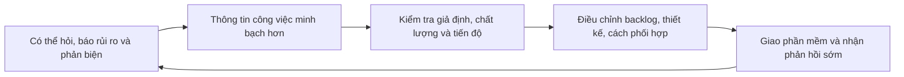

# An toàn tâm lý trong trao đổi, phản biện và thừa nhận sai sót

Một nhóm phát triển họp Sprint Planning để chốt tính năng thanh toán. Một lập trình viên phát hiện phương án hiện tại có thể tính sai phí khi khách hàng đổi địa chỉ giao hàng. Người ấy im lặng vì lần trước đặt câu hỏi đã bị đáp lại: “Việc đơn giản thế mà cũng chưa rõ sao?”. Hai tuần sau, lỗi xuất hiện trên môi trường thật. Nhóm vẫn có Daily Scrum, Sprint Review và backlog được cập nhật đầy đủ, nhưng thông tin quan trọng đã không được nói ra đúng lúc.

Trong môi trường Agile, **khả năng trao đổi thẳng thắn, phản biện có căn cứ và thừa nhận sai sót** là điều kiện để nhận phản hồi sớm và thích ứng. Nếu người trong nhóm ngại hỏi, ngại báo lỗi hay sợ bị quy trách nhiệm khi thử nghiệm thất bại, cơ chế “kiểm tra và điều chỉnh” (*inspect and adapt*) sẽ thiếu dữ liệu đáng tin cậy.

Chủ đề này thuộc chương **Cộng tác và lãnh đạo** trong mô-đun **AGILE_DEVELOPMENT**. Nó làm rõ cách xây dựng an toàn tâm lý (*psychological safety*) để nhóm phát triển phần mềm có thể cộng tác, giao sản phẩm tăng dần, sử dụng user story và backlog minh bạch, vận hành Scrum hoặc Kanban hiệu quả, thực hành kỹ thuật XP và học từ những gì chưa đạt.

## 1. Mục tiêu học tập

Sau bài học, bạn có thể:

- Giải thích **an toàn tâm lý** là gì và vì sao nó hỗ trợ học hỏi, chất lượng kỹ thuật và khả năng thích ứng trong Agile.
- Phân biệt an toàn tâm lý với sự dễ chịu, đồng thuận, thân thiết, nể nang và miễn trừ trách nhiệm.
- Nhận diện hành vi khiến đồng đội ngại hỏi, ngại phản biện, không dám báo rủi ro hoặc che giấu sai sót.
- Thực hành cách **nêu bất đồng dựa trên bằng chứng**, tiếp nhận phản biện và xử lý căng thẳng mà vẫn tôn trọng con người.
- Tổ chức các hoạt động Scrum, Kanban, code review, pair programming và retrospective để khuyến khích tiếng nói thật.
- Phân tích sự cố theo hướng học hỏi hệ thống, đồng thời giữ trách nhiệm và các yêu cầu an toàn, bảo mật cần thiết.
- Lựa chọn những tín hiệu đánh giá và thử cải tiến nhỏ phù hợp với bối cảnh đội.

## 2. An toàn tâm lý là gì?

### 2.1. Định nghĩa và phạm vi

Trong nghiên cứu về các nhóm làm việc, giáo sư **Amy Edmondson** mô tả an toàn tâm lý của nhóm là một **niềm tin được chia sẻ rằng nhóm đủ an toàn để các thành viên chấp nhận rủi ro giữa người với người** (*interpersonal risk taking*). Ví dụ về rủi ro này là đặt một câu hỏi tưởng như ngớ ngẩn, thừa nhận mình chưa hiểu, chỉ ra lỗi, xin giúp đỡ, đưa ý tưởng chưa hoàn chỉnh hoặc nói rằng mình không đồng ý với người có thẩm quyền.

An toàn tâm lý **không có nghĩa thành viên chắc chắn sẽ không gặp bất cứ hậu quả nào**. Nó nói đến mức độ họ tin rằng việc lên tiếng **trên tinh thần xây dựng và trong phạm vi công việc** không khiến họ bị sỉ nhục, chế giễu, loại trừ hoặc trừng phạt bất công.

Hãy so sánh:

| Tình huống | Môi trường thiếu an toàn tâm lý | Môi trường hỗ trợ an toàn tâm lý |
| --- | --- | --- |
| Chưa hiểu user story | Giả vờ hiểu vì sợ bị đánh giá kém | Hỏi lại và cùng bổ sung ví dụ, tiêu chí chấp nhận |
| Thấy rủi ro kỹ thuật | Im lặng vì “kiến trúc sư đã quyết rồi” | Nêu bằng chứng, tác động và phương án kiểm chứng |
| Làm sai một thay đổi | Che giấu lỗi, tìm người khác chịu trách nhiệm | Báo sớm, xử lý tác động và cùng xem nguyên nhân |
| Không đồng ý với kế hoạch | Gật đầu trong cuộc họp rồi than phiền ngoài cuộc họp | Trình bày phản biện đúng lúc, cùng quyết định hướng đi |
| Chưa biết cách làm | Cố tự giải quyết trong im lặng quá lâu | Hỏi hỗ trợ trước khi việc bị tắc nghẽn |
| Có kết quả thử nghiệm không như mong đợi | Làm đẹp số liệu hoặc chọn chỉ nói chỉ số thuận lợi | Công bố kết quả trung thực và điều chỉnh giả thuyết |

Một thành viên có thể tự tin nói trong nhóm nhỏ thân thiết nhưng vẫn ngại lên tiếng khi có quản lý cấp cao. Vì vậy, an toàn tâm lý là **đặc tính được trải nghiệm trong một bối cảnh quan hệ cụ thể**, không phải nhãn cố định gắn cho tính cách một người hoặc giấy chứng nhận dành cho đội.

### 2.2. Điều gì *không* đồng nghĩa với an toàn tâm lý?

| Khái niệm dễ nhầm | Phân biệt |
| --- | --- |
| **Luôn thoải mái, không căng thẳng** | Thảo luận về lỗi nghiêm trọng, từ chối một yêu cầu hoặc nhận phản hồi khó nghe có thể không thoải mái nhưng vẫn an toàn nếu mọi người được tôn trọng. |
| **Mọi người luôn đồng ý** | Bất đồng có chất lượng là tín hiệu cho thấy những giả định khác nhau được đưa ra để kiểm chứng. |
| **Lúc nào cũng nói lời tích cực** | Có thể và cần nêu thẳng vấn đề, giới hạn, chất lượng chưa đạt và hành vi cần thay đổi. |
| **Không có tiêu chuẩn hoặc trách nhiệm** | Đội vẫn phải đáp ứng Definition of Done, tiêu chí bảo mật, cam kết công việc và trách nhiệm khắc phục hậu quả. |
| **Ai nói gì cũng đúng** | Mọi ý kiến đều có thể được lắng nghe công bằng; quyết định cuối phải dựa trên dữ kiện, mục tiêu, rủi ro và trách nhiệm được xác định. |
| **Thân thiết hoặc tin nhau tuyệt đối** | Có thể có quan hệ chuyên nghiệp và vẫn được phép hỏi, phản biện, thừa nhận chưa biết dù không phải bạn thân. |
| **Bắt buộc ai cũng chia sẻ cảm xúc riêng tư** | Thành viên có quyền giữ ranh giới cá nhân. An toàn tâm lý không cho phép ép buộc tiết lộ thông tin ngoài nhu cầu công việc. |

Điểm quan trọng: **an toàn tâm lý đi cùng trách nhiệm và tiêu chuẩn cao**. Khi một thay đổi gây lỗi, nhóm cần sửa lỗi, bảo vệ người dùng, đánh giá hậu quả và học cách phòng ngừa. Không nên nhầm “không đổ lỗi vô căn cứ” với “không cần giải trình”.

### 2.3. Bốn kiểu môi trường để tự quan sát

Ma trận sau là **công cụ gợi ý cách suy nghĩ**, không phải một thang đo chẩn đoán chính thức:

| | Kỳ vọng và trách nhiệm thấp | Kỳ vọng và trách nhiệm cao |
| --- | --- | --- |
| **An toàn tâm lý thấp** | **Thờ ơ/né tránh:** ít lên tiếng, ít cùng học | **Lo sợ:** chạy theo kết quả, che giấu vấn đề, ngại nói thật |
| **An toàn tâm lý cao** | **Dễ dãi:** thoải mái nhưng có thể thiếu nỗ lực cải tiến | **Học hỏi và thực thi:** dám hỏi, dám phản biện, cùng chịu trách nhiệm với chất lượng |

Đích hướng tới không phải cuộc họp lúc nào cũng yên ổn. Đó là **nơi người ta đủ an toàn để nói điều khó và đủ trách nhiệm để xử lý điều vừa được nói ra**.

## 3. Vì sao an toàn tâm lý quan trọng với Agile?

Agile coi trọng tương tác, cộng tác với khách hàng, phần mềm hoạt động, phản hồi trước thay đổi và cải tiến liên tục. Những điều này phụ thuộc vào việc đội **nhìn thấy hiện trạng một cách trung thực**.

### 3.1. Minh bạch → kiểm tra → thích ứng

Scrum dựa vào các trụ cột *transparency* (minh bạch), *inspection* (kiểm tra) và *adaptation* (thích ứng). Nếu Developers không dám nói rằng một yêu cầu chưa rõ hoặc một Increment chưa đạt chất lượng, Sprint Review và Sprint Retrospective khó tạo ra điều chỉnh đúng.



Ngược lại, nếu mọi người chỉ đưa tin tốt để giữ hình ảnh, nhóm có thể thấy một “bảng công việc xanh” nhưng thực tế đang tích tụ lỗi hoặc chờ đợi.

### 3.2. Học từ thử nghiệm và phản hồi khách hàng

Phát triển sản phẩm thích ứng cần thử giả thuyết: người dùng có thật sự cần tính năng này không, lựa chọn thiết kế có dễ dùng không, phương án kỹ thuật có đủ tin cậy không. **Một thử nghiệm bác bỏ giả thuyết có thể là kết quả học tập có giá trị**, miễn là thử nghiệm được thiết kế và thực hiện có trách nhiệm.

Nếu người phụ trách sợ phải thừa nhận “giả thuyết của tôi sai”, họ có thể giấu số liệu bất lợi hoặc tiếp tục đầu tư vào phương án kém hiệu quả. An toàn tâm lý giúp nhóm công bố bằng chứng sớm, cập nhật thứ tự Product Backlog hoặc dừng một hướng đi chưa có giá trị.

### 3.3. Chất lượng kỹ thuật và phòng ngừa lỗi

Một kỹ sư nhìn thấy nguy cơ lỗi phân quyền nhưng không dám làm chậm kế hoạch; một người kiểm thử ngại báo lỗi vào cuối Sprint; một thành viên mới không hỏi về cách rollback: cả ba đều tạo ra khoảng trống nguy hiểm trong hệ thống.

An toàn tâm lý thúc đẩy **báo lỗi sớm, hỏi khi chưa rõ, review có thực chất và đề xuất biện pháp phòng ngừa**. Nó không thay thế kiểm thử tự động, CI, thiết kế tốt hoặc quản lý rủi ro. Nó làm cho thông tin về chất lượng **được nói ra và được xử lý**.

### 3.4. Dòng công việc và khả năng dự báo

Trong Kanban, một hạng mục bị tắc ở bước review cần được nêu rõ để cả đội phối hợp gỡ. Nếu người phụ trách ngại nói “tôi cần hỗ trợ” hoặc “khối lượng việc này vượt khả năng hiện tại”, WIP có thể tăng mà nguyên nhân không được giải quyết.

Việc công khai tồn đọng và thời gian chờ phải phục vụ **cải tiến dòng chảy**, không biến thành cơ chế làm xấu hổ một cá nhân vì ticket của họ lâu hơn người khác.

## 4. Rủi ro khi lên tiếng trong nhóm phần mềm

Không phải ai cũng chịu rủi ro xã hội như nhau. Khả năng lên tiếng chịu ảnh hưởng của vai trò, thâm niên, quyền quyết định, ngôn ngữ, văn hóa giao tiếp, cách phân chia trách nhiệm và kinh nghiệm đã có trước đó.

### 4.1. Bất cân xứng quyền lực

Một Product Owner có thể cảm thấy dễ dàng chất vấn thứ tự ưu tiên hơn một người mới gia nhập. Một Senior Developer có thể bác bỏ thiết kế của đồng nghiệp mà không lo bị đánh giá; một Junior Developer có thể ngại đưa ra cùng ý kiến.

**Hành vi của người có quyền quyết định mang trọng lượng lớn**. Một cái thở dài, câu nói mỉa mai hoặc việc ngắt lời liên tục có thể khiến người khác hiểu rằng phản biện không được chào đón, ngay cả khi người lãnh đạo tuyên bố “cửa luôn mở”.

Biện pháp thực tế:

- Trình bày quyết định như **giả thuyết cần kiểm chứng** khi vẫn còn bất định.
- Mời người ít quyền lực hơn phát biểu trước khi quản lý công bố lựa chọn.
- Cho phép phản hồi bằng văn bản hoặc gặp riêng nếu họ chưa sẵn sàng nói trong nhóm lớn.
- Giải thích rõ ai có quyền quyết định cuối cùng và cách đưa thêm bằng chứng sau quyết định.
- Người lãnh đạo chủ động nhận lỗi trong các quyết định thuộc trách nhiệm mình.

### 4.2. Thành kiến về năng lực và việc “biết mọi thứ”

Các câu như “cái này ai cũng biết”, “sao em hỏi lại” làm người học hiểu rằng xin giúp đỡ là dấu hiệu kém năng lực. Về lâu dài, nhóm sẽ mất một cơ chế phát hiện lỗ hổng trong tài liệu, thiết kế và quy trình onboarding.

Thay bằng câu hỏi có mục đích:

> “Chỗ nào trong ví dụ chưa rõ? Nếu khó hiểu với em thì có thể tài liệu hoặc yêu cầu của chúng ta cũng chưa đủ rõ.”

Không cần biến mọi câu hỏi thành cuộc họp dài. Có thể chỉ rõ người hỗ trợ, nguồn tham khảo và thời điểm phản hồi; điều quan trọng là **không phán xét con người vì họ chưa biết một điều hợp lý**.

### 4.3. Nhầm bất đồng với chống đối

Bất đồng về phương án kỹ thuật hoặc ưu tiên sản phẩm **không đồng nghĩa thiếu tinh thần đồng đội**. Ngược lại, phản biện đúng lúc có thể ngăn quyết định tốn kém.

Phân biệt:

- **Phản biện có ích:** nêu giả định, bằng chứng, rủi ro, câu hỏi và phương án thay thế.
- **Tấn công cá nhân:** quy kết động cơ, chế giễu năng lực, hạ thấp người nói.
- **Tranh luận bất tận:** lặp ý kiến mà không thêm dữ liệu, không thống nhất tiêu chí quyết định.
- **Bất tuân có chủ ý:** sau khi đã có quyết định hợp lệ và trách nhiệm rõ, cố tình bỏ qua mà không báo rủi ro mới.

An toàn tâm lý bảo vệ việc nêu vấn đề chính đáng; nó không đòi nhóm chấp nhận lăng mạ hay bỏ qua quy trình cần thiết.

## 5. Nói thẳng nhưng có trách nhiệm: phương pháp phản biện

Phản biện tốt vừa tạo chỗ cho ý kiến khác biệt, vừa giúp nhóm **tiến tới quyết định**.

### 5.1. Mẫu trình bày một bất đồng kỹ thuật

Có thể dùng cấu trúc:

1. **Mục tiêu chung:** Chúng ta đang muốn đạt kết quả gì?
2. **Quan sát/dữ kiện:** Tôi thấy điều gì trong mã, dữ liệu, kiểm thử hoặc trải nghiệm?
3. **Rủi ro/giả thuyết:** Điều gì có thể xảy ra? Phần nào vẫn chưa chắc chắn?
4. **Đề nghị:** Ta có thể kiểm chứng, thay đổi hoặc ra quyết định theo cách nào?
5. **Lời mời:** Có dữ liệu khác hoặc điểm nào tôi đang bỏ sót không?

Ví dụ khi nhóm định gọi API thanh toán đồng bộ trong luồng đặt hàng:

> “Mục tiêu là xác nhận đơn nhanh và tránh tính tiền hai lần. Trong log của môi trường thử nghiệm, tôi thấy có lần API phản hồi sau 12 giây. Nếu người dùng bấm lại, tôi chưa rõ cơ chế chống lặp hoạt động thế nào. Tôi đề xuất kiểm thử timeout và idempotency trước khi bật cho toàn bộ người dùng. Có trường hợp nào tôi chưa xét không?”

Câu nói này khác với “thiết kế này tệ quá”. Nó mô tả **vấn đề có thể kiểm chứng**, không gán nhãn năng lực người thiết kế.

### 5.2. Mẫu lắng nghe khi nhận phản biện

Người nhận phản biện có thể áp dụng chuỗi hành động:

- **Dừng phản ứng phòng vệ:** Để người nói hoàn tất trước khi bác bỏ.
- **Nhắc lại điều đã hiểu:** “Bạn lo rằng timeout có thể tạo thanh toán lặp, đúng không?”
- **Làm rõ bằng chứng:** “Lần nào xảy ra, ta có thể tái hiện ra sao?”
- **Cảm ơn việc báo rủi ro:** “Cảm ơn vì đã chỉ ra trước lúc phát hành.”
- **Chuyển thành hành động:** Quyết định test, thay đổi hoặc chấp nhận rủi ro với người chịu trách nhiệm rõ.
- **Khép vòng phản hồi:** Thông báo kết quả kiểm chứng cho người nêu vấn đề.

Chỉ nói “mọi ý kiến đều đáng quý” rồi không bao giờ xử lý vấn đề có thể gây tác dụng ngược: nhân viên thấy việc lên tiếng **không mang lại thay đổi**.

### 5.3. Tách dữ kiện, diễn giải và lựa chọn

Ví dụ trong Sprint Review:

| Thành phần | Phát biểu minh họa |
| --- | --- |
| **Dữ kiện** | “4 trong 12 người thử nghiệm không hoàn tất bước chọn địa chỉ.” |
| **Diễn giải/giả thuyết** | “Có thể tên trường địa chỉ gây nhầm, nhưng chưa chắc đây là nguyên nhân chính.” |
| **Tác động** | “Nếu tiếp tục như vậy, người dùng có thể bỏ dở thanh toán.” |
| **Đề xuất kiểm chứng** | “Quan sát thêm các phiên sử dụng và thử thay nhãn cho nhóm nhỏ.” |
| **Quyết định** | “Ưu tiên kiểm chứng giả thuyết trước khi mở rộng triển khai.” |

Cách tách này giúp mọi người tranh luận về **mức độ tin cậy của thông tin** thay vì bảo vệ “ý kiến của mình”.

### 5.4. Phản biện một phương án không đồng nghĩa phủ nhận một con người

| Cách nói dễ làm giảm an toàn | Cách nói rõ ràng và tôn trọng hơn |
| --- | --- |
| “Bạn lúc nào cũng viết code rối.” | “Hàm này có ba trách nhiệm; tôi khó xác định thay đổi phí sẽ tác động đến đâu.” |
| “Chắc chắn giải pháp của tôi tốt hơn.” | “Tôi thấy phương án A ít phụ thuộc hơn ở trường hợp X; ta so với B theo độ trễ và công sức vận hành nhé?” |
| “Lỗi này cơ bản quá, sao không thấy?” | “Kiểm thử ranh giới này đang thiếu. Ta thêm test và xem vì sao pipeline chưa phát hiện sớm.” |
| “Không kịp là do nhóm backend chậm.” | “Bước kiểm chứng hợp đồng API đang chờ bốn ngày; ta cần xem điều kiện bàn giao và năng lực xử lý.” |
| “Quản lý đã quyết rồi, không bàn nữa.” | “Quyết định hiện tại là A do thời hạn và rủi ro B; nếu có bằng chứng về lỗi bảo mật, hãy báo ngay để xem xét lại.” |

Phản hồi hữu ích **cụ thể, dựa trên hành vi hoặc sản phẩm công việc, có tác động rõ và hướng đến việc cần sửa**.

## 6. Lãnh đạo xây an toàn tâm lý bằng hành vi nào?

An toàn tâm lý không thể chỉ giao cho Scrum Master hoặc phòng nhân sự. Người có quyền quyết định sản phẩm, kỹ thuật và nhân sự đều góp phần tạo ra môi trường mà đội trải nghiệm hằng ngày.

### 6.1. Thừa nhận giới hạn hiểu biết của chính mình

Một người lãnh đạo có thể nói:

> “Tôi nghiêng về phương án này nhưng chưa chắc phần xử lý retry an toàn. Ai có ví dụ hoặc dữ kiện phản biện không?”

Lời mời chỉ có giá trị khi người ấy **không làm xấu mặt** người phản biện sau đó. Đặt câu hỏi về giới hạn hiểu biết là cách giảm sự chênh lệch vị thế trong cuộc thảo luận.

### 6.2. Mời phản biện trước khi công bố kết luận

Khi người quản lý nêu lựa chọn đầu tiên bằng giọng chắc chắn, các thành viên có thể thuận theo dù có thông tin khác. Một trình tự khác:

1. Xác định mục tiêu và tiêu chí quyết định.
2. Yêu cầu mỗi người xem xét riêng, có thể ghi ý tưởng trước khi thảo luận.
3. Mời các góc nhìn đa dạng, đặc biệt người trực tiếp vận hành hoặc kiểm thử.
4. So sánh bằng chứng, mức bất định và trade-off.
5. Công bố quyết định, người chịu trách nhiệm, lý do và tín hiệu sẽ khiến nhóm xem lại.

**Người lãnh đạo không cần nhường quyền quyết định cho mọi người trong mọi trường hợp.** Nhưng họ cần làm cho cách lắng nghe và ra quyết định minh bạch.

### 6.3. Phản ứng đầu tiên khi có người báo lỗi

Một tình huống thường bộc lộ văn hóa đội nhanh nhất là **phút đầu tiên sau khi ai đó báo tin xấu**.

Phản ứng hạn chế học hỏi:

> “Ai làm? Tại sao lỗi đơn giản này lại lọt? Để tôi biết ai phải chịu trách nhiệm.”

Phản ứng hỗ trợ học hỏi và giải quyết:

> “Cảm ơn vì báo sớm. Hiện lỗi ảnh hưởng đến người dùng nào? Chúng ta cần làm gì ngay để giảm tác động? Sau khi ổn định, mình sẽ xem chuỗi điều kiện khiến lỗi lọt qua.”

Sau khi hệ thống ổn định, vẫn cần đánh giá việc tuân thủ quy trình, quyết định thiếu thận trọng hoặc vi phạm có chủ ý theo cơ chế công bằng. **Không tìm vật tế thần** không có nghĩa **không có trách nhiệm**.

### 6.4. Làm gương trong việc nhận sai

Nếu lãnh đạo chốt thời hạn bất hợp lý dù kỹ thuật đã báo rủi ro, một câu nhận trách nhiệm cụ thể có thể là:

> “Tôi đã quyết định giữ ngày phát hành khi chúng ta chưa xác minh được trường hợp timeout. Quyết định đó góp phần tạo rủi ro. Tôi sẽ cùng nhóm đổi quy tắc đánh giá mức sẵn sàng trước phát hành.”

Câu này hữu ích hơn lời xin lỗi chung “nếu ai thấy khó chịu”. Nó nêu **hành động của chính mình** và **thay đổi có thể kiểm chứng**.

### 6.5. Bảo vệ người nêu cảnh báo chính đáng

Cần tránh hành vi trả đũa như loại người báo rủi ro khỏi cuộc họp, hạ đánh giá hiệu suất vì họ nêu phản biện có căn cứ, hoặc đổ lỗi cho người phát hiện lỗi. Nếu hành vi gây hại hoặc quấy rối xảy ra, đội cần dùng **quy trình phản ánh và xử lý phù hợp của tổ chức**, không ép người chịu tác động giải quyết trong một buổi retrospective công khai.

## 7. Từ cuộc họp Agile đến hành vi cụ thể

### 7.1. Backlog refinement: cho phép nói “chưa rõ”

Trong buổi làm rõ Product Backlog Item, câu hỏi có ích gồm:

- “Người dùng nào nhận giá trị từ hạng mục này và vì sao?”
- “Có ví dụ ranh giới hoặc trường hợp lỗi nào chưa được mô tả?”
- “Điều gì còn bất định về dữ liệu, phân quyền, tích hợp?”
- “Có giả thuyết nào đang bị xem như sự thật?”
- “Hạng mục có quá lớn để kiểm chứng sớm không?”

Một user story như “Là người mua, tôi muốn lưu địa chỉ để đặt hàng nhanh hơn” cần trao đổi thêm về người dùng ẩn danh, địa chỉ đã xóa, phân quyền và dữ liệu cá nhân. Nếu thành viên ngại hỏi, đội có thể ước lượng hoặc cam kết dựa trên những giả định khác nhau.

**Kết quả tốt của refinement** không phải tất cả đều nói “đã rõ”, mà là **những điểm chưa rõ quan trọng được nhìn thấy và có cách giải quyết**.

### 7.2. Sprint Planning: cam kết dựa trên năng lực thật

Trong Scrum, Developers lựa chọn các Product Backlog Item cho Sprint và xây kế hoạch thực hiện nhằm đạt Sprint Goal. Khi có áp lực từ mục tiêu kinh doanh, nhóm cần được phép nêu năng lực, phụ thuộc, rủi ro, công việc hỗ trợ và kiểm thử thực tế.

Một thành viên nói “tôi chưa chắc phần tích hợp có thể xong trong Sprint này” đang cung cấp **thông tin dự báo**, không mặc định chống lại mục tiêu. Nếu điều đó bị trừng phạt, kế hoạch lần sau có thể trở nên lạc quan giả tạo.

Người điều phối có thể hỏi:

> “Giả định nào phải đúng để kế hoạch này khả thi? Nếu giả định sai, chúng ta điều chỉnh phạm vi thế nào để vẫn giữ Sprint Goal?”

### 7.3. Daily Scrum: làm rõ trở ngại, tránh báo cáo để được chấm điểm

Daily Scrum là sự kiện cho Developers kiểm tra tiến độ hướng tới Sprint Goal và điều chỉnh Sprint Backlog khi cần. Nó **không phải cuộc họp để từng người chứng minh mình bận thế nào**.

Những phát biểu cần được đón nhận:

- “Tôi chưa hiểu luồng xác thực và cần người hỗ trợ 30 phút.”
- “Task này đang bị chặn bởi dữ liệu từ đối tác.”
- “Tôi phát hiện yêu cầu mới khiến cách triển khai hiện tại không an toàn.”
- “Chúng ta đang làm quá nhiều việc song song; nên hoàn tất hai thay đổi trước.”

Nếu người quản lý dùng Daily Scrum để công khai chê trách “hôm qua sao làm ít thế”, cả nhóm sẽ có động cơ giấu trở ngại.

### 7.4. Sprint Review: nói thật về kết quả với bên liên quan

Sprint Review là cơ hội kiểm tra Increment và điều chỉnh hướng đi với bên liên quan. Một sản phẩm được demo tốt chưa chắc tạo giá trị; người xem cần được phép phản biện một giả định hoặc chỉ ra trải nghiệm khó dùng.

Đội có thể nói rõ:

> “Increment này đã đạt Definition of Done. Tuy nhiên, thử nghiệm ban đầu chưa cho thấy tỷ lệ hoàn tất đặt hàng cải thiện. Chúng tôi đề xuất kiểm tra lại giả thuyết về bước nhập địa chỉ trước khi xây tiếp ba tính năng liên quan.”

Thông điệp này thể hiện **trung thực về kết quả** mà không đánh đồng việc giả thuyết chưa đúng với năng lực kém.

### 7.5. Sprint Retrospective: phản tư về hệ thống, không tìm người có lỗi

Một retrospective có ích cần:

1. Mô tả sự kiện và tác động với dữ liệu.
2. Mời mọi người chia sẻ góc nhìn mà không bị ngắt lời, kể cả quan điểm thiểu số.
3. Nhận diện điều đang giúp nhóm và điều cản trở chất lượng hoặc luồng công việc.
4. Chọn **một hoặc vài** thay đổi nhỏ có người phụ trách và tín hiệu kiểm chứng.
5. Ở lần sau, xem thay đổi có tác dụng gì.

Có thể dùng ghi ý kiến riêng trước cuộc họp, hình thức phản hồi bằng văn bản hoặc cách điều phối lần lượt để giảm tác động của người nói nhiều nhất. Tuy vậy, **không nên ép tất cả thành viên kể chuyện cá nhân hoặc công khai một trải nghiệm nhạy cảm**.

### 7.6. Kanban: minh bạch dòng công việc mà không biến thành giám sát cá nhân

Trong Kanban, các tín hiệu như WIP, work item age, cycle time và throughput có thể giúp cả đội xác định nơi cần hỗ trợ. Hãy hỏi:

> “Hạng mục đang chờ review đã bốn ngày. Điều kiện gì khiến nó chưa chuyển được? Ta cần giảm WIP, chia nhỏ việc hay điều chỉnh chính sách review?”

Tránh:

> “Ticket của bạn lâu hơn trung bình hai ngày, nghĩa là bạn làm chậm nhóm.”

Chỉ số về hạng mục mô tả **hành trình của công việc trong một hệ thống**, chịu ảnh hưởng bởi phụ thuộc, chờ đợi và độ phức tạp. Dùng nó để làm xấu hổ cá nhân sẽ làm mọi người có xu hướng thao túng trạng thái hoặc không nhận việc khó.

## 8. Cộng tác kỹ thuật: code review, pair programming và bất đồng thiết kế

### 8.1. Code review tập trung vào mã và rủi ro

Một review đáng tin cậy nên thảo luận về:

- Hành vi có đúng acceptance criteria và các trường hợp ranh giới không?
- Có nguy cơ dữ liệu, bảo mật, hiệu năng hay lỗi hồi quy nào?
- Mã có dễ hiểu và kiểm thử được không?
- Có phương án đơn giản hơn, với đánh đổi được mô tả rõ không?
- Pipeline/test có tín hiệu gì cần chú ý?

Có thể phân biệt mức độ phản hồi:

| Cách đánh dấu | Ý nghĩa | Ví dụ |
| --- | --- | --- |
| **Blocker** | Rủi ro nghiêm trọng cần giải quyết trước khi merge theo tiêu chuẩn đội | Có thể truy cập dữ liệu người dùng khác |
| **Major** | Vấn đề đáng kể cần trao đổi/giải quyết hoặc chấp nhận rủi ro có lý do | Trường hợp timeout chưa được xử lý |
| **Suggestion** | Phương án cải thiện, không nhất thiết là điều kiện merge | Đổi tên biến cho dễ đọc |
| **Question** | Cần hiểu quyết định trước khi đánh giá | “Nếu API trả 409 thì hệ thống làm gì?” |
| **Nit** | Chi tiết nhỏ, nên tránh kéo dài quá mức | Một lựa chọn format đã có công cụ chuẩn hóa |

Nhãn trên là **quy ước minh họa**, không phải chuẩn bắt buộc. Khi dùng, đội cần thống nhất ý nghĩa để tránh hiểu nhầm rằng mọi lời góp ý đều là yêu cầu bắt buộc.

### 8.2. Khi người review và tác giả không đồng ý

Một trình tự ngắn:

1. Nhắc lại hành vi cần đạt, ràng buộc và tiêu chí chất lượng.
2. Mô tả **hai lựa chọn** và rủi ro của mỗi lựa chọn.
3. Nếu dữ liệu chưa đủ, viết test hoặc thử nghiệm nhỏ để phân biệt.
4. Xác định ai chịu trách nhiệm quyết định theo quy ước đội.
5. Ghi lý do cần thiết; chấp nhận quyết định sau khi đã nêu rủi ro, tiếp tục quan sát.

Nếu bất đồng liên quan lỗi bảo mật nghiêm trọng, quyền riêng tư hoặc nghĩa vụ pháp lý, phải tuân thủ chính sách kiểm soát rủi ro và kênh xử lý phù hợp; không thể bỏ qua chỉ vì “đa số đồng ý”.

### 8.3. Pair programming và việc học từ người khác

Trong pair programming, người có kinh nghiệm không nên liên tục giật bàn phím hoặc chế giễu ý tưởng. Thay vào đó có thể nói: “Hãy thử viết test cho trường hợp này, rồi chúng ta cùng xem thiết kế hiện tại hỗ trợ ra sao.” Một cặp làm việc tốt cho phép người đang gõ được giải thích suy nghĩ, và người quan sát đưa ra giả định, câu hỏi, rủi ro.

Tư duy này phù hợp XP: chất lượng kỹ thuật và học hỏi nhóm cùng hỗ trợ việc phát hành nhỏ, nhận phản hồi nhanh và cải tiến liên tục.

## 9. Thừa nhận sai sót: trách nhiệm, học hỏi và xử lý sự cố

Làm phần mềm trong điều kiện bất định đồng nghĩa có lúc giả định sai, kiểm thử thiếu hoặc quyết định chưa tối ưu. An toàn tâm lý giúp các lỗi và dấu hiệu bất thường được nêu sớm, nhưng **không xóa nghĩa vụ giảm thiểu hậu quả**.

### 9.1. Ba loại tình huống cần phân biệt

| Tình huống | Ví dụ | Cách xử lý phù hợp |
| --- | --- | --- |
| **Sai sót có thể phòng ngừa trong quy trình đã biết** | Bỏ qua kiểm tra quan trọng dù đã có hướng dẫn rõ | Sửa hậu quả, tìm lý do kiểm soát không hoạt động; hướng dẫn, cải tiến hoặc xử lý trách nhiệm công bằng tùy bối cảnh |
| **Sự cố trong hệ thống phức tạp** | Hai dịch vụ hoạt động riêng lẻ đúng nhưng tương tác tạo lỗi hiếm gặp | Xây timeline, phân tích điều kiện hệ thống, bổ sung tín hiệu và biện pháp kiểm soát |
| **Thử nghiệm có chủ đích trong vùng bất định** | Nguyên mẫu được phép thử cho thấy người dùng không cần tính năng | Ghi lại điều học được, điều chỉnh giả thuyết; không coi mọi kết quả không đạt kỳ vọng là lỗi cá nhân |

Đây là khung phân biệt để suy nghĩ, **không tự động quyết định mức độ vi phạm**. Hành vi cố ý gây hại, gian lận hoặc vi phạm an toàn cần xử lý qua quy trình chính thức theo chính sách tổ chức và pháp luật áp dụng. Các buổi học hỏi của đội không thay thế quy trình điều tra cần thiết.

### 9.2. Lúc đang có sự cố: ưu tiên người dùng và giảm thiểu tác động

Một chuỗi hành động điển hình:

1. **Báo dấu hiệu và mức ảnh hưởng:** ai bị tác động, chức năng nào, khi nào bắt đầu, thông tin nào đã chắc chắn.
2. **Ổn định hệ thống:** tạm dừng triển khai tiếp, vô hiệu hóa tính năng, rollback hoặc áp dụng biện pháp đã được chuẩn bị khi an toàn.
3. **Phân công điều phối rõ:** ai theo dõi kỹ thuật, ai liên lạc với bên liên quan, ai ghi lại timeline.
4. **Cập nhật thông tin theo sự thật đã xác minh:** phân biệt điều quan sát được và giả thuyết.
5. **Sau khi ổn định**, tiến hành xem xét để học và cải tiến.

Trong lúc sự cố đang diễn ra, tranh luận “ai tạo ra lỗi” thường không giúp giảm ảnh hưởng. Tuy nhiên, khi cần đưa ra quyết định khẩn có rủi ro, vẫn phải làm rõ người chịu trách nhiệm và giới hạn thẩm quyền.

### 9.3. Postmortem không đổ lỗi theo kiểu quy kết cá nhân

Một *blameless postmortem* tập trung vào **điều kiện hệ thống, thông tin sẵn có và chuỗi quyết định** khiến sự cố có thể xảy ra. Câu hỏi hay:

- Những người liên quan đã nhìn thấy dữ liệu gì ở thời điểm quyết định?
- Vì sao phương án đó có vẻ hợp lý trong bối cảnh lúc ấy?
- Cơ chế kiểm thử, review, cảnh báo hoặc rollback nào chưa hoạt động như kỳ vọng?
- Có điều kiện tổ chức nào góp phần tạo áp lực hoặc làm rút ngắn bước kiểm chứng?
- Chúng ta có thể bổ sung rào chắn nào để giảm khả năng hoặc mức độ ảnh hưởng lần sau?

Một postmortem cần tránh đi tìm “người đáng trách nhất”, nhưng **không được viết lại lịch sử để che giấu quyết định hoặc vi phạm**. Minh bạch sự kiện và trách nhiệm phải đi cùng sự công bằng.

### 9.4. Mẫu postmortem minh họa

```markdown
# Sự cố: phí giao hàng bị tính sai cho một nhóm đơn hàng

## Tác động
- Người dùng nào bị ảnh hưởng?
- Khoảng thời gian, số lượng trường hợp và mức độ nghiêm trọng?
- Biện pháp bảo vệ người dùng / khắc phục thiệt hại?

## Dòng thời gian (ghi giờ và nguồn dữ liệu)
- 09:10: triển khai phiên bản X
- 09:25: cảnh báo tỷ lệ tính phí bất thường
- 09:32: đội hỗ trợ chuyển thông tin đến nhóm kỹ thuật
- 09:45: tạm vô hiệu hóa thay đổi liên quan
- 10:20: xác nhận trở lại hành vi mong đợi

## Sự kiện đã xác minh
- Quy tắc ngưỡng phí xuất hiện tại hai nơi.
- Test ở ngưỡng giá trị chưa có trong bộ kiểm tra chạy CI.

## Những điểm chưa rõ
- Vì sao trường hợp này không được phát hiện khi review?
- Giám sát nào nên báo sớm hơn?

## Điều kiện góp phần
- Phụ thuộc và kiến thức nghiệp vụ nằm rải rác.
- Thay đổi lớn nên review khó đối chiếu toàn bộ.

## Cải tiến có người phụ trách và điều kiện hoàn thành
- Bổ sung test ranh giới và xác minh tích hợp.
- Thống nhất một nguồn quy tắc phí.
- Bổ sung tín hiệu cảnh báo phí bất thường.
- Kiểm tra hiệu quả ở các lần phát hành tiếp theo.
```

Tất cả mốc thời gian và sự kiện trên **chỉ là ví dụ giả định**. Trong sự cố thật, không nên tự điền kết luận khi bằng chứng chưa đủ.

### 9.5. Không biến “5 Whys” thành 5 lần hỏi “ai làm sai?”

Kỹ thuật hỏi “Vì sao?” nhiều lần có thể giúp mở rộng nguyên nhân, nhưng sự cố phần mềm thường có **nhiều yếu tố tương tác** chứ không có một chuỗi nguyên nhân tuyến tính duy nhất.

Ví dụ:

- “Vì sao sai phí?” → hai nơi định nghĩa quy tắc khác nhau.
- “Vì sao có hai nơi?” → quy tắc hình thành qua nhiều thay đổi, chưa có ranh giới sở hữu rõ.
- “Vì sao không phát hiện?” → thiếu test ranh giới và kiểm tra tích hợp.
- “Vì sao thiếu test?” → các trường hợp ranh giới không xuất hiện trong trao đổi yêu cầu.
- “Vì sao trao đổi chưa đủ?” → bước refinement ít người kiểm thử tham gia, có áp lực phát hành.

Những câu trả lời này gợi ý **nhiều đường cải tiến cùng lúc**. Không nên kết luận đơn giản rằng “lỗi do người viết code chưa cẩn thận”.

## 10. An toàn tâm lý trong nhóm làm việc từ xa và đa vai trò

Trong nhóm phân tán, giao tiếp bằng văn bản dễ mất ngữ cảnh. Một bình luận ngắn như “Sai rồi” có thể gây hiểu là bác bỏ con người, dù người viết chỉ muốn báo lỗi.

### 10.1. Trình bày phản hồi rõ ngữ cảnh

Nên cung cấp:

- Đoạn mã, hành vi hoặc dữ liệu cụ thể.
- Mức độ ảnh hưởng và điều đang muốn làm rõ.
- Đề xuất hoặc câu hỏi kiểm chứng.
- Nhận biết điều gì vẫn là giả thuyết.
- Tên người hoặc kênh cần tham gia nếu quyết định vượt thẩm quyền.

Ví dụ trong pull request:

> “Ở trường hợp token hết hạn, API hiện trả 500. Theo hợp đồng giao tiếp, tôi hiểu trường hợp này nên trả 401; chúng ta có test integration cho nhánh đó chưa? Đây là điểm cần xử lý trước khi merge vì ảnh hưởng trải nghiệm đăng nhập.”

Cách này giúp người đọc hiểu **cơ sở phản biện và mức ưu tiên**, giảm khả năng tưởng rằng họ đang bị công kích.

### 10.2. Đảm bảo tiếng nói của người ít hiện diện

- Gửi trước tài liệu và mục tiêu để người cần thời gian suy nghĩ có cơ hội chuẩn bị.
- Dùng vòng góp ý bằng văn bản trước khi người có chức vụ cao nêu quan điểm.
- Luân phiên thời gian họp nếu đội làm ở nhiều múi giờ.
- Tóm tắt quyết định và lý do bằng văn bản để người vắng mặt có thể bổ sung dữ liệu sau.
- Không xem im lặng là đồng ý chắc chắn; hãy xác nhận mức hiểu biết và các trở ngại bằng cách phù hợp.

Có người phát biểu ít vì thói quen giao tiếp hoặc vì đang tập trung lắng nghe, **không thể suy ra chắc chắn họ thiếu an toàn tâm lý**. Cần hỏi bằng nhiều cách và tôn trọng lựa chọn của từng người.

### 10.3. Bảo vệ quyền riêng tư và ranh giới cá nhân

Khi thu thập phản hồi về môi trường nhóm:

- Không buộc người tham gia kể trải nghiệm nhạy cảm trước đám đông.
- Tránh gắn tên người với câu trả lời khảo sát nếu không cần thiết.
- Không công bố dữ liệu nhóm quá nhỏ khiến người trả lời dễ bị nhận diện.
- Hạn chế quyền truy cập, nói rõ mục đích dùng dữ liệu và thời gian lưu giữ theo quy định.
- Với hành vi quấy rối, phân biệt đối xử hoặc nguy cơ an toàn nghiêm trọng, dùng các kênh phản ánh/điều tra chuyên trách.

Một retrospective có thể giúp sửa cách phối hợp; nó **không thay thế** cơ chế bảo vệ và xử lý vi phạm chính thức.

## 11. Làm sao biết môi trường đang cải thiện?

An toàn tâm lý là trải nghiệm của con người và khó đo bằng một con số duy nhất. Không nên coi số ý kiến trong cuộc họp, số lỗi được báo hoặc khảo sát “điểm an toàn” là bằng chứng trực tiếp để xếp loại cá nhân.

### 11.1. Quan sát hành vi và chất lượng trao đổi

Có thể xem:

| Tín hiệu | Điều có thể cho thấy | Cần tránh kết luận vội |
| --- | --- | --- |
| Thành viên tự nêu trở ngại, thiếu rõ ràng, yêu cầu hỗ trợ | Người trong đội có cơ hội báo khó khăn sớm | Nhiều báo cáo hơn không tự chứng minh an toàn hơn; cũng có thể là hệ thống đang có nhiều lỗi |
| Phản biện xuất hiện trước quyết định lớn | Nhiều giả định/rủi ro được nhận diện kịp thời | Ít bất đồng không chắc là vấn đề nếu đội thực sự có bằng chứng rõ |
| Ý kiến thiểu số được ghi nhận và phản hồi | Người ít tiếng nói có cơ hội ảnh hưởng vào quyết định | Mời phát biểu hình thức chưa đủ nếu kết quả luôn bị bỏ qua |
| Sau sự cố có hành động cải tiến được hoàn tất | Đội chuyển điều học được thành thay đổi thực | Nhiều action item nhưng không có tác dụng có thể là gánh nặng thủ tục |
| Review, retro và refinement có những câu hỏi thực chất | Cấu trúc sinh hoạt hỗ trợ học hỏi | Số lượng comment hoặc thời gian họp không bằng chất lượng |
| Các thành viên có thể xin giúp đỡ mà không bị hạ thấp | Rào cản liên cá nhân có thể đang giảm | Cần kiểm tra bối cảnh, không ép mọi người thể hiện cảm xúc |

### 11.2. Khảo sát ngắn và trao đổi định tính

Nếu tổ chức có cơ chế bảo mật thông tin phù hợp, có thể hỏi mức độ đồng ý với các câu như:

1. “Trong nhóm, tôi có thể nói rằng mình chưa hiểu một vấn đề công việc.”
2. “Tôi có thể nêu rủi ro dù người phụ trách phương án là người có kinh nghiệm hoặc thẩm quyền cao.”
3. “Khi một sự cố xảy ra, chúng tôi tập trung tìm nguyên nhân và cải thiện cách làm.”
4. “Ý kiến phản biện được xem xét nghiêm túc ngay cả khi quyết định cuối khác với đề xuất.”
5. “Tôi có thể yêu cầu hỗ trợ trước khi công việc gặp vấn đề nghiêm trọng.”

Các câu trên là **gợi ý thực hành, không phải bộ công cụ khảo sát chuẩn hóa hay thang đo lâm sàng**. Kết quả chỉ có ý nghĩa khi đội tin rằng phản hồi được xử lý đúng mục đích, không dùng để đánh giá người trả lời. Với nhóm nhỏ, nên ưu tiên trao đổi tự nguyện, cấu trúc bảo mật phù hợp và quan sát thay đổi thực tế thay vì cố công bố tỷ lệ có thể tiết lộ danh tính.

### 11.3. Kết hợp tín hiệu cộng tác với kết quả sản phẩm

An toàn tâm lý là điều kiện hỗ trợ, **không phải mục tiêu kết quả duy nhất**. Khi thử cải thiện, theo dõi thêm:

- Chất lượng hạng mục được làm rõ và mức độ phải sửa yêu cầu muộn.
- Thời gian phát hiện rủi ro/điều kiện chặn công việc.
- Lỗi hồi quy và thời gian xử lý sự cố.
- Khả năng hoàn tất Increment phù hợp với Definition of Done.
- Thời gian dòng công việc, đặc biệt phần chờ review và các bước bàn giao.
- Kết quả người dùng, như mức hoàn tất tác vụ hoặc phản hồi thực tế.

Nếu mọi người nói rằng họ thoải mái hơn nhưng vấn đề đã phản ánh không bao giờ được xử lý, cần xem lại cách đội **khép vòng hành động**. Ngược lại, nếu nhiều lỗi được báo sớm hơn trong giai đoạn đầu, đó có thể là dấu hiệu việc che giấu đã giảm; phải xem chất lượng tổng thể và xu hướng lâu hơn trước khi kết luận.

## 12. Tình huống thực hành: phản biện trước khi phát hành tính năng thanh toán

Giả sử đội phát triển ứng dụng đặt hàng đang chuẩn bị phát hành tính năng “lưu địa chỉ giao hàng”. Trong Sprint Planning, Product Owner muốn giao toàn bộ chức năng trong một Sprint. Một Developers mới tham gia phát hiện hai rủi ro: địa chỉ lưu có thể hiển thị sai tài khoản, và quy tắc phí vận chuyển không tính lại khi đổi tỉnh thành.

### 12.1. Cách xử lý khiến nhóm mất tiếng nói

- Người phụ trách cắt lời: “Chúng ta đã chốt rồi, đừng phức tạp hóa.”
- Developers thấy chưa đủ thời gian nhưng vẫn nhận toàn bộ công việc để tránh bị đánh giá.
- Code review có câu “thứ cơ bản vậy cũng sai à?”.
- Test phân quyền bị hoãn để kịp demo.
- Sau phát hành, lỗi xảy ra; retro tập trung tìm người “làm mất Sprint Goal”.

Hệ quả không chỉ là bầu không khí kém. **Thông tin rủi ro không vào quyết định**, tiêu chí chất lượng bị bỏ qua và phản hồi thực tế đến quá muộn.

### 12.2. Cách xử lý có an toàn tâm lý và trách nhiệm

1. Product Owner nhắc lại mục tiêu: giảm thời gian đặt hàng cho người dùng quay lại; có thể giảm phạm vi để đạt mục tiêu một cách an toàn.
2. Developers nêu dữ kiện: đường đi lưu địa chỉ cần kiểm tra phân quyền; khi thay địa chỉ, phí cần tính lại theo dữ liệu mới.
3. Nhóm xác định hạng mục có thể giao tăng dần: lưu **một địa chỉ** cho tài khoản đã đăng nhập, chọn lại và tính phí đúng; hoãn quản lý nhiều địa chỉ hoặc nhập từ danh bạ.
4. Bổ sung acceptance criteria: một tài khoản chỉ thấy dữ liệu của mình; cập nhật địa chỉ tính lại phí; lỗi tính phí không dẫn đến số tiền cuối cùng khác với số đã xác nhận.
5. Nhóm xác định yêu cầu DoD liên quan: kiểm thử phân quyền, trường hợp phí ranh giới, CI đạt và cách phát hiện lỗi sau phát hành.
6. Trong Sprint, Daily Scrum nêu thẳng phụ thuộc chưa xử lý; công việc được điều chỉnh theo Sprint Goal thay vì giấu việc chậm.
7. Sprint Review trình bày cả Increment đã đạt và những giả thuyết còn cần người dùng kiểm chứng.
8. Retrospective xem điểm chưa rõ đã được phát hiện ở giai đoạn nào, bước trao đổi nào hữu ích và cần thay đổi gì cho Sprint sau.

**Bài học:** người phản biện không chỉ “được phép nói”, mà **thông tin phản biện thay đổi quyết định và giảm rủi ro sản phẩm**.

### 12.3. Khi vẫn có bất đồng sau khi đã thảo luận

Giả sử Product Owner muốn phát hành rộng để kịp chiến dịch, trong khi Developers cảnh báo kiểm thử phân quyền chưa đạt. Cách ra quyết định phải phân biệt:

- **Trade-off về phạm vi hoặc thứ tự ưu tiên:** có thể thảo luận và chọn lựa theo giá trị, chi phí, thời điểm.
- **Tiêu chuẩn chất lượng, bảo mật, nghĩa vụ bắt buộc:** không thể bỏ qua bằng cách yêu cầu thành viên “linh hoạt” hoặc im lặng.

Nếu Increment không đáp ứng Definition of Done thì theo Scrum Guide, nó **không được coi là Increment hoàn thành**. Việc xử lý có thể là giảm phạm vi, cải thiện cách kiểm chứng hoặc thay đổi kế hoạch phát hành; không phải gây áp lực để nhóm đánh dấu chất lượng đạt khi thực tế chưa đạt.

## 13. Kế hoạch cải tiến thực tế trong bốn tuần

Một đội đang gặp khó trong phản biện có thể thử một vòng nhỏ như sau. Đây là **mẫu tham khảo**, không phải chương trình bắt buộc hoặc bảo đảm kết quả.

| Thời điểm | Thử nghiệm nhóm | Dấu hiệu cần xem |
| --- | --- | --- |
| **Tuần 1 — Nhìn hiện trạng** | Hỏi riêng/tự nguyện các tình huống khiến thành viên ngại hỏi, báo lỗi; quan sát cuộc họp và review | Điểm nào khiến tiếng nói bị ngắt? Có nhóm vai trò nào ít được lắng nghe? |
| **Tuần 2 — Sửa cách đối thoại** | Thống nhất quy ước: nêu quan sát, tác động, câu hỏi, đề xuất; điều phối để ý kiến thiểu số xuất hiện trước quyết định | Phản biện có cụ thể và được xử lý? Có giảm mỉa mai, quy kết? |
| **Tuần 3 — Đưa vào công việc kỹ thuật** | Thử phân loại comment PR theo mức độ, rút ngắn hàng chờ review; trong Daily Scrum nêu blocker không quy trách cá nhân | Có vấn đề quan trọng được phát hiện sớm? Thời gian chờ và lỗi có biến chuyển? |
| **Tuần 4 — Học từ kết quả** | Retrospective về chính thử nghiệm: điều có ích, tác dụng phụ, điều cần giữ/bỏ | Thành viên có thấy tiếng nói được tôn trọng và biến thành hành động? |

Lãnh đạo nên chọn **một đến hai hành vi thực sự có thể duy trì**, chẳng hạn “không ngắt lời khi người khác báo rủi ro” và “mọi cảnh báo nghiêm trọng đều có người phản hồi, thời hạn xem xét”. Khi thành viên đã từng bị phản ứng tiêu cực, niềm tin có thể cần nhiều lần trải nghiệm nhất quán để cải thiện; một buổi công bố nguyên tắc mới là chưa đủ.

### 13.1. Quy ước nhóm ngắn gọn để áp dụng

Một ví dụ **working agreement** có thể cùng nhau hiệu chỉnh:

> **Chúng tôi nêu vấn đề sớm và tôn trọng con người.** Khi phản biện, mô tả bằng chứng và tác động; khi nhận phản biện, hỏi để hiểu trước khi bác bỏ. Chúng tôi báo lỗi và trở ngại kịp thời, bảo vệ người dùng, giữ trách nhiệm xử lý và tìm cách cải thiện hệ thống. Quyết định có người chịu trách nhiệm; khi có bằng chứng mới, chúng tôi có quyền yêu cầu xem xét lại theo kênh phù hợp.

Quy ước có ích khi mọi người **thấy nó được thực hành**, đặc biệt trong lúc áp lực cao hoặc khi người lãnh đạo cũng là một phần của vấn đề.

## 14. Những ngộ nhận cần sửa

| Ngộ nhận | Cách hiểu đúng |
| --- | --- |
| “An toàn tâm lý tức là không được phê bình.” | Có thể phê bình thẳng việc làm, hành vi hoặc quyết định; tránh sỉ nhục và quy chụp con người. |
| “Nhóm an toàn là nhóm không có xung đột.” | Xung đột về ý tưởng, ưu tiên hoặc đánh đổi là bình thường; cần quản lý cách đối thoại và quyết định. |
| “Không đổ lỗi nghĩa là không ai phải chịu trách nhiệm.” | Cần khắc phục hậu quả, giải trình và xử lý vi phạm công bằng, đồng thời học từ yếu tố hệ thống. |
| “Trưởng nhóm nói cởi mở là nhóm đã an toàn.” | Phải xem phản ứng thực tế khi có ý kiến khó nghe, báo lỗi hoặc thất bại. |
| “Người ít nói chắc chắn không có ý kiến.” | Im lặng có nhiều nguyên nhân; cần tạo kênh phản hồi khác nhau và không ép buộc. |
| “Tất cả quyết định phải đồng thuận tuyệt đối.” | Mọi góc nhìn có thể được nghe; quyền quyết định và điều kiện xem lại vẫn cần rõ ràng. |
| “Càng nhiều comment code review càng tốt.” | Chất lượng phản hồi và khả năng xử lý rủi ro quan trọng hơn số lượng comment. |
| “Retrospective xong là vấn đề đã được giải quyết.” | Hành động cải tiến phải có người phụ trách và được kiểm chứng trong công việc sau đó. |
| “Cần che bớt lỗi để bảo vệ tinh thần đội.” | Che giấu lỗi gây hại cho người dùng và đội; báo lỗi sớm phải được hỗ trợ và xử lý. |
| “Sự cố do một người tạo ra nên không cần xem quy trình.” | Cá nhân có thể phải giải trình, nhưng vẫn cần tìm điều kiện hệ thống để ngăn lặp lại. |
| “An toàn tâm lý thay thế test, CI và các quy định.” | Cần cả môi trường dám báo rủi ro lẫn các biện pháp kỹ thuật, vận hành và tuân thủ. |
| “Điểm khảo sát an toàn thấp nghĩa là một người lãnh đạo tồi.” | Phải xem bối cảnh, phương pháp thu thập, tín hiệu đa chiều và biến động theo thời gian. |

## 15. Câu hỏi ôn tập và bài tập áp dụng

**Câu hỏi 1.** Một Senior Developer nói: “Mọi người cứ phản biện thoải mái”, nhưng sau đó thường ngắt lời thành viên mới. Vấn đề nằm ở tuyên bố, hành vi hay cấu trúc quyền lực? Hãy đề xuất hai thay đổi có thể quan sát được.

**Câu hỏi 2.** Trong Sprint Planning, một người cho rằng hạng mục quá lớn nhưng không dám nêu vì Product Owner đã hứa ngày phát hành. Hãy viết một câu phản biện có mục tiêu chung, dữ kiện, rủi ro và đề xuất.

**Câu hỏi 3.** Một lỗi phát sinh sau khi merge, nhưng tác giả báo ngay và cùng đội rollback. Cần nhận diện những trách nhiệm nào trong giai đoạn xử lý sự cố? Sau đó nên hỏi gì trong postmortem để vừa học vừa công bằng?

**Câu hỏi 4.** Bảng Kanban cho thấy nhiều hạng mục chờ review quá lâu. Vì sao đánh giá người có ticket lâu nhất là “làm chậm nhóm” có thể làm số liệu kém đáng tin? Hãy đề xuất chính sách cải thiện luồng.

**Câu hỏi 5.** Một kết quả thử nghiệm cho thấy tính năng mới không cải thiện tỷ lệ hoàn tất thanh toán. Vì sao điều này có thể vẫn là một kết quả hữu ích? Hãy mô tả cách thông báo trong Sprint Review.

**Bài tập tình huống:** Nhóm của bạn có ba vai trò: người quyết định ưu tiên sản phẩm, người phát triển và người kiểm thử. Thiết kế cuộc họp 20 phút để thảo luận một rủi ro phát hành:

1. Dành 3 phút mô tả mục tiêu và dữ kiện.
2. Dành 4 phút cho mỗi người ghi riêng giả định và rủi ro.
3. Dành 6 phút lắng nghe từng góc nhìn, không ngắt lời.
4. Dành 5 phút chọn phương án theo rủi ro và mục tiêu, ghi người chịu trách nhiệm.
5. Dành 2 phút xác nhận câu hỏi còn mở và thời điểm xem lại.

Sau cuộc họp, đánh giá: **có ý kiến quan trọng nào xuất hiện? Có quyết định rõ? Người nêu rủi ro có nhận được phản hồi?** Không đánh giá thành công chỉ theo số người đã phát biểu.

## 16. Tóm tắt trọng tâm

**An toàn tâm lý** là niềm tin chung rằng các thành viên có thể chấp nhận rủi ro giữa người với người trong công việc, như hỏi khi chưa biết, nêu bất đồng, báo lỗi hoặc xin giúp đỡ mà không bị hạ thấp hay trừng phạt bất công. Nó **không loại bỏ trách nhiệm, tiêu chuẩn chất lượng hoặc yêu cầu an toàn**.

Trong Agile, an toàn tâm lý giúp **thông tin quan trọng được nói ra sớm**. Scrum cần nó để các vòng minh bạch, kiểm tra và thích ứng có dữ liệu thật; Kanban cần nó để tắc nghẽn được đưa ra ánh sáng; XP và các thực hành kỹ thuật cần nó để review, pair programming, kiểm thử và cải tiến mã diễn ra có thực chất. Product Owner, Developers, Scrum Master, lãnh đạo kỹ thuật và bên liên quan đều góp phần bằng cách **nói thẳng, lắng nghe nghiêm túc, xử lý vấn đề và giữ trách nhiệm rõ ràng**.

Một đội phát triển thích ứng không cần mọi người luôn đồng ý. Đội cần những người **có thể bất đồng một cách tôn trọng, sửa sai khi có bằng chứng mới, bảo vệ người dùng và cùng cải tiến cách làm**.

## Tài liệu tham khảo

1. Edmondson, A. (1999). *Psychological Safety and Learning Behavior in Work Teams*, Administrative Science Quarterly, 44(2), 350–383. [DOI: 10.2307/2666999](https://doi.org/10.2307/2666999) — nền tảng nghiên cứu về an toàn tâm lý và hành vi học hỏi trong nhóm.
2. Edmondson, A. (2018). *The Fearless Organization: Creating Psychological Safety in the Workplace for Learning, Innovation, and Growth* — mối liên hệ giữa lên tiếng, trách nhiệm và học hỏi trong tổ chức.
3. [Manifesto for Agile Software Development](https://agilemanifesto.org/) và [Principles behind the Agile Manifesto](https://agilemanifesto.org/principles.html) — giá trị tương tác, cộng tác, phản hồi và cải tiến của Agile.
4. [The Scrum Guide](https://scrumguides.org/scrum-guide.html) (2020) — các trụ cột minh bạch, kiểm tra, thích ứng; Sprint Planning, Daily Scrum, Sprint Review, Sprint Retrospective và Definition of Done.
5. [Kanban University — The Official Guide to the Kanban Method](https://kanban.university/kanban-guide/) — trực quan hóa, quản lý WIP, chính sách, phản hồi và cải tiến.
6. [Agile Alliance — Extreme Programming](https://agilealliance.org/glossary/xp/) — cộng tác và các thực hành kỹ thuật như pair programming, kiểm thử và tích hợp liên tục.
