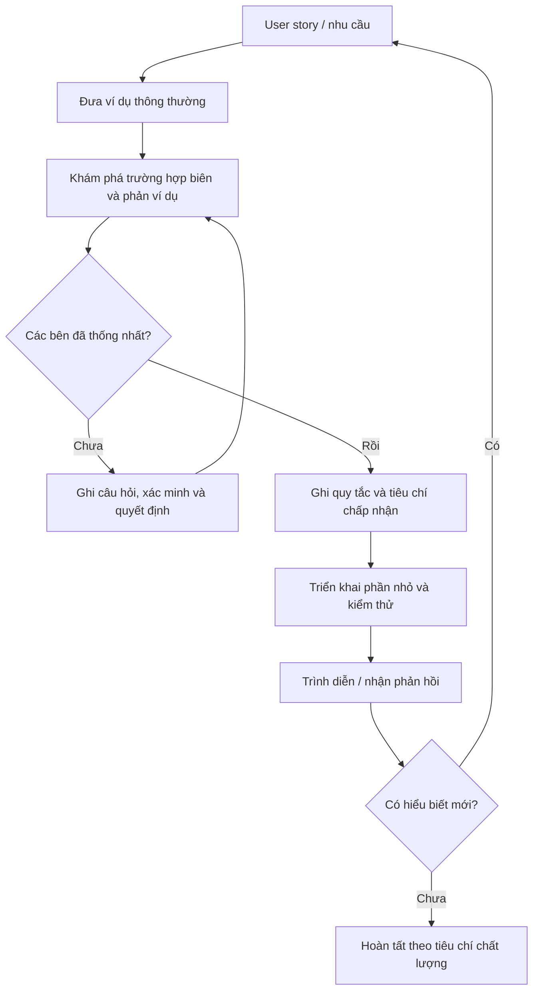

# Mô tả ví dụ cụ thể để phát hiện cách hiểu khác nhau

## Mục tiêu học tập

Sau bài học, bạn có thể:

- Giải thích vì sao một câu yêu cầu có vẻ rõ ràng vẫn có thể được khách hàng, lập trình viên và người kiểm thử hiểu theo các cách khác nhau.
- Biến các từ mơ hồ như **“đủ điều kiện”, “còn chỗ”, “ngay lập tức”, “hoàn thành”** thành những ví dụ cụ thể có đầu vào, hoàn cảnh và kết quả mong đợi.
- Tổ chức cuộc trao đổi **ba góc nhìn** (nghiệp vụ, phát triển, kiểm thử) để phát hiện các giả định chưa được thống nhất trước khi viết nhiều mã.
- Dùng **bảng ví dụ, bảng quyết định và Given–When–Then** để mô tả quy tắc nghiệp vụ, ngoại lệ và trường hợp biên.
- Chuyển các ví dụ đã được thống nhất thành **tiêu chí chấp nhận** và, khi phù hợp, kiểm thử tự động.
- Cập nhật user story và product backlog khi phát hiện cách hiểu mới, đồng thời giữ vòng phản hồi ngắn theo tinh thần Agile.

## 1. Vì sao cần ví dụ cụ thể trong yêu cầu thích ứng?

Trong phát triển phần mềm Agile, yêu cầu được làm rõ dần thông qua trao đổi và phản hồi. Một **user story** ngắn thường cho biết **ai cần điều gì và để đạt mục đích nào**; nó không thể thay thế toàn bộ cuộc thảo luận về quy tắc nghiệp vụ.

Xét yêu cầu trên một nền tảng học trực tuyến:

> “Học viên có thể ghi danh khóa học khi khóa còn chỗ.”

Các bên dễ đồng ý với câu này nhưng đang hình dung những hành vi khác nhau:

| Người tham gia | Cách hiểu có thể xuất hiện | Câu hỏi còn bỏ ngỏ |
| --- | --- | --- |
| Người phụ trách sản phẩm | Chỉ học viên đủ điều kiện mới ghi danh được, số chỗ không vượt giới hạn. | “Đủ điều kiện” bao gồm những gì? |
| Lập trình viên | Số người ghi danh phải nhỏ hơn sức chứa công bố. | Tính cả yêu cầu đang chờ duyệt hay chỉ lượt đã xác nhận? |
| Người kiểm thử | Phải kiểm tra lúc vừa đủ, lúc đã đầy và khi hai người đăng ký đồng thời. | Nếu hai yêu cầu đến cùng lúc cho chỗ cuối thì xử lý sao? |
| Người vận hành | Đăng ký trùng do người dùng bấm lại không được làm sai dữ liệu. | Gửi lại yêu cầu có tạo thêm bản ghi hoặc trừ thêm chỗ không? |
| Người học | Bấm “Ghi danh” thì biết ngay mình đã được nhận hay chưa. | Thông báo nào xuất hiện khi không thành công? |

Không bên nào nhất thiết thiếu năng lực. Vấn đề là một cụm từ như **“còn chỗ”** đang che giấu những giả định khác nhau. Nếu mỗi người tự quyết theo cách hiểu riêng, sai lệch thường chỉ lộ ra ở giai đoạn tích hợp, kiểm thử hoặc sau khi phát hành.

**Ví dụ cụ thể** là một tình huống đủ rõ để mọi người có thể trả lời cùng câu hỏi: *“Với trạng thái ban đầu này, khi xảy ra hành động này, kết quả quan sát được phải là gì?”*

Ví dụ:

> Khóa có sức chứa **2**. Đã có **1 học viên ghi danh được xác nhận**. Khi học viên Lan chưa ghi danh gửi yêu cầu trong thời gian mở đăng ký, hệ thống chấp nhận ghi danh cho Lan. Sau đó khóa có **2/2 chỗ đã được xác nhận**.

Câu này làm rõ hơn câu “khi còn chỗ”, nhưng vẫn chưa giải quyết mọi ngoại lệ. Chính những câu hỏi phát sinh từ ví dụ sẽ giúp nhóm phát hiện điều mình chưa biết.

### Ví dụ, quy tắc và kiểm thử không phải một khái niệm

- **Quy tắc nghiệp vụ (business rule):** phát biểu khái quát về hành vi phải đúng, chẳng hạn “không vượt quá sức chứa khóa học”.
- **Ví dụ (example):** một trường hợp có số liệu và hoàn cảnh cụ thể minh họa hoặc thách thức quy tắc.
- **Tiêu chí chấp nhận (acceptance criterion):** điều kiện để hạng mục được người chịu trách nhiệm sản phẩm chấp nhận, có thể được diễn đạt bằng quy tắc và ví dụ.
- **Kiểm thử (test):** hoạt động hoặc cơ chế kiểm tra hệ thống có đáp ứng hành vi kỳ vọng hay không. Một ví dụ có thể được chuyển thành kiểm thử thủ công hoặc tự động khi thích hợp.

Một quy tắc có thể cần nhiều ví dụ; một ví dụ chưa chắc thể hiện đủ mọi trạng thái. **Thống nhất ví dụ là để có cùng hiểu biết; tự động hóa chỉ là bước tiếp theo nếu mang lại giá trị.**

## 2. Từ câu chữ mơ hồ đến tình huống kiểm chứng được

Những từ khó kiểm chứng trong yêu cầu thường là dấu hiệu để hỏi thêm.

| Phát biểu mơ hồ | Điều các bên có thể hiểu khác nhau | Ví dụ hoặc thông tin cần bổ sung |
| --- | --- | --- |
| “Ghi danh nhanh” | Dưới 1 giây, dưới 5 giây hay xong trong ngày? | Với điều kiện và tải nào, người học nhận kết quả sau bao lâu? |
| “Khóa học còn chỗ” | Chỗ được tính từ lượt đã xác nhận, đăng ký chờ hay số người đang học? | Khóa có 2 chỗ, 1 xác nhận, 1 đang chờ: người mới có được đăng ký? |
| “Học viên đạt yêu cầu” | Điểm bằng ngưỡng có được tính? Có thi lại không? | Điểm 79, 80, 81 với ngưỡng 80 cho kết quả gì? |
| “Gửi thông báo ngay” | Gửi khi bắt đầu xử lý, khi lưu thành công hay khi bên nhận nhận được? | Sau khi ghi danh thành công, hệ thống phải tạo thông báo ở trạng thái nào? |
| “Chỉ người có quyền mới xem được” | Quyền theo vai trò, khóa học, tổ chức hay chủ sở hữu dữ liệu? | Giảng viên A có xem dữ liệu học viên thuộc khóa do giảng viên B phụ trách? |
| “Cho phép sửa trước hạn” | Đúng thời điểm đóng hạn còn được sửa không? Theo múi giờ nào? | Hạn 17:00 +07:00: yêu cầu lúc 16:59:59 và 17:00:00 cho kết quả gì? |
| “Hệ thống chịu tải lớn” | 100, 1.000 hay 10.000 người cùng thao tác? | Trong điều kiện tải và môi trường đã xác định, tiêu chí độ trễ/lỗi là gì? |

**Chuyển từ tính từ sang dữ kiện quan sát được**. Đừng mặc định một ngưỡng là “chuẩn Agile”. Các con số và quy tắc phải được bên có trách nhiệm nghiệp vụ thống nhất theo bối cảnh thật.

Một ví dụ tốt thường có bốn thành phần:

1. **Ngữ cảnh:** ai đang thao tác, dữ liệu và trạng thái nào đã có.
2. **Sự kiện/hành động:** điều gì xảy ra, vào thời điểm nào.
3. **Kết quả kỳ vọng:** hệ thống thay đổi hoặc trả lời ra sao, có thể quan sát bằng cách nào.
4. **Ràng buộc liên quan:** quyền truy cập, giới hạn, ngoại lệ, đồng thời, thời gian hoặc dữ liệu nhạy cảm nếu tác động đến hành vi.

Không phải mọi ví dụ đều cần dài. Chỉ thêm những chi tiết có thể thay đổi kết luận, tránh trộn thông tin trang trí làm che khuất quy tắc chính.

## 3. Ba góc nhìn để phát hiện khác biệt trước khi lập trình

Một cách làm phổ biến là trao đổi với **ba góc nhìn** thường được gọi là *Three Amigos*:

- **Nghiệp vụ/sản phẩm:** xác định vấn đề, giá trị, quy tắc và ngoại lệ; có quyền đưa ra hoặc xác nhận quyết định nghiệp vụ.
- **Phát triển:** làm rõ cách hệ thống có thể hiện thực hành vi, phụ thuộc dữ liệu/tích hợp và những giả định kỹ thuật.
- **Kiểm thử/chất lượng:** tìm trường hợp phản ví dụ, tình huống biên, rủi ro và cách quan sát hành vi đúng.

“Ba” ở đây là **ba góc nhìn**, không bắt buộc đúng ba người, ba chức danh hay một cuộc họp dài. Ở nhóm nhỏ, một người có thể đóng nhiều góc nhìn; ở trường hợp có rủi ro bảo mật hoặc dữ liệu, có thể mời chuyên gia liên quan.

### Cuộc trao đổi minh họa

**Đề bài:** “Chỉ cho phép ghi danh khi khóa còn chỗ.”

**Người phụ trách sản phẩm:** “Chỗ là số lượt ghi danh đã xác nhận. Lượt chờ duyệt chưa chiếm chỗ.”

**Lập trình viên:** “Một học viên gửi cùng yêu cầu hai lần thì có tạo hai lượt ghi danh không?”

**Người phụ trách sản phẩm:** “Không. Nếu đã ghi danh thì hiển thị trạng thái đã ghi danh.”

**Người kiểm thử:** “Nếu chỉ còn một chỗ và hai học viên gửi yêu cầu cùng thời điểm?”

**Lập trình viên:** “Phải bảo đảm chỉ một lượt được xác nhận; không thể chỉ đọc số chỗ trên giao diện.”

**Người phụ trách sản phẩm:** “Đúng. Người còn lại phải nhận thông báo hết chỗ, không hiển thị ghi danh thành công.”

**Người kiểm thử:** “Khóa đóng đăng ký lúc 17 giờ thì yêu cầu đúng 17:00:00 có được chấp nhận không? Và theo múi giờ nào?”

**Người phụ trách sản phẩm:** “Đóng từ 17:00:00 theo giờ Việt Nam. Ta ghi rõ vào quy tắc.”

Trước cuộc trao đổi, những người tham gia có thể đã tưởng mình đồng ý. Sau cuộc trao đổi, họ có **các quyết định cụ thể** và biết cần kiểm thử điều gì.

### Để cuộc trao đổi hiệu quả

1. Bắt đầu bằng **một user story hoặc lát cắt tính năng cụ thể**, không mở rộng sang mọi vấn đề sản phẩm.
2. Mời đủ góc nhìn để quyết định; giữ tập trung vào hành vi và kết quả.
3. Đưa ra một ví dụ thông thường trước, rồi hỏi “khi nào ví dụ này không còn đúng?”.
4. Ghi lại **quy tắc đã thống nhất, ví dụ minh họa và câu hỏi chưa được giải đáp**.
5. Chỉ chuyển thành tiêu chí chấp nhận sau khi người có thẩm quyền nghiệp vụ xác nhận.
6. Nếu xuất hiện vấn đề lớn hơn phạm vi user story, đưa vào backlog hoặc hẹn cách xử lý, không ép quyết định thiếu dữ liệu.

## 4. Example Mapping: quy tắc, ví dụ và câu hỏi

*Example Mapping* là một kỹ thuật thảo luận nhẹ để phân tách thông tin thành ba loại chính: **quy tắc**, **ví dụ** và **câu hỏi** (thường bắt đầu từ một user story). Những nhóm thông tin này có thể được trình bày trên thẻ hoặc trong một bảng dùng chung.

| Loại thông tin | Mục đích | Ví dụ trong bài toán ghi danh |
| --- | --- | --- |
| **User story** | Nêu giá trị cần tạo. | “Là học viên, tôi muốn ghi danh khóa đang mở để có thể bắt đầu học.” |
| **Quy tắc** | Diễn đạt hành vi chung. | “Số lượt xác nhận không vượt sức chứa.” |
| **Ví dụ** | Minh họa hoặc thử thách quy tắc bằng dữ liệu cụ thể. | “Sức chứa 2, đã xác nhận 1; Lan ghi danh thì tổng là 2.” |
| **Câu hỏi** | Phơi bày điều chưa rõ, cần một quyết định. | “Nếu hai người tranh chỗ cuối, kết quả và thông báo là gì?” |

Ví dụ minh họa bản đồ ban đầu:

```text
USER STORY: Học viên ghi danh một khóa học đang mở

QUY TẮC R1: Chỉ ghi danh khi còn chỗ
  - Ví dụ E1: sức chứa 2, đã xác nhận 1 → chấp nhận người mới
  - Ví dụ E2: sức chứa 2, đã xác nhận 2 → từ chối người mới
  - Câu hỏi Q1: đăng ký đang chờ duyệt có giữ chỗ không?

QUY TẮC R2: Không ghi danh trùng
  - Ví dụ E3: Lan đã ghi danh, gửi lại yêu cầu → không tạo thêm lượt
  - Câu hỏi Q2: trả lại bản ghi cũ hay thông báo lỗi?

QUY TẮC R3: Chỉ ghi danh trong thời gian cho phép
  - Ví dụ E4: trước hạn đóng 1 giây → có thể chấp nhận
  - Câu hỏi Q3: tại đúng thời điểm đóng và theo múi giờ nào?
```

Bản đồ này **chưa phải đặc tả đã hoàn tất**. Các câu hỏi Q1–Q3 cần được trả lời trước khi mọi người có thể hiểu và triển khai thống nhất. Câu trả lời có thể dẫn đến quy tắc mới hoặc làm thay đổi ví dụ đã viết.

### Khi bản đồ trở nên quá lớn

Nếu một user story cần quá nhiều quy tắc, ví dụ và câu hỏi để nhóm có thể thảo luận rõ ràng, đó thường là tín hiệu rằng **phạm vi cần được tách nhỏ hoặc còn quá nhiều điều chưa biết**.

Chẳng hạn, “ghi danh khóa học bất kỳ” có thể được chia thành các lát cắt:

- Ghi danh khóa **miễn phí, đang mở, không có điều kiện tiên quyết**.
- Kiểm tra **điều kiện tiên quyết** của khóa học.
- Xử lý **danh sách chờ** khi hết chỗ.
- Ghi danh khóa **có thanh toán** và xử lý trạng thái giao dịch.

Mỗi lát cắt vẫn cần có hành vi xuyên suốt và tiêu chí chất lượng phù hợp. Tách nhỏ không phải là tách UI, API, database thành những hạng mục không có giá trị độc lập.

## 5. Bài thực hành xuyên suốt: ghi danh một khóa học

Phần này minh họa cách chuyển những giả định đã thảo luận thành **bộ quy tắc và ví dụ nhất quán**. Tất cả số liệu là **giả định dành cho bài học**, không phải chính sách mặc định cho mọi nền tảng.

### 5.1. Thống nhất từ vựng

| Thuật ngữ | Định nghĩa được chọn cho ví dụ |
| --- | --- |
| **Sức chứa** | Số lượt ghi danh **đã xác nhận** tối đa của khóa. |
| **Còn chỗ** | Số lượt đã xác nhận **nhỏ hơn** sức chứa. |
| **Ghi danh trùng** | Cùng học viên gửi thêm yêu cầu cho khóa mà học viên **đã có lượt xác nhận**. |
| **Đang chờ duyệt** | Trạng thái chưa được tính vào số chỗ đã xác nhận trong ví dụ này. |
| **Thời gian mở đăng ký** | Khoảng từ **08:00 ngày 01/12/2026** (bao gồm) đến **17:00 ngày 10/12/2026** (không bao gồm), múi giờ **Asia/Ho_Chi_Minh**. |
| **Chấp nhận ghi danh** | Tạo đúng một lượt xác nhận mới và tăng số chỗ đã xác nhận lên một. |
| **Từ chối ghi danh mới** | Không tạo lượt xác nhận mới; người học thấy lý do có thể hiểu. |

Sự cụ thể này quan trọng. Ví dụ, nếu nghiệp vụ sau đó quyết định **đơn đang chờ duyệt vẫn giữ chỗ**, định nghĩa “còn chỗ” và nhiều ví dụ sẽ thay đổi theo. Nhóm cần cập nhật cả quy tắc và tiêu chí chấp nhận, thay vì sửa riêng câu kiểm thử.

### 5.2. Các quy tắc được thống nhất cho lát cắt

**R1 — Điều kiện ghi danh mới:** học viên đã xác thực, khóa còn mở đăng ký, còn chỗ và không vướng điều kiện tiên quyết khác trong phạm vi lát cắt này thì có thể ghi danh.

**R2 — Không ghi danh trùng:** nếu học viên đã có lượt ghi danh được xác nhận cho cùng khóa, gửi lại yêu cầu không tạo thêm lượt hoặc chiếm thêm chỗ; hệ thống trả thông tin trạng thái đã ghi danh.

**R3 — Không vượt sức chứa:** số lượt đã xác nhận sau bất kỳ yêu cầu nào không vượt sức chứa, kể cả khi nhiều yêu cầu đến đồng thời.

**R4 — Thời hạn rõ ràng:** thời điểm bắt đầu được tính, thời điểm kết thúc không được tính; đều được hiểu theo mốc thời gian và múi giờ đã thỏa thuận.

**R5 — Phản hồi phù hợp:** người học được thông báo thành công, đã ghi danh, hết chỗ, đóng đăng ký hoặc không đủ điều kiện tương ứng với tình huống. Nội dung và giao diện cụ thể được làm rõ trong tiêu chí trải nghiệm khi triển khai.

**Thứ tự xử lý nghiệp vụ cần lưu ý:** trường hợp học viên đã có ghi danh được xác nhận được xác định trước khi đánh giá một *ghi danh mới*. Vì vậy, người đã ghi danh bấm lại sau hạn đóng vẫn nhận trạng thái “đã ghi danh”, chứ không bị xem như đang xin một chỗ mới. Đây là **lựa chọn nghiệp vụ minh họa đã được thống nhất**, không phải quy tắc áp dụng ở mọi hệ thống.

### 5.3. Bảng ví dụ phát hiện trường hợp biên

Giả sử khóa có sức chứa **2**. “Đã xác nhận” là số lượt đã có *trước hành động*. Mỗi dòng xét một trạng thái độc lập.

| ID | Hoàn cảnh trước hành động | Hành động | Kết quả kỳ vọng |
| --- | --- | --- | --- |
| E1 | Trong giờ mở đăng ký; 0/2 lượt xác nhận; Lan chưa ghi danh. | Lan gửi yêu cầu. | Chấp nhận; sau đó 1/2. |
| E2 | Trong giờ mở đăng ký; 1/2; Lan chưa ghi danh. | Lan gửi yêu cầu. | Chấp nhận; sau đó 2/2. |
| E3 | Trong giờ mở đăng ký; 2/2; Nam chưa ghi danh. | Nam gửi yêu cầu. | Từ chối vì hết chỗ; vẫn 2/2. |
| E4 | Trong giờ mở đăng ký; 2/2; Lan đã có lượt xác nhận. | Lan gửi lại yêu cầu. | Trả trạng thái đã ghi danh; không tạo lượt mới; vẫn 2/2. |
| E5 | 08:00:00 ngày 01/12/2026, giờ Việt Nam; 1/2. | Học viên mới ghi danh. | Chấp nhận vì mốc bắt đầu được bao gồm. |
| E6 | 16:59:59 ngày 10/12/2026, giờ Việt Nam; 1/2. | Học viên mới ghi danh. | Chấp nhận nếu các điều kiện khác đúng. |
| E7 | 17:00:00 ngày 10/12/2026, giờ Việt Nam; 1/2. | Học viên mới ghi danh. | Từ chối vì đã hết thời hạn. |
| E8 | Trong giờ mở; 1/2; Lan và Nam đều chưa ghi danh. | Hai người gửi yêu cầu gần như đồng thời. | Chỉ một lượt được xác nhận; tổng tối đa 2/2; người còn lại nhận lý do hết chỗ. |
| E9 | Trong giờ mở; 1/2; người gửi chưa đăng nhập. | Gửi yêu cầu ghi danh mới. | Yêu cầu phải được xác thực phù hợp; không tạo lượt xác nhận. |

E8 là một ví dụ đặc biệt có ích: nếu chỉ kiểm tra điều kiện “còn chỗ” trong từng yêu cầu mà không kiểm soát thao tác ghi danh trên dữ liệu chung, **cả hai yêu cầu có thể cùng thấy còn một chỗ**. Ví dụ giúp nhóm phát hiện rủi ro **đồng thời (concurrency)** trước khi phát hành.

Về kỹ thuật, nhóm có thể cân nhắc ràng buộc dữ liệu, giao dịch, khóa phù hợp hoặc thao tác cập nhật nguyên tử để bảo toàn quy tắc. **Ví dụ nghiệp vụ xác định kết quả bắt buộc; lựa chọn kỹ thuật cần được đội phát triển kiểm chứng riêng.**

### 5.4. Bảng quyết định cho quy tắc ghi danh

Bảng quyết định (*decision table*) giúp tránh bỏ sót tổ hợp điều kiện. Dưới đây là bảng rút gọn, với giả định người dùng đã xác thực trừ dòng cuối.

| Đã ghi danh xác nhận? | Trong thời hạn? | Còn chỗ? | Được xác thực? | Kết quả |
| --- | --- | --- | --- | --- |
| Có | Bất kỳ | Bất kỳ | Có | Trả trạng thái đã ghi danh; không tạo lượt mới. |
| Không | Có | Có | Có | Chấp nhận ghi danh mới. |
| Không | Có | Không | Có | Từ chối: hết chỗ. |
| Không | Không | Bất kỳ | Có | Từ chối: ngoài thời hạn. |
| Bất kỳ | Bất kỳ | Bất kỳ | Không | Yêu cầu đăng nhập/xác thực; không tạo lượt. |

“Bất kỳ” là điều kiện không ảnh hưởng đến kết quả ở dòng đó. Trong sản phẩm thật, nếu **vừa hết hạn vừa hết chỗ**, nhóm vẫn phải quyết định thông điệp ưu tiên và cách tránh lộ thông tin không cần thiết; bảng trên mới mô tả kết quả chính. Quy tắc xác thực có thể được kiểm tra trước để bảo vệ dữ liệu tài khoản.

### 5.5. Diễn đạt vài ví dụ bằng Given–When–Then

Định dạng **Given–When–Then** hữu ích vì tách ngữ cảnh, hành động và kết quả. Những câu dưới đây dùng từ khóa Gherkin tiếng Anh và mô tả nghiệp vụ tiếng Việt. Chúng là **đặc tả hành vi để trao đổi**; muốn chạy tự động bằng một công cụ như Cucumber cần có các *step definitions*, dữ liệu và môi trường kiểm thử phù hợp.

```gherkin
Feature: Ghi danh khóa học miễn phí đang mở

  Scenario: Ghi danh thành công khi còn đúng một chỗ
    Given khóa "Java căn bản" có sức chứa 2
    And đã có 1 lượt ghi danh được xác nhận
    And Lan đã đăng nhập và chưa ghi danh khóa đó
    And thời điểm hiện tại nằm trong khoảng mở đăng ký
    When Lan gửi yêu cầu ghi danh
    Then hệ thống tạo 1 lượt ghi danh xác nhận cho Lan
    And tổng số lượt xác nhận của khóa là 2
    And Lan nhìn thấy thông báo ghi danh thành công

  Scenario: Học viên nhấn ghi danh lần nữa
    Given khóa "Java căn bản" có sức chứa 2 và đã đủ 2 lượt xác nhận
    And Lan đã có lượt ghi danh được xác nhận
    And Lan đã đăng nhập
    When Lan gửi lại yêu cầu ghi danh khóa đó
    Then hệ thống không tạo lượt ghi danh mới
    And tổng số lượt xác nhận của khóa vẫn là 2
    And Lan nhìn thấy trạng thái đã ghi danh

  Scenario: Từ chối ghi danh mới tại đúng thời điểm đóng
    Given khóa "Java căn bản" có sức chứa 2
    And mới có 1 lượt ghi danh được xác nhận
    And Nam đã đăng nhập và chưa ghi danh khóa đó
    And thời điểm hiện tại là 17:00:00 ngày 10/12/2026 theo giờ Việt Nam
    When Nam gửi yêu cầu ghi danh
    Then hệ thống không tạo lượt ghi danh mới
    And Nam nhìn thấy thông báo đã hết thời hạn đăng ký
```

Tránh mô tả các bước như “bấm nút màu xanh ở góc phải”, trừ khi vị trí/màu sắc là một phần thiết yếu của hành vi phải kiểm chứng. Một kịch bản nghiệp vụ nên bền trước những thay đổi giao diện không ảnh hưởng quy tắc.

## 6. Kiểm chứng trường hợp biên, phản ví dụ và xung đột

Một ví dụ “đường đi thành công” thường chưa đủ. Để phát hiện khác biệt về cách hiểu, hãy chủ động tìm **phản ví dụ**: một trường hợp cho thấy quy tắc hiện tại thiếu thông tin, dẫn đến kết quả trái kỳ vọng hoặc không nhất quán.

### 6.1. Những nhóm câu hỏi nên thử

| Nhóm trường hợp | Câu hỏi phát hiện khoảng trống |
| --- | --- |
| **Ranh giới số học** | Nếu ngưỡng là 80 điểm, **79, 80, 81** được xử lý thế nào? Giá trị thập phân có làm tròn không? |
| **Ranh giới thời gian** | Trước, đúng và sau hạn thì sao? Có múi giờ, lịch mùa hè hoặc độ trễ giữa hệ thống không? |
| **Trạng thái** | Chưa bắt đầu, đang xử lý, thành công, thất bại, đã hủy có hành vi nào khác nhau? |
| **Trùng lặp/thử lại** | Người dùng bấm hai lần, mạng gửi lại yêu cầu hoặc hệ thống xử lý lại sự kiện thì sao? |
| **Đồng thời** | Hai người thực hiện hành động tranh cùng tài nguyên hữu hạn thì kết quả nhất quán thế nào? |
| **Quyền truy cập** | Nếu người dùng chưa đăng nhập hoặc không có quyền trên dữ liệu này thì sao? |
| **Đầu vào không hợp lệ** | Thiếu dữ liệu, sai định dạng, dữ liệu quá dài hoặc giá trị không thuộc tập cho phép thì sao? |
| **Tích hợp không sẵn sàng** | Dịch vụ ngoài lỗi hoặc phản hồi muộn, người dùng thấy trạng thái gì? Có rủi ro thực hiện trùng không? |
| **Chuyển trạng thái** | Khi hủy ghi danh, chỗ được trả lại ngay hay cần xác nhận? Người đang chờ có được nhận chỗ? |
| **Bảo mật và dữ liệu** | Thông báo lỗi có lộ tài khoản người khác, trạng thái riêng tư hoặc thông tin nhạy cảm không? |

Không cần đưa **mọi tổ hợp** vào một user story. Hãy chọn trường hợp có thể thay đổi quyết định, có rủi ro cao hoặc có khả năng bị hiểu sai; chia nhỏ phần còn lại vào backlog khi phù hợp.

### 6.2. Ví dụ phát hiện hiểu nhầm nhờ ngưỡng điểm

Yêu cầu: “Học viên được cấp chứng chỉ khi đạt từ 80 điểm.”

Hai cách hiểu:

- **Cách A:** điểm chưa làm tròn phải **lớn hơn hoặc bằng 80,0**.
- **Cách B:** làm tròn điểm trước rồi so với 80.

Với điểm **79,6**, A từ chối, B có thể chấp nhận. Chỉ một ví dụ đã lộ ra quyết định cần làm rõ. Nhóm hỏi người phụ trách nghiệp vụ **quy tắc làm tròn, thang điểm, nguồn dữ liệu và thời điểm tính điểm**, rồi mới viết tiêu chí chấp nhận.

Ví dụ nhỏ này thường hiệu quả hơn nhiều trang mô tả chung “hệ thống kiểm tra điểm và cấp chứng chỉ đúng quy định”.

## 7. Từ ví dụ đã thống nhất đến tiêu chí chấp nhận và kiểm thử

Các ví dụ trong workshop chỉ có giá trị khi chúng dẫn đến **hiểu biết chung và hành động tiếp theo**.

### 7.1. Quy trình chuyển đổi



Một cách làm thực tế:

1. Viết user story cùng giá trị cần đạt.
2. Mời những góc nhìn cần thiết tạo vài ví dụ có dữ liệu cụ thể.
3. Hỏi những trường hợp đảo ngược, biên và ngoại lệ để phát hiện giả định.
4. Đánh dấu **đã quyết định** hay **cần làm rõ**; không biến câu hỏi chưa trả lời thành hành vi mặc định.
5. Ghi quy tắc và tiêu chí chấp nhận đủ để nhóm cùng triển khai.
6. Chọn các ví dụ quan trọng làm kiểm thử thủ công hoặc tự động ở cấp phù hợp.
7. Khi sản phẩm chạy được, cùng người liên quan kiểm chứng; nếu phản hồi thay đổi cách hiểu, cập nhật backlog và ví dụ.

### 7.2. Tiêu chí chấp nhận và Definition of Done

**Tiêu chí chấp nhận** trả lời: *“Hành vi của hạng mục cụ thể này phải đúng như thế nào?”* Ví dụ: “Khi khóa có 2/2 lượt xác nhận, yêu cầu ghi danh mới không tạo lượt và nhận lý do hết chỗ.”

**Definition of Done (DoD)** trả lời: *“Tiêu chuẩn chất lượng chung nào phải đạt để phần việc được coi là hoàn thành?”* Ví dụ: mã đã tích hợp, kiểm thử phù hợp đạt, tuân thủ yêu cầu bảo mật và dữ liệu, tài liệu cần thiết đã cập nhật.

Hai khái niệm bổ sung cho nhau. Một tính năng có thể vượt qua ví dụ nghiệp vụ nhưng vẫn chưa đạt DoD nếu chưa kiểm thử tích hợp quan trọng hoặc chưa bảo đảm an toàn dữ liệu.

### 7.3. Khi nào tự động hóa ví dụ?

Nên cân nhắc tự động hóa những ví dụ:

- Đại diện cho **quy tắc nghiệp vụ quan trọng**, đặc biệt quy tắc dễ bị phá khi sửa mã.
- Có **kết quả ổn định và xác định được**, ít phụ thuộc dữ liệu ngoài khó kiểm soát.
- Được chạy lại thường xuyên và mang lại tín hiệu hồi quy đáng tin cậy.
- Có thể kiểm tra ở **cấp thấp nhất phù hợp** (unit, integration, API, contract hoặc end-to-end), giảm chậm và sai lệch so với chỉ kiểm tra mọi thứ qua giao diện.

Không cần chuyển mọi thẻ ví dụ thành một bài kiểm thử UI dài. Một số ví dụ phục vụ **khám phá** hoặc hướng dẫn trao đổi và sẽ không có lợi khi tự động hóa. Số lượng kịch bản Gherkin cũng không phải thước đo chất lượng yêu cầu.

Nếu dùng Cucumber hoặc công cụ tương tự, phải nối các câu bước với mã kiểm thử (*step definitions*), chuẩn bị dữ liệu và kiểm soát môi trường. **Một tài liệu Given–When–Then chỉ là văn bản cho đến khi có cơ chế thực thi tương ứng.**

## 8. Ví dụ giúp Agile thích ứng thế nào?

Nguyên tắc Agile khuyến khích **cộng tác với khách hàng, giao sản phẩm sớm và đón nhận thay đổi**, kể cả khi hiểu biết thay đổi muộn trong quá trình phát triển. Ví dụ cụ thể giúp làm các điều đó với chi phí thấp hơn:

- **Trước khi triển khai:** khám phá khác biệt về cách hiểu, giảm công việc phải sửa vì giả định sai.
- **Trong khi triển khai:** cung cấp tiêu chí chung để người thiết kế, lập trình viên và người kiểm thử phối hợp, thay vì giải thích qua nhiều lần bàn giao.
- **Khi trình diễn phần mềm:** so sánh hành vi thật với ví dụ đã thỏa thuận và mời người dùng chỉ ra tình huống chưa bao phủ.
- **Sau khi có phản hồi:** chuyển phát hiện mới thành quy tắc hoặc ví dụ, đánh giá ưu tiên và điều chỉnh backlog.

### Scrum, Kanban và XP hỗ trợ ở đâu?

| Cách làm | Vị trí ứng dụng ví dụ cụ thể | Điều cần nhớ |
| --- | --- | --- |
| **Scrum** | Khi làm rõ Product Backlog Items, lập kế hoạch Sprint, phối hợp trong Sprint và đánh giá Increment. | Scrum không bắt buộc phải dùng Gherkin hay Example Mapping. Ví dụ hỗ trợ minh bạch và cùng hiểu mục tiêu. |
| **Kanban** | Khi chọn hạng mục sẵn sàng đưa vào luồng, làm rõ chính sách chuyển trạng thái và xử lý việc bị chặn. | Ví dụ giúp giảm việc quay lại để hỏi, nhưng vẫn phải theo dõi WIP, thời gian chờ và kết quả của dòng công việc. |
| **XP** | Khi viết kiểm thử, áp dụng TDD, tích hợp liên tục và tái cấu trúc mã. | Ví dụ nghiệp vụ làm rõ **đúng là gì**; thực hành kỹ thuật giúp duy trì đúng khi phần mềm thay đổi. |

Có thể bắt đầu từ **một câu hỏi mơ hồ và ba ví dụ rõ ràng**, không cần lập tức tổ chức một quy trình nhiều bước hay mua công cụ.

## 9. Những lỗi thường gặp khi viết ví dụ

### Lỗi 1: Viết ví dụ chỉ để chứng minh giải pháp đã chọn

**Dấu hiệu:** lập trình viên triển khai xong, sau đó mới chọn các trường hợp đã biết là chạy đúng và gọi chúng là đặc tả.

**Cải thiện:** mang ví dụ vào cuộc thảo luận **trước khi** khóa chặt thiết kế, chủ động tìm tình huống phản ví dụ. Sau phát hành, dùng phản hồi người dùng để kiểm tra giả thuyết.

### Lỗi 2: Dùng câu chữ trừu tượng trong chính ví dụ

**Dấu hiệu:** “Given khóa hợp lệ, When học viên đủ điều kiện, Then ghi danh đúng.”

Câu này chưa cho biết thế nào là hợp lệ, đủ điều kiện hoặc đúng.

**Cải thiện:** đưa vào dữ liệu có ý nghĩa: sức chứa **2**, đã xác nhận **1**, người chưa ghi danh, thời gian **trước hạn**, kết quả tổng xác nhận **2**. Nếu một thuật ngữ đã có định nghĩa chung, có thể dẫn tới định nghĩa đó thay vì lặp lại mọi chi tiết.

### Lỗi 3: Lẫn lộn quy tắc nghiệp vụ với cấu trúc kỹ thuật

**Dấu hiệu:** yêu cầu người dùng chỉ có mục tiêu “ghi danh thành công” nhưng kịch bản buộc phải gọi lớp dịch vụ tên cụ thể, truy vấn bảng có cấu trúc cố định hoặc bấm vào phần tử có CSS selector.

**Cải thiện:** diễn đạt kết quả từ góc nhìn nghiệp vụ, để đội kỹ thuật chọn cơ chế hiện thực và tầng kiểm thử phù hợp. Chỉ đưa chi tiết kỹ thuật vào yêu cầu khi đó là một ràng buộc thực sự.

### Lỗi 4: Không đánh dấu câu hỏi chưa giải đáp

**Dấu hiệu:** nhóm tự đoán quy tắc thời gian, cách làm tròn hoặc xử lý đăng ký trùng, rồi các bên tranh luận khi kiểm thử.

**Cải thiện:** quản lý câu hỏi mở, người có trách nhiệm trả lời và quyết định đã chốt. Đừng coi dự đoán của người viết mã là thỏa thuận nghiệp vụ.

### Lỗi 5: Tìm mọi tổ hợp trước khi có một lát cắt hữu dụng

**Dấu hiệu:** user story phình ra với hàng chục trường hợp chưa chắc có giá trị, khiến nhóm không có gì để trình diễn.

**Cải thiện:** bảo vệ những trường hợp bắt buộc về tính đúng đắn, an toàn và dữ liệu; tách phần còn lại thành lát cắt theo giá trị và rủi ro. Một bản nhỏ vẫn phải đáp ứng mức chất lượng cần thiết.

### Lỗi 6: Nghĩ rằng Gherkin tự bảo đảm hiểu đúng yêu cầu

**Dấu hiệu:** nhóm có nhiều kịch bản `Given–When–Then` nhưng các bên không hề trao đổi, kết quả mong đợi vẫn do một người tự viết.

**Cải thiện:** trọng tâm là **cuộc trao đổi và ví dụ được cùng xác nhận**. Gherkin chỉ là một cách ghi lại thỏa thuận.

## 10. Bài tập thực hành

### Bài tập A: Phát hiện nhiều cách hiểu

User story:

> “Là học viên, tôi muốn nhận chứng chỉ sau khi hoàn thành khóa học để chứng minh kết quả học tập.”

Yêu cầu ban đầu: **“Chứng chỉ được cấp khi học viên hoàn thành toàn bộ bài học và đạt các bài kiểm tra bắt buộc.”**

Hãy viết ít nhất **ba cách hiểu khác nhau** của hai cụm “hoàn thành bài học” và “đạt bài kiểm tra”, sau đó tạo **năm ví dụ cụ thể**: một trường hợp thành công, một trường hợp thất bại, một trường hợp ở ngưỡng điểm, một trường hợp học lại/thi lại và một trường hợp dữ liệu trạng thái chưa đồng bộ.

Gợi ý: nếu điểm tối thiểu là 80, hãy kiểm tra **79, 80 và 81**; nếu video phải xem 100%, hãy làm rõ việc xem lại, tua đến cuối và thời điểm ghi nhận tiến độ. Không tự quyết những quy tắc này nếu đề bài chưa cho biết.

### Bài tập B: Tạo bản đồ ví dụ

Với yêu cầu “chỉ học viên đã ghi danh mới được xem tài liệu riêng của khóa”, lập một bảng gồm:

- **Quy tắc:** những điều kiện nào quyết định quyền xem?
- **Ví dụ:** học viên đã ghi danh, học viên chưa ghi danh, học viên bị thu hồi quyền, giảng viên của khóa.
- **Câu hỏi:** quyền tồn tại bao lâu sau khi khóa kết thúc, tài liệu có thể được chia sẻ bên ngoài không?

Chọn một câu hỏi chưa rõ, mô tả **hai quyết định nghiệp vụ khác nhau** và chỉ ra ít nhất một kết quả phần mềm sẽ khác theo mỗi quyết định.

### Bài tập C: Viết kịch bản có thể kiểm chứng

Chọn một ví dụ từ bài tập B, diễn đạt bằng **Given–When–Then**. Kịch bản phải có ngữ cảnh, hành động và kết quả quan sát được. Chỉ ra kiểm thử nào phù hợp ở cấp API hoặc tích hợp và kiểm thử nào cần nhìn từ phía người dùng.

### Gợi ý tự đánh giá

Một ví dụ tốt giúp người đọc độc lập trả lời được:

1. Trạng thái trước hành động là gì?
2. Hành động nào được thực hiện, bởi ai?
3. Kết quả mong đợi chính xác là gì?
4. Trường hợp gần giống nào sẽ cho kết quả khác?
5. Ai đã xác nhận quy tắc và câu hỏi nào còn mở?

Nếu hai người vẫn có thể đưa ra **hai kết quả đều được xem là đúng**, ví dụ chưa đủ rõ hoặc quy tắc chưa được thống nhất.

## 11. Ghi nhớ cốt lõi

- **Từ ngữ chung không bảo đảm hiểu biết chung.** Các từ như “đủ điều kiện”, “còn chỗ”, “hoàn thành” cần được làm rõ bằng tình huống thật.
- **Ví dụ cụ thể** nối nhu cầu người dùng với hành vi quan sát được: ngữ cảnh, hành động, kết quả và ràng buộc liên quan.
- **Ba góc nhìn** nghiệp vụ, phát triển và kiểm thử giúp phát hiện giả định thiếu hoặc khác nhau khi chi phí thay đổi còn thấp.
- **Example Mapping** phân biệt quy tắc, ví dụ và câu hỏi; **bảng quyết định** cùng **Given–When–Then** giúp biểu đạt quy tắc đủ rõ để kiểm chứng.
- **Tiêu chí chấp nhận** nói về hành vi đúng của một hạng mục; **Definition of Done** nói về chất lượng chung cần đạt. Không nên đánh đồng.
- Ví dụ có thể dẫn tới kiểm thử tự động, nhưng **mục tiêu đầu tiên là cùng hiểu đúng và biết phản ứng khi có thông tin mới**.

Khi gặp một yêu cầu tưởng như rõ ràng, hãy hỏi: **“Hãy cho tôi một trường hợp có dữ liệu thật hoặc gần thật; điều gì xảy ra, và trường hợp nào chỉ khác một chi tiết nhưng phải cho kết quả khác?”** Câu hỏi này thường giúp nhóm khám phá nhiều điều trước khi phải sửa mã.

## Nguồn tham khảo

- [Manifesto for Agile Software Development](https://agilemanifesto.org/) — các giá trị về tương tác, cộng tác, phần mềm hoạt động được và phản ứng với thay đổi.
- [Principles behind the Agile Manifesto](https://agilemanifesto.org/principles.html) — các nguyên tắc giao phần mềm thường xuyên, hợp tác hằng ngày và đón nhận thay đổi.
- [The Scrum Guide (2020)](https://scrumguides.org/scrum-guide.html) — Product Backlog, Increment và Definition of Done trong Scrum.
- [Cucumber: Behaviour-Driven Development](https://cucumber.io/docs/bdd/) — trao đổi về hành vi theo ví dụ và phát triển dựa trên hành vi.
- [Cucumber: Gherkin Reference](https://cucumber.io/docs/gherkin/reference/) — cấu trúc Feature, Scenario và các bước Given, When, Then.
