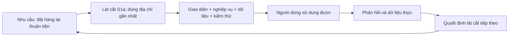

# User story như công cụ hỗ trợ trao đổi về giá trị

Một bên liên quan yêu cầu nhóm phát triển: “Hãy thêm nút **Lưu địa chỉ** ở màn hình thanh toán”. Lập trình viên có thể hoàn thành đúng chiếc nút, người kiểm thử có thể xác nhận nút hoạt động, và bảng công việc có thể chuyển sang trạng thái **Done**. Nhưng người mua vẫn phải nhập lại địa chỉ trong lần đặt hàng tiếp theo, hoặc không biết địa chỉ đã lưu có đang được sử dụng hay không.

Nếu chỉ nhìn yêu cầu như một danh sách tính năng, nhóm dễ **giao đúng thứ được yêu cầu nhưng chưa giải quyết đúng vấn đề**. User story giúp dịch cuộc trao đổi từ “xây nút gì?” sang “ai cần đạt kết quả nào, vì sao điều đó có giá trị và làm sao kiểm chứng?”. Nó là một công cụ giao tiếp trong phát triển Agile, không phải mẫu câu thần kỳ hay tài liệu đặc tả đầy đủ.

Bài học thuộc chương **User story** của mô-đun **AGILE_DEVELOPMENT**. Trọng tâm là sử dụng user story để tạo vòng phản hồi sớm, giao sản phẩm tăng dần và cải tiến liên tục, đồng thời thấy được cách story kết nối với backlog, Scrum, Kanban, XP và việc đo lường giá trị.

## 1. Mục tiêu học tập

Sau bài học, bạn có thể:

- Giải thích vì sao user story trước hết là **lời mời trao đổi và tìm hiểu nhu cầu**, không chỉ là một câu theo khuôn mẫu.
- Phân biệt **người dùng, nhu cầu, lợi ích mong đợi, giải pháp đề xuất** và **bằng chứng thành công**.
- Sử dụng ba yếu tố **Card – Conversation – Confirmation (3C)** để trao đổi và kiểm chứng một story.
- Viết một user story đủ rõ để bắt đầu thảo luận, rồi bổ sung ví dụ, câu hỏi và tiêu chí chấp nhận (*acceptance criteria*) phù hợp.
- Dùng các gợi ý **INVEST** để nhìn lại chất lượng story, chia hạng mục lớn thành những lát cắt sản phẩm có giá trị.
- Phân biệt user story với task kỹ thuật, epic, Product Backlog Item và một bản đặc tả yêu cầu chi tiết.
- Nhận diện tác động của story đến Product Backlog, Scrum/Kanban, kiểm thử và kết quả sản phẩm, tránh đánh giá thành công chỉ bằng số story hoàn tất.

## 2. Bản chất của user story

### 2.1. Một câu chuyện ngắn nhìn từ nhu cầu người sử dụng

User story là cách mô tả ngắn gọn **một nhu cầu hoặc khả năng có giá trị** từ góc nhìn của người dùng hoặc bên thụ hưởng. Cấu trúc thường gặp:

> **Là một** [vai trò/nhóm người dùng], **tôi muốn** [khả năng hoặc mục tiêu], **để** [nhận được lợi ích].

Ví dụ:

> Là một **khách hàng đã từng mua hàng**, tôi muốn **sử dụng lại địa chỉ giao hàng đã lưu** để **hoàn tất đơn tiếp theo nhanh hơn và tránh gõ sai**.

Ba phần không phải ba ô để điền cho xong. Chúng gợi ra những câu hỏi quan trọng:

| Thành phần | Câu hỏi cần làm rõ | Nguy cơ khi bỏ qua |
| --- | --- | --- |
| **Ai?** | Người nào thực sự gặp vấn đề? Người mua quay lại, người mua lần đầu hay nhân viên chăm sóc khách hàng? | Giải pháp phù hợp với người viết yêu cầu nhưng không phù hợp người sử dụng |
| **Muốn gì?** | Người dùng muốn đạt mục tiêu nào trong hành trình làm việc? | Chỉ mô tả màn hình, nút hoặc API mà không làm rõ hành vi |
| **Vì sao?** | Lợi ích nào đáng nhận được? Tiết kiệm thời gian, giảm sai sót hay minh bạch chi phí? | Nhóm xây đúng hạng mục nhưng không có lý do để ưu tiên hoặc đánh giá kết quả |

Khuôn mẫu hữu ích cho giao tiếp nhưng **không bắt buộc trong Agile hay Scrum**. Một story có thể được ghi bằng một câu, hình phác họa, ví dụ về hành vi, đoạn hội thoại hoặc định dạng khác nếu cách đó giúp nhóm hiểu nhau tốt hơn.

### 2.2. Story là lời hứa cùng trao đổi, không phải hợp đồng đầy đủ

Dòng chữ “sử dụng lại địa chỉ giao hàng” vẫn để ngỏ nhiều câu hỏi:

- Chỉ tài khoản đã đăng nhập hay cả khách vãng lai?
- Người mua lưu địa chỉ ở bước nào?
- Có thể có bao nhiêu địa chỉ? Có cần tên gợi nhớ không?
- Địa chỉ được lấy làm mặc định khi nào và có thể sửa trước khi đặt không?
- Đổi tỉnh thành thì phí vận chuyển có được tính lại?
- Nếu địa chỉ không còn hợp lệ hoặc tài khoản bị xóa thì xử lý thế nào?
- Dữ liệu địa chỉ được bảo vệ ra sao để không lộ sang tài khoản khác?
- Người dùng có nhận ra mình đang dùng địa chỉ đã lưu hay không?

**Câu story mở đầu cuộc trò chuyện; cuộc trò chuyện và ví dụ cụ thể biến nó thành sự hiểu biết chung.** Nếu chỉ chuyển một câu cho nhóm lập trình rồi mỗi người tự diễn giải, story có thể làm mơ hồ yêu cầu không khác gì một ticket đặt tên đẹp.

### 2.3. Từ giải pháp được đề xuất đến vấn đề cần giải quyết

Một yêu cầu như “thêm một checkbox nhớ địa chỉ” chứa sẵn giải pháp. Người phụ trách sản phẩm có thể hỏi:

1. Người dùng nào đang cần checkbox này?
2. Họ muốn làm điều gì mà hiện không làm được hoặc mất nhiều công sức?
3. Có bằng chứng nào: phản hồi hỗ trợ, quan sát sử dụng, số liệu bỏ dở?
4. Nếu đạt được kết quả mong muốn bằng cách khác, người dùng có còn cần đúng checkbox không?
5. Đâu là thử nghiệm nhỏ nhất giúp biết hướng này có ích?

Có thể dẫn đến story: “Là người mua quay lại, tôi muốn chọn nhanh một địa chỉ từng dùng để hoàn tất đơn không phải nhập lại thông tin”. **Nút hay checkbox chỉ là một trong nhiều phương án giao diện.**

Ngược lại, nếu sản phẩm có yêu cầu pháp lý hoặc kỹ thuật phải thể hiện một control cụ thể, vẫn phải ghi nhận ràng buộc đó. Tư duy story không có nghĩa bỏ qua những điều kiện bắt buộc.

## 3. Ba chữ C: Card, Conversation, Confirmation

Ron Jeffries thường gắn user story với ba yếu tố **Card – Conversation – Confirmation (3C)**. Cách diễn đạt này giúp nhắc rằng **văn bản ngắn chỉ là điểm bắt đầu**, còn việc trao đổi và xác nhận sự hiểu biết mới giúp nhóm xây đúng thứ có ích.

| Thành tố | Vai trò | Ví dụ |
| --- | --- | --- |
| **Card — thẻ nhắc nhớ** | Dòng mô tả ngắn đủ để gọi đúng nhu cầu và ưu tiên trong backlog | “Người mua quay lại sử dụng địa chỉ đã lưu” |
| **Conversation — trao đổi** | Những cuộc hội thoại tiếp diễn về bối cảnh, quy tắc, ngoại lệ, lựa chọn thiết kế và tác động | Product Owner, Developers, người kiểm thử và hỗ trợ khách hàng cùng làm rõ tình huống địa chỉ đã xóa |
| **Confirmation — xác nhận** | Các ví dụ/điều kiện có thể kiểm tra để xác nhận giải pháp đáp ứng nhu cầu đã thống nhất | Khi chọn địa chỉ đã lưu ở tỉnh khác, phí vận chuyển được cập nhật trước khi xác nhận thanh toán |

Ba chữ C **không bắt buộc thành ba tài liệu riêng** hoặc ba cuộc họp cố định. Chúng đại diện cho ba chức năng mà nhóm cần bảo đảm.

### 3.1. Card giữ câu chuyện ngắn, có chủ đích

Một “card” tốt đủ thông tin để người đọc nhận ra đối tượng và giá trị, đồng thời còn chỗ cho người thực hiện hỏi lại. Nó không nhất thiết ghi đủ câu trả lời cho hàng chục câu hỏi ngay từ lúc hình thành.

Ví dụ card:

> **Sử dụng địa chỉ giao hàng đã lưu**
>
> Người dùng: khách hàng có tài khoản và từng đặt hàng.
>
> Giá trị giả định: đặt hàng tiếp nhanh hơn, giảm lỗi nhập địa chỉ.

Hai dòng bên dưới giúp giữ bối cảnh nhưng vẫn chưa phải bản đặc tả hoàn chỉnh.

### 3.2. Conversation diễn ra nhiều lần, với đúng người

Trao đổi có thể bắt đầu khi khám phá vấn đề, tiếp tục trong backlog refinement, lúc triển khai hoặc ngay sau khi quan sát phản hồi thật. Những vai trò thường đóng góp khác nhau:

- **Người dùng hoặc đại diện người dùng** cho biết tác vụ, điểm đau và tiêu chí “dễ dùng”.
- **Product Owner / người chịu trách nhiệm sản phẩm** giúp xác định lợi ích, ưu tiên và ràng buộc kinh doanh.
- **Developers** làm rõ tính khả thi, tác động thiết kế, bảo mật, phụ thuộc và khả năng giao phần nhỏ.
- **Người kiểm thử/đảm bảo chất lượng** đặt câu hỏi về ngoại lệ, dữ liệu ranh giới và cách xác minh.
- **Vận hành, hỗ trợ, bảo mật hoặc pháp chế** bổ sung những rủi ro có liên quan đến hệ thống hoặc người dùng.

Trong Scrum, *Developers* là nhóm chịu trách nhiệm tạo Increment, có thể bao gồm các năng lực như kiểm thử và thiết kế; danh sách vai trò trên nói về **góc nhìn chuyên môn**, không áp đặt thêm vai trò bắt buộc vào Scrum Team.

Một phiên trao đổi hữu ích có thể chỉ 15–30 phút nếu vấn đề nhỏ, người cần thiết đã có mặt và ví dụ đủ rõ. Không có số phút chuẩn cho mọi story.

### 3.3. Confirmation kiểm chứng sự hiểu biết, không chỉ kiểm tra code

“Confirmation” thường được thể hiện qua **ví dụ về hành vi và acceptance criteria**. Nó giúp phát hiện người tham gia đang tưởng tượng những kết quả khác nhau.

Ví dụ, câu “sử dụng lại địa chỉ đã lưu” có thể bị hiểu theo hai cách:

- A: hệ thống tự đặt một địa chỉ cũ làm mặc định, người dùng không cần thao tác.
- B: hệ thống cho phép chọn trong danh sách các địa chỉ cũ, mặc định để trống.

Hai cách đều có thể phù hợp với câu story ban đầu. Một câu hỏi ngắn cùng ví dụ sẽ làm rõ lựa chọn cần thực hiện. Sau đó đội kiểm tra giải pháp thực tế theo điều đã thống nhất.

**Confirmation không chứng minh sản phẩm tạo ra giá trị ngoài đời.** Nó xác nhận cách triển khai thỏa điều kiện đã định; muốn biết người dùng có thao tác nhanh hơn hay không cần quan sát kết quả thật.

## 4. Vì sao “giá trị” là điểm tựa của cuộc trao đổi?

### 4.1. Phân biệt đầu ra, kết quả và tác động

| Khái niệm | Câu hỏi | Ví dụ |
| --- | --- | --- |
| **Output — đầu ra** | Đội đã giao thứ gì? | Màn hình chọn địa chỉ cũ và API lưu địa chỉ |
| **Outcome — kết quả** | Hành vi hoặc trải nghiệm người dùng thay đổi thế nào? | Người mua quay lại hoàn tất thanh toán nhanh hơn, ít sửa lỗi địa chỉ hơn |
| **Impact — tác động** | Giá trị dài hạn cho khách hàng/tổ chức là gì? | Người dùng tin tưởng hơn, mua lại thuận tiện, giảm chi phí hỗ trợ |

Story giúp nhóm **phát biểu một giả thuyết giá trị**; một story hoàn thành chỉ chứng minh đã giao đầu ra theo tiêu chí kỹ thuật, chưa chắc chứng minh outcome hay impact.

Ví dụ, sau khi phát hành, 70% người mua quay lại có thể sử dụng tính năng nhưng thời gian thanh toán không giảm vì bước nhập mã giảm giá vẫn gây khó khăn. Đội cần học từ kết quả và cân nhắc điều chỉnh backlog, không kết luận “story đã Done nên vấn đề đã được giải quyết”.

### 4.2. Giá trị không nhất thiết là một tính năng nhìn thấy được

Trong sản phẩm phần mềm, giá trị còn là:

- **Giảm rủi ro:** chặn truy cập trái phép vào dữ liệu địa chỉ.
- **Tăng độ tin cậy:** giảm lỗi giao dịch hoặc cải thiện phục hồi sau sự cố.
- **Khả năng tiếp cận:** người dùng bàn phím có thể hoàn tất luồng đặt hàng.
- **Khả năng vận hành:** hệ thống phát hiện nhanh lỗi tính phí bất thường.
- **Tuân thủ:** đáp ứng quy định liên quan đến lưu giữ hoặc xóa dữ liệu.
- **Khả năng thay đổi:** giảm phụ thuộc kỹ thuật khiến lần sửa tiếp theo an toàn và nhanh hơn.

Không phải hạng mục giá trị nào cũng nên ép vào câu “Là một người dùng, tôi muốn…”. Công việc kỹ thuật, sửa lỗi, thử nghiệm rủi ro hoặc nhiệm vụ bắt buộc có thể được mô tả theo cách trực tiếp hơn. Tên gọi **user story** chỉ phù hợp nếu nó giúp biểu đạt một nhu cầu thực và hướng cuộc trao đổi đến lợi ích.

### 4.3. Giá trị là giả thuyết cần học hỏi

Nếu chưa có dữ liệu, nên nói “chúng ta **giả định** lưu địa chỉ sẽ rút ngắn thời gian đặt hàng” thay vì “tính năng này chắc chắn làm tăng doanh thu”.

Nhóm có thể ghi lại:

> **Giả thuyết:** Người mua đã từng đặt hàng thường mất thời gian nhập lại địa chỉ.
>
> **Thay đổi:** Cho họ chọn một địa chỉ đã lưu một cách rõ ràng và an toàn.
>
> **Kỳ vọng:** Giảm thời gian hoàn tất phần nhập địa chỉ và số lần sửa địa chỉ.
>
> **Bằng chứng:** Quan sát tác vụ và số liệu phù hợp sau khi người dùng được tiếp cận tính năng.

Một story tốt không loại bỏ bất định. Nó **làm cho bất định có thể được trao đổi và kiểm chứng sớm**.

## 5. Ví dụ xuyên suốt: từ một yêu cầu mơ hồ đến story có thể giao

Giả sử đội sản phẩm thương mại điện tử nhận được phản hồi: “Quá phiền khi lần nào mua cũng phải nhập địa chỉ”. Đội chưa biết bao nhiêu người gặp vấn đề hoặc giải pháp chính xác là gì.

### 5.1. Bước 1 — Quan sát nhu cầu trước khi ghi story

Các câu hỏi khám phá:

- Người mua gặp khó ở bước nào: nhập địa chỉ, tìm mã bưu chính hay chọn phương thức vận chuyển?
- Vấn đề xuất hiện với khách mới, khách quay lại hay cả hai?
- Người dùng có lo ngại dữ liệu địa chỉ được lưu không?
- Bao nhiêu giao dịch bị bỏ dở ở bước nhập địa chỉ, và kết luận này đáng tin đến đâu?
- Có những yêu cầu kỹ thuật, bảo mật, dữ liệu hoặc giao diện bắt buộc nào?

Đội có thể dùng phỏng vấn ngắn, quan sát người dùng, dữ liệu hỗ trợ và phân tích hành trình. Nếu bằng chứng chưa đủ, **nghiên cứu thêm** có thể là công việc được ưu tiên thay vì lập tức xây chức năng.

### 5.2. Bước 2 — Viết card thể hiện giá trị

> **Story S1 — Chọn địa chỉ giao hàng từng sử dụng**
>
> Là người mua đã đăng nhập và từng đặt hàng, tôi muốn chọn lại địa chỉ giao hàng của mình để đặt đơn tiếp theo nhanh hơn mà vẫn kiểm soát được nơi nhận.

Câu story không cần mô tả từng thành phần UI. Những điểm còn chưa rõ sẽ chuyển sang conversation.

### 5.3. Bước 3 — Trao đổi bằng tình huống thực

| Tình huống | Câu hỏi | Kết quả cần thống nhất |
| --- | --- | --- |
| Người mua chỉ có một địa chỉ cũ | Hệ thống tự chọn hay cho người dùng xác nhận? | Cách chọn hiển thị rõ, có thể thay đổi trước khi đặt |
| Người mua có nhiều địa chỉ | Hiển thị tất cả hay một tập hợp có giới hạn? | Quy tắc hiển thị và cách chọn thuận tiện |
| Người mua thay tỉnh/thành phố | Phí vận chuyển cập nhật khi nào? | Tổng tiền được tính lại trước khi xác nhận |
| Địa chỉ không còn được hỗ trợ giao hàng | Có cho xác nhận đơn không? | Báo rõ vấn đề và hướng sửa |
| Người dùng khác đăng nhập trên cùng thiết bị | Có nhìn thấy địa chỉ tài khoản trước không? | Dữ liệu được cách ly theo tài khoản |
| Khách vãng lai | Tính năng có áp dụng không? | Chọn phạm vi phát hành ban đầu; không tự ý lưu dữ liệu cá nhân |
| Địa chỉ có ký tự đặc biệt hoặc trường dài | Hệ thống lưu/hiển thị ra sao? | Đảm bảo dữ liệu không bị cắt hoặc diễn giải sai |
| Lần phát hành đầu | Có cần quản lý, đổi tên, xóa nhiều địa chỉ ngay không? | Quyết định phần nhỏ nhất đủ dùng để học |

Chính **bảng trao đổi** này giúp nhóm khám phá yêu cầu quan trọng hơn việc hoàn thiện câu “Là…, tôi muốn…, để…” cho đẹp.

### 5.4. Bước 4 — Tách lát cắt nhỏ có thể dùng

Một phương án phát hành tăng dần:

| Lát cắt | Giá trị kiểm chứng được | Phạm vi gợi ý |
| --- | --- | --- |
| **S1a — Dùng lại một địa chỉ gần nhất** | Người mua quay lại không phải nhập lại toàn bộ địa chỉ | Hiển thị địa chỉ gần nhất, cho xác nhận hoặc sửa, tính lại phí và bảo vệ dữ liệu |
| **S1b — Chọn một trong nhiều địa chỉ** | Người mua có thể nhanh chóng chọn nơi nhận phù hợp | Danh sách địa chỉ của chính tài khoản, quy tắc lựa chọn và các trường hợp trống |
| **S1c — Quản lý địa chỉ đã lưu** | Người mua chủ động đổi tên, cập nhật, xóa địa chỉ | Chỉnh sửa, xóa, phản hồi khi địa chỉ được dùng ở đơn cũ |
| **S1d — Địa chỉ mặc định tùy chọn** | Người mua tiết kiệm thêm thao tác ở lần sau | Cấu hình mặc định rõ ràng, có thể đổi và hủy |

**S1a vẫn phải hoàn chỉnh theo chiều dọc**: có trải nghiệm sử dụng, xử lý nghiệp vụ, dữ liệu, kiểm thử và chính sách bảo mật cần thiết. “Chỉ làm giao diện trước, backend sau” có thể là cách phân công kỹ thuật, nhưng chưa tạo phần sản phẩm sử dụng được để nhận phản hồi thực tế.

Đội cũng có thể chọn thứ tự hoặc lát cắt khác dựa trên nghiên cứu; đây là ví dụ minh họa, không phải lịch trình cố định.

### 5.5. Bước 5 — Thống nhất xác nhận cho lát cắt đầu

Có thể ghi các acceptance criteria:

1. Khi khách hàng đã đăng nhập có địa chỉ hợp lệ từng dùng, hệ thống cung cấp cách chọn lại địa chỉ ấy ở luồng thanh toán.
2. Khách hàng có thể xác nhận hoặc sửa địa chỉ trước khi đặt đơn.
3. Sau khi chọn hoặc sửa địa chỉ, phí vận chuyển và tổng tiền hiển thị được tính lại đúng.
4. Không tài khoản nào có thể xem hoặc dùng địa chỉ lưu của tài khoản khác nếu không được phép.
5. Nếu địa chỉ không được hỗ trợ giao hàng, hệ thống giải thích vấn đề và ngăn xác nhận đơn với phí không hợp lệ.
6. Khách vãng lai không bị tự động lưu thông tin cá nhân khi chưa có cơ sở phù hợp.

Các tiêu chí vẫn cần làm rõ bằng ví dụ dữ liệu và chính sách sản phẩm. Điểm quan trọng là chúng **có thể kiểm chứng**, liên quan đến hành vi và rủi ro; không chỉ ghi “giao diện thân thiện” hoặc “chạy đúng”.

### 5.6. Bước 6 — Giao sản phẩm và kiểm tra giả thuyết giá trị

Sau khi phần sản phẩm đáp ứng tiêu chuẩn chất lượng, đội có thể phát hành trong phạm vi phù hợp và quan sát:

- Phần trăm người mua đủ điều kiện đã thực sự chọn lại địa chỉ.
- Thời gian hoàn tất bước địa chỉ của nhóm người dùng liên quan.
- Tỷ lệ phải sửa địa chỉ và báo lỗi giao hàng.
- Tỷ lệ hoàn tất thanh toán, lỗi tính phí hoặc sự cố quyền truy cập.
- Phản hồi định tính: dễ hiểu không, có cảm thấy kiểm soát được thông tin cá nhân không.

Các chỉ số đo phải có định nghĩa về **người dùng đủ điều kiện, mốc thời gian và phạm vi quan sát**. Không thể kết luận tính năng gây ra thay đổi chỉ từ việc số liệu tăng sau một lần phát hành; có thể cần so sánh theo nhóm phù hợp và xem yếu tố bên ngoài.

Nếu người dùng dùng tính năng nhưng trải nghiệm vẫn chậm, backlog nên được điều chỉnh theo nguyên nhân tìm thấy. **Đó mới là vòng phản hồi Agile**, thay vì coi việc đóng story là điểm kết thúc mọi cuộc trao đổi.

## 6. Acceptance criteria: từ “hiểu giống nhau” đến “kiểm chứng được”

### 6.1. Tiêu chí chấp nhận nên nói về hành vi

Có nhiều cách viết acceptance criteria. Một cách phổ biến là kịch bản **Given – When – Then**, đặc biệt hữu ích cho những quy tắc có đầu vào và kết quả rõ.

```gherkin
Feature: Sử dụng địa chỉ giao hàng đã lưu

  Scenario: Chọn địa chỉ cũ cập nhật tổng tiền
    Given khách hàng đã đăng nhập và có địa chỉ A đã lưu
    And giỏ hàng đủ điều kiện đặt
    When khách hàng chọn địa chỉ A tại bước thanh toán
    Then địa chỉ nhận hàng hiển thị là địa chỉ A
    And phí vận chuyển được tính theo địa chỉ A
    And tổng tiền xác nhận khớp với phí mới

  Scenario: Không thể truy cập địa chỉ của tài khoản khác
    Given khách hàng B đã đăng nhập
    And địa chỉ A thuộc tài khoản khác
    When khách hàng B gửi yêu cầu sử dụng địa chỉ A
    Then hệ thống từ chối yêu cầu không được phép
    And dữ liệu riêng của địa chỉ A không bị trả về
```

Các dòng là **đặc tả hành vi minh họa**, chưa phải tập test tự động chạy được trong mọi dự án. Muốn tự động hóa cần gắn với mã thực thi, fixture dữ liệu và môi trường phù hợp.

### 6.2. Tập trung vào ví dụ làm lộ sự khác biệt

Chỉ có kịch bản “happy path” chưa đủ. Hãy trao đổi những nơi dễ hiểu khác nhau:

| Loại ví dụ | Câu hỏi |
| --- | --- |
| **Điển hình** | Người mua có một địa chỉ hợp lệ; thao tác ra sao? |
| **Ranh giới** | Địa chỉ vừa bị xóa, giới hạn ký tự, thay đổi tỉnh/thành? |
| **Bất thường** | Dịch vụ phí vận chuyển tạm không phản hồi thì làm gì? |
| **Phân quyền/bảo mật** | Tài khoản khác đoán được ID của địa chỉ thì sao? |
| **Dữ liệu cũ** | Địa chỉ từ đơn hàng cũ thiếu trường mới thì xử lý thế nào? |
| **Trạng thái chuyển tiếp** | Người dùng đổi địa chỉ sau khi có báo giá vận chuyển? |
| **Trải nghiệm** | Người dùng có nhận ra địa chỉ được chọn và cách đổi không? |

Các ví dụ này không nhất thiết phải viết đủ ngay khi tạo story. Nên bổ sung đến mức **đủ để giảm rủi ro và hỗ trợ quyết định tiếp theo**, tiếp tục làm rõ khi có thông tin mới.

### 6.3. Acceptance criteria khác Definition of Done

| Nội dung | Giải quyết câu hỏi | Ví dụ |
| --- | --- | --- |
| **Acceptance criteria (AC)** | Story cụ thể phải thể hiện hành vi gì? | Khi đổi địa chỉ, phí vận chuyển được tính lại |
| **Definition of Done (DoD)** | Mức chất lượng chung nào khiến Increment được coi là hoàn thành? | Kiểm thử liên quan đạt; dữ liệu và bảo mật được kiểm tra; tích hợp an toàn |
| **Mục tiêu sản phẩm/outcome** | Vì sao nên giao và người dùng có thực sự được lợi không? | Người mua quay lại đặt hàng thuận tiện hơn |
| **Test case** | Cách thực hiện một phép kiểm chứng cụ thể? | Chuẩn bị giỏ hàng, đăng nhập, đổi địa chỉ và so sánh kết quả |

Trong **Scrum Guide 2020**, DoD là mô tả chính thức về trạng thái Increment khi đáp ứng những yêu cầu chất lượng. Scrum **không bắt buộc Product Backlog Item phải được viết dưới dạng user story** và cũng không quy định một mẫu acceptance criteria duy nhất.

Một story có thể thỏa AC nhưng chưa đạt DoD nếu bỏ qua kiểm tra phân quyền hoặc tích hợp. Ngược lại, một Increment đạt DoD về kỹ thuật chưa chứng minh outcome đã tăng; đội vẫn cần học từ người sử dụng.

## 7. INVEST: gợi ý kiểm tra story có thể trao đổi và giao giá trị

Bill Wake phổ biến bộ gợi ý **INVEST** khi xem xét chất lượng user story:

| Chữ | Ý nghĩa | Câu hỏi giúp trao đổi |
| --- | --- | --- |
| **I — Independent** | Tương đối độc lập | Có thể chọn thứ tự, phát triển và kiểm chứng mà ít phụ thuộc không cần thiết? |
| **N — Negotiable** | Có thể thương lượng | Story mở ra cuộc trao đổi về cách đạt giá trị, hay đã khóa mọi chi tiết thực hiện? |
| **V — Valuable** | Có giá trị | Người dùng/bên thụ hưởng nhận được lợi ích nào và vì sao đáng ưu tiên? |
| **E — Estimable** | Có thể ước lượng ở mức hữu ích | Nhóm đã hiểu đủ để trao đổi quy mô/rủi ro chưa? Nếu chưa, cần học gì? |
| **S — Small** | Đủ nhỏ | Có thể hoàn thành, kiểm chứng và nhận phản hồi trong một khoảng thời gian phù hợp? |
| **T — Testable** | Có thể kiểm chứng | Có ví dụ hoặc tiêu chí nào cho biết khả năng đó hoạt động đúng? |

**INVEST là gợi ý trao đổi, không phải chứng nhận chất lượng hay luật cứng.** Một story có thể cần phụ thuộc vào cơ sở dữ liệu hoặc chính sách nền tảng; không vì thế mà không được làm. Mục tiêu là nhận biết phụ thuộc và tìm cách giảm chúng nếu có thể.

### 7.1. Nhìn lại một story kém hữu ích

> “Là một developer, tôi muốn refactor toàn bộ backend để kiến trúc sạch hơn.”

Câu này có thể phản ánh nhu cầu kỹ thuật thật nhưng chưa làm rõ:

- Phần nào đang gây rủi ro hoặc chi phí thay đổi?
- Ai bị ảnh hưởng: người dùng, nhóm vận hành hay đội phát triển?
- Lợi ích kỳ vọng được kiểm chứng ra sao?
- Có thể cải thiện từng phần thay vì “toàn bộ backend” không?

Một cách ghi hạng mục trực tiếp và rõ hơn:

> **Giảm rủi ro sai phí vận chuyển:** Hiện quy tắc phí đang được sao chép ở ba đường xử lý, đã gây lỗi không nhất quán. Hợp nhất quy tắc về một thành phần có kiểm thử ranh giới để thay đổi chính sách phí mới an toàn hơn.

Đây có thể là **Product Backlog Item kỹ thuật**, không cần ép thành một user story giả tạo. Dạng mô tả nào tốt nhất là dạng giúp các bên hiểu rủi ro, giá trị và điều kiện hoàn thành.

### 7.2. “Có thể ước lượng” không đồng nghĩa phải có story point

INVEST nhắc đến *Estimable* để chỉ khả năng nhóm có đủ thông tin đánh giá quy mô/rủi ro nhằm đưa ra quyết định. Nó **không bắt buộc dùng story point**, Fibonacci hoặc velocity.

Nếu chưa thể đánh giá vì chưa biết API đối tác có hỗ trợ idempotency, có thể làm một **spike giới hạn thời gian** để kiểm tra hợp đồng API và cập nhật backlog. Khi bất định giảm, đội xem lại cách chia và ưu tiên công việc.

## 8. Chia nhỏ story nhưng giữ nguyên giá trị

Một story lớn có thể chứa nhiều hành vi, quy tắc và nhánh ngoại lệ. Nếu chia theo tầng kỹ thuật đơn thuần, mỗi phần có thể không tạo ra trải nghiệm kiểm chứng được.

### 8.1. Chia theo hành vi, quy tắc và kịch bản

| Cách chia thường hữu ích | Ví dụ cho địa chỉ giao hàng |
| --- | --- |
| **Theo kịch bản người dùng** | Dùng lại một địa chỉ → chọn trong nhiều địa chỉ → quản lý địa chỉ |
| **Theo quy tắc nghiệp vụ** | Địa chỉ trong vùng được hỗ trợ → xử lý địa chỉ ngoài vùng |
| **Theo nhóm dữ liệu có ý nghĩa** | Tài khoản có địa chỉ hợp lệ → tài khoản với địa chỉ lịch sử thiếu trường |
| **Theo hành trình hoặc công đoạn giá trị** | Chọn lại địa chỉ khi thanh toán → cập nhật địa chỉ trước khi đặt |
| **Theo mức độ phức tạp có thể hoãn** | Trường hợp thường gặp trước → ngoại lệ ít gặp khi rủi ro cho phép |
| **Theo mức độ kiểm chứng giả thuyết** | Bản đơn giản đủ đo giảm nhập lại → nâng cao khi có phản hồi thực |

Cần phân biệt **hoãn độ phức tạp tùy chọn** với **hoãn yêu cầu an toàn bắt buộc**. Không thể giao một bản cho phép đọc địa chỉ của người khác rồi nói sẽ bổ sung phân quyền ở story sau.

### 8.2. Chia ngang theo lớp kỹ thuật thường làm phản hồi chậm

Ví dụ cách chia:

- Story A: tạo bảng lưu địa chỉ.
- Story B: viết API địa chỉ.
- Story C: làm giao diện chọn địa chỉ.
- Story D: viết test cho toàn bộ tính năng.

Đây là các **task kỹ thuật** hỗ trợ phát triển, nhưng nếu mỗi phần được coi là một user story độc lập, người dùng chưa nhận được giá trị sau A hoặc B. Các thành phần có thể cần được triển khai riêng trong thực tế, song **đơn vị giao và đánh giá giá trị** nên ưu tiên một lát cắt xuyên suốt có thể sử dụng.



### 8.3. Chia nhỏ không có nghĩa mất ngữ cảnh chung

Nếu tách story thành nhiều phần, nên duy trì liên kết với **mục tiêu sản phẩm, journey hoặc epic** để tránh tối ưu cục bộ. Story nhỏ phải có lý do tồn tại và điều kiện hoàn thành; story map hoặc một sơ đồ hành trình đơn giản có thể giúp nhóm nhìn lại toàn cảnh.

## 9. Story map: tạo cuộc trao đổi về hành trình và thứ tự giá trị

**User story mapping**, được phổ biến rộng rãi bởi Jeff Patton, tổ chức các hoạt động của người dùng theo trình tự trải nghiệm và đặt các story chi tiết dưới mỗi hoạt động. Nó giúp nhóm thảo luận **điều người dùng muốn hoàn thành trọn vẹn**, không chỉ xếp một danh sách ticket.

Ví dụ hành trình đặt hàng:

| Hoạt động chính | Chọn hàng | Chuẩn bị đơn | Chọn địa chỉ | Thanh toán | Theo dõi |
| --- | --- | --- | --- | --- | --- |
| **Mục tiêu người dùng** | Tìm sản phẩm phù hợp | Kiểm tra số lượng/giá | Xác định nơi nhận | Hoàn tất giao dịch | Biết trạng thái đơn |
| **Lát cắt đầu** | Xem giỏ hàng | Sửa số lượng | Dùng địa chỉ gần nhất | Xác nhận và trả phí | Xem mã đơn |
| **Lát cắt tiếp theo** | Danh sách yêu thích | Mã ưu đãi | Nhiều địa chỉ, mặc định | Nhiều phương thức | Theo dõi theo mốc vận chuyển |

Bảng trên là minh họa giản lược, không phải bản story map hoàn chỉnh cho mọi sản phẩm. Khi mapping, đội cần mời người hiểu hành trình thật, tìm chỗ rủi ro, xác định việc tối thiểu để hoàn thành **một hành trình có ý nghĩa** và liên tục cập nhật theo điều vừa học.

**Story map không thay thế Product Backlog**, nhưng có thể giúp quyết định thứ tự backlog và làm rõ tại sao một story được chọn trước một story khác.

## 10. User story, epic, task, backlog và các tài liệu khác

Để tránh đồng nhất khái niệm:

| Thuật ngữ | Vai trò chủ yếu | Ví dụ |
| --- | --- | --- |
| **User story** | Lời mời trao đổi về một nhu cầu có giá trị từ góc nhìn người sử dụng | Dùng lại địa chỉ giao hàng để đặt hàng nhanh hơn |
| **Epic** | Nhóm công việc/mục tiêu lớn cần chia nhỏ; cách dùng từ có thể khác giữa các tổ chức | Cải thiện trải nghiệm thanh toán |
| **Task kỹ thuật** | Việc cụ thể để xây hoặc kiểm chứng một hạng mục | Thêm bảng lưu địa chỉ và test quyền truy cập |
| **Product Backlog Item (PBI)** | Hạng mục của Product Backlog trong Scrum, thuộc tập hợp công việc cần để cải thiện sản phẩm | Story người dùng, lỗi cần sửa, cải tiến nền tảng hoặc hạng mục nghiên cứu |
| **Product Backlog** | Danh sách có thứ tự, phát triển dần, gắn với Product Goal | Các PBI cho sản phẩm thanh toán, được sắp theo ưu tiên |
| **Acceptance criteria** | Điều kiện cụ thể giúp xác nhận hạng mục thỏa hành vi đã thống nhất | Đổi tỉnh thành làm phí vận chuyển cập nhật |
| **Definition of Done** | Tiêu chuẩn chất lượng chung để Increment được coi là hoàn thành | Kiểm thử và kiểm tra bảo mật liên quan đạt |

**Không phải mọi PBI đều là user story; không phải mọi story đều phải được chia thành task theo cùng một mẫu.** Trong Scrum, Product Owner chịu trách nhiệm tối đa hóa giá trị và quản lý Product Backlog hiệu quả, còn Developers chịu trách nhiệm lập kế hoạch công việc trong Sprint để tạo Increment đáp ứng DoD.

Có những tình huống mà **use case, đặc tả hợp đồng API, sơ đồ trạng thái, bảng quy tắc hoặc yêu cầu tuân thủ** cần chi tiết hơn câu story. Có thể dùng chúng để bổ sung hiểu biết, không xem chúng là “không Agile” chỉ vì không viết theo mẫu “Là…, tôi muốn…”.

## 11. Cách story kết nối với Scrum, Kanban và XP

### 11.1. Trong Scrum

- **Product Backlog:** PBI có thể được diễn đạt bằng user story nếu cách này hỗ trợ hiểu giá trị.
- **Backlog refinement:** nhóm chia nhỏ và làm rõ PBI theo nhu cầu. Refinement là hoạt động liên tục, **không phải một sự kiện Scrum bắt buộc có timebox riêng**.
- **Sprint Planning:** Developers chọn các PBI phù hợp, xây Sprint Goal và kế hoạch thực hiện. Story hỗ trợ trao đổi về điều gì có thể hoàn thành để tiến gần mục tiêu.
- **Trong Sprint:** tiếp tục trao đổi khi thấy bất định; Sprint Backlog có thể được điều chỉnh khi học thêm, nhưng thay đổi không được làm nguy hại Sprint Goal.
- **Sprint Review:** xem Increment và phản hồi để điều chỉnh hướng đi, không chỉ kiểm tra story đã tick Done.
- **Definition of Done:** đảm bảo Increment đạt tiêu chuẩn chất lượng; user story không thay thế điều kiện này.

Ví dụ Product Goal là giảm khó khăn khi người mua quay lại. Sprint Goal có thể là “giúp người mua đã đăng nhập sử dụng lại địa chỉ gần nhất trong thanh toán”. Một số PBI và task góp phần đạt mục tiêu ấy. Nếu nhóm phát hiện người dùng còn bị mắc ở bước chọn phương thức vận chuyển, Sprint Review là nơi xem xét lại kế hoạch tiếp theo.

### 11.2. Trong Kanban

Một đội quản lý công việc theo luồng liên tục có thể dùng story như **đơn vị nhu cầu có giá trị**. Bảng giúp hiển thị trạng thái, còn việc làm rõ điều kiện kéo việc, WIP limit và chính sách hoàn thành giúp giữ luồng ổn định.

Ví dụ:

```text
Options → Ready → In progress → Review → Verify → Done
                         WIP 2      WIP 2
```

Dòng trên chỉ minh họa trạng thái và giới hạn WIP, **không phải một workflow chuẩn bắt buộc**. Khi story bị chặn bởi câu hỏi nghiệp vụ, cần công khai trạng thái chờ, ai sẽ làm rõ và điều gì cho phép tiếp tục. Không nên để story ở trạng thái “đang làm” chỉ vì không ai dám hỏi Product Owner.

Có thể theo dõi **work item age, cycle time, throughput và WIP** để tìm nút thắt. Những chỉ số này đo dòng công việc, không trực tiếp đo giá trị người dùng. Việc chia story nhỏ hơn có thể khiến throughput tăng mà tổng giá trị không đổi.

### 11.3. Trong Extreme Programming (XP)

XP nhấn mạnh trao đổi gần với khách hàng và các thực hành kỹ thuật như **test-first/TDD, pair programming, tích hợp liên tục, thiết kế đơn giản, refactoring và phát hành nhỏ**. Story tạo bối cảnh nghiệp vụ cho công việc kỹ thuật; các ví dụ xác nhận giúp viết kiểm thử, còn thực hành kỹ thuật hỗ trợ đổi hướng an toàn khi phản hồi đến.

Giả sử story “dùng lại địa chỉ” dẫn đến quy tắc “mỗi tài khoản chỉ xem địa chỉ của chính mình”. Nhóm có thể:

1. Nêu ví dụ về tài khoản A/B và trường hợp truy cập trái phép.
2. Viết test đơn vị hoặc tích hợp liên quan phân quyền, tùy ranh giới cần kiểm chứng.
3. Hiện thực hành vi tối thiểu để các kiểm tra đạt.
4. Refactor cấu trúc mà giữ nguyên hành vi.
5. Tích hợp, phát hành và quan sát hành vi thật.

Nhóm vẫn cần kiểm tra rủi ro hệ thống như cách ly dữ liệu và xác thực; **unit test một hàm riêng lẻ không đủ bảo đảm an toàn toàn bộ luồng**.

## 12. Trò chuyện ba bên: biến cách hiểu riêng thành hiểu biết chung

Một thực hành hữu ích là để **sản phẩm/nghiệp vụ, phát triển và kiểm thử** cùng khám phá một story (thường gọi là *Three Amigos*). Đây là cách phối hợp thực dụng, **không phải bộ vai trò bắt buộc của Scrum**.

### 12.1. Một phiên trao đổi mẫu

**Bối cảnh:** Story “Chọn địa chỉ đã lưu” sắp được làm.

> **Sản phẩm:** “Mục tiêu là giúp người mua quay lại ít phải nhập lại thông tin. Tôi nghĩ chỉ cần địa chỉ gần nhất trong lần đầu.”
>
> **Phát triển:** “Nếu địa chỉ gần nhất nằm ở tỉnh khác, hệ thống tính lại phí trước khi xác nhận nhé? Tôi cũng cần biết khi địa chỉ không còn hợp lệ thì có cho chọn không.”
>
> **Kiểm thử:** “Tôi muốn xác nhận thêm: người dùng A có thể lấy ID địa chỉ của người dùng B qua API không? Và khi người mua chưa đăng nhập thì trạng thái nào được hiển thị?”
>
> **Sản phẩm:** “Ta chỉ phát hành cho tài khoản đã đăng nhập; người dùng chọn/sửa địa chỉ và xem lại tổng tiền. Không cho dùng địa chỉ của tài khoản khác. Tôi sẽ xác nhận quy tắc địa chỉ không hợp lệ với vận hành.”
>
> **Phát triển:** “Vậy tôi đề xuất một lát cắt chỉ hỗ trợ địa chỉ gần nhất, có kiểm tra phân quyền và cập nhật phí. Ta sẽ xem nhu cầu nhiều địa chỉ sau khi nhận phản hồi.”

Sau 15–30 phút, đầu ra có thể là story được làm rõ hơn, vài ví dụ kiểm chứng, một câu hỏi mở có người phụ trách và lựa chọn giảm phạm vi. **Chất lượng cuộc hội thoại quan trọng hơn độ dài tài liệu tạo ra.**

### 12.2. Những câu hỏi đáng mang vào refinement

- Ai đang thực hiện tác vụ, trong bối cảnh nào?
- Người dùng muốn đạt kết quả gì và vì sao?
- Giả định nào chưa có bằng chứng?
- Điều gì cho thấy giải pháp đang hoạt động đúng? Điều gì cho thấy nó có giá trị?
- Có trường hợp ranh giới, bảo mật hoặc dữ liệu nào dễ bỏ qua?
- Phạm vi nhỏ nhất vẫn tạo trải nghiệm có thể sử dụng là gì?
- Story phụ thuộc vào quyết định hoặc hệ thống nào? Ai có thể giúp gỡ?
- Nếu phản hồi bác bỏ giả thuyết, nhóm sẵn sàng đổi hướng đến đâu?

Một cuộc trao đổi thiếu người có hiểu biết cần thiết có thể kết thúc bằng danh sách câu hỏi cần xác minh. **Không nên giả vờ story đã rõ chỉ để chuyển trạng thái.**

## 13. Đo lường: story giúp học gì về giá trị?

### 13.1. Story là đơn vị trao đổi, không phải đơn vị giá trị cố định

Hai story cùng được đánh dấu Done có thể mang lại ảnh hưởng rất khác nhau: một story giảm tỷ lệ lỗi thanh toán rõ rệt, story khác chỉ thay đổi một lựa chọn hiếm người dùng. Vì vậy:

- **Story count** là số hạng mục hoàn thành theo quy ước của đội.
- **Story point**, nếu đội chọn dùng, là đơn vị ước lượng tương đối trong bối cảnh của đội.
- **Velocity**, nếu sử dụng, có thể giúp đội hiểu xu hướng lập kế hoạch trong chính bối cảnh đó.

Không có đại lượng nào trong ba số trên đo trực tiếp giá trị người dùng hoặc dùng đáng tin để so sánh năng suất giữa hai nhóm khác nhau.

### 13.2. Đo outcome gắn với giả thuyết

Ví dụ đội muốn kiểm tra việc dùng lại địa chỉ giúp hoàn tất thanh toán thuận tiện hơn:

| Câu hỏi | Tín hiệu có thể đo | Chú ý diễn giải |
| --- | --- | --- |
| Người dùng có tiếp cận và dùng tính năng? | Tỷ lệ người mua đủ điều kiện chọn địa chỉ đã lưu | Cần xác định mẫu số rõ; không lẫn khách mới vào nhóm |
| Họ có tiết kiệm thời gian? | Thời gian từ bước địa chỉ đến xác nhận đơn | Loại trừ/giải thích các luồng khác biệt; xem phân bố chứ không chỉ trung bình |
| Họ có ít sai sót? | Số lần chỉnh địa chỉ, khiếu nại giao sai | Có thể phát hiện vấn đề muộn hơn thời điểm thanh toán |
| Trải nghiệm có tốt hơn? | Hoàn thành tác vụ trong usability test, phản hồi định tính | Số người thử ít không đại diện cho mọi nhóm khách |
| Có tác dụng phụ? | Sai phí, lỗi phân quyền, tỷ lệ lỗi API, sự cố sau phát hành | Cần xem như chỉ số bảo vệ, không được đánh đổi bừa bãi |

Nếu dữ liệu chưa đủ cho kết luận định lượng, có thể dùng quan sát và phỏng vấn để giảm bất định trước. Không nên phát biểu “story làm tăng chuyển đổi” chỉ vì tỷ lệ thay đổi sau một lần phát hành; cần xét nhóm so sánh, thời điểm và các yếu tố đồng thời.

### 13.3. Đo thời gian chảy qua luồng để cải thiện việc giao

Khi nhiều story phải chờ hỏi lại yêu cầu, chờ review hay kiểm thử, đội có thể quan sát:

- **WIP:** số hạng mục đang làm tại một thời điểm theo ranh giới được chọn.
- **Cycle time:** thời gian từ lúc bắt đầu xử lý đến khi hoàn thành theo định nghĩa của đội.
- **Lead time:** thời gian từ một mốc yêu cầu/cam kết đến khi hoàn thành theo định nghĩa của hệ thống đo.
- **Throughput:** số hạng mục hoàn thành trong một khoảng thời gian.
- **Work item age:** thời gian hạng mục hiện đang xử lý đã nằm trong luồng.

Các mốc có thể khác theo tổ chức, nên công bố rõ điểm đầu/cuối trước khi so sánh. Ví dụ nếu đa số story mất 2 ngày làm và 6 ngày chờ làm rõ, **thêm lập trình viên chưa chắc giải quyết được nút thắt**; câu chuyện về giá trị và sự tham gia sớm của người có thông tin có thể quan trọng hơn.

## 14. Những nhầm lẫn thường gặp

| Nhầm lẫn | Cách hiểu đúng hơn |
| --- | --- |
| “Mọi user story bắt buộc viết theo mẫu Là… tôi muốn… để…” | Định dạng là gợi ý; điều quan trọng là hiểu nhu cầu, lợi ích và có cuộc trao đổi đủ tốt. |
| “Story là tài liệu yêu cầu đầy đủ, chỉ cần chuyển cho lập trình viên.” | Story là điểm mở đầu; conversation và confirmation cần tiếp tục trong quá trình phát triển. |
| “Chỉ cần thêm chữ ‘người dùng’ vào một task kỹ thuật là thành user story.” | Vai trò và lợi ích phải có ý nghĩa thực; nhiều việc kỹ thuật nên được mô tả trực tiếp theo rủi ro/giá trị. |
| “Story viết càng dài càng chính xác.” | Quá nhiều chi tiết sớm có thể khóa giả định; nên ghi đủ để trao đổi và kiểm chứng theo mức bất định. |
| “Story phải độc lập tuyệt đối.” | INVEST khuyến khích giảm phụ thuộc để dễ chọn thứ tự; phụ thuộc thực vẫn có và cần quản lý rõ. |
| “Mọi story đều phải có story point.” | Scrum Guide không bắt buộc story point hay khuôn mẫu user story. |
| “Nghiệp vụ đã đưa AC thì không cần tiếp tục trao đổi.” | AC phản ánh sự hiểu biết tại thời điểm đó; có thể xuất hiện rủi ro và phản hồi mới. |
| “Các story giao diện, backend, test riêng lẻ đều tạo giá trị người dùng.” | Đây thường là task kỹ thuật; nên giữ một lát cắt xuyên suốt để kiểm chứng hành vi có ích. |
| “Story Done nghĩa là người dùng đã được lợi.” | Done nói về hoàn thành theo tiêu chuẩn; giá trị cần quan sát qua outcome và phản hồi. |
| “Scrum chỉ làm việc bằng user story.” | Scrum dùng Product Backlog Item với định dạng thích hợp; user story là một kỹ thuật tùy chọn. |
| “INVEST là tiêu chí bắt buộc, phải đạt đủ sáu chữ trước khi bắt đầu.” | INVEST là công cụ phản tư; quyết định phụ thuộc mức bất định và tình huống thật. |
| “Đếm nhiều story cho thấy đội có năng suất hơn.” | Kích thước hạng mục và cách chia khác nhau; giá trị, chất lượng và dòng chảy quan trọng hơn số lượng đơn thuần. |

## 15. Một quy trình thực hành để đưa story vào công việc

Có thể bắt đầu với một tình huống người dùng và tiến dần qua các bước sau.

1. **Chọn vấn đề đáng quan tâm.** Viết một câu mô tả người dùng gặp trở ngại gì, thay vì bắt đầu từ một nút hoặc màn hình muốn xây.
2. **Tìm bằng chứng tối thiểu.** Dữ liệu sử dụng, phản hồi hỗ trợ, quan sát tác vụ, yêu cầu tuân thủ hoặc rủi ro vận hành nào cho thấy vấn đề có thật?
3. **Viết card ngắn.** Nêu ai, muốn đạt điều gì, vì sao có giá trị; gắn với mục tiêu sản phẩm khi có.
4. **Mời conversation đa góc nhìn.** Trao đổi với người hiểu nghiệp vụ, kỹ thuật, kiểm thử, vận hành hoặc người dùng liên quan; làm rõ điều còn chưa biết.
5. **Tạo confirmation.** Chọn ví dụ điển hình, ranh giới, ngoại lệ và tiêu chí chấp nhận; ghi điều chưa rõ có người chịu trách nhiệm.
6. **Chia thành lát cắt nhỏ.** Ưu tiên lát cắt có thể sử dụng/kiểm chứng; bảo đảm tiêu chuẩn chất lượng và ràng buộc bắt buộc ngay từ lần giao đầu.
7. **Đưa vào backlog và phối hợp thực hiện.** Sắp thứ tự theo giá trị, rủi ro, phụ thuộc và khả năng học; dùng Scrum, Kanban hay cách phối hợp phù hợp.
8. **Kiểm chứng hoạt động và chất lượng.** Sử dụng test, review, CI và Definition of Done nếu áp dụng; xác minh những điều đã cam kết.
9. **Quan sát outcome và cập nhật.** Đo tín hiệu người dùng, kiểm tra giả thuyết, xem tác dụng phụ và sửa thứ tự backlog theo phản hồi thật.

**Không cần biến chín bước thành một quy trình cứng cho mọi story.** Một sửa đổi nhỏ có thể làm rõ trong vài phút; một thay đổi rủi ro cao cần khám phá và kiểm chứng kỹ hơn. Mục tiêu luôn là rút ngắn vòng học mà không đánh đổi chất lượng.

### 15.1. Checklist hội thoại cho một story đang chuẩn bị làm

| Kiểm tra | Câu hỏi |
| --- | --- |
| **Giá trị** | Ai có lợi, lợi ích nào, dựa trên giả định hay bằng chứng? |
| **Ngữ cảnh** | Người dùng đang làm gì, ở thời điểm nào, với điều kiện gì? |
| **Tính nhỏ gọn** | Có lát cắt đầu nào tự nó có thể dùng và kiểm chứng? |
| **Trao đổi** | Những người cần hiểu câu chuyện đã cùng bàn chưa? |
| **Ví dụ** | Có trường hợp điển hình, ranh giới, lỗi và quyền truy cập phù hợp? |
| **Chất lượng** | Những tiêu chuẩn nào phải đạt để phần giao có thể sử dụng an toàn? |
| **Bất định** | Điều chưa biết được ghi rõ, có người xác minh và cách kiểm tra? |
| **Phản hồi** | Sau khi giao, tín hiệu nào giúp biết giả thuyết có ích hay không? |

Checklist này giúp mở thảo luận. Không nên biến nó thành biểu mẫu dài bắt buộc khiến chuyện nhỏ mất nhiều thời gian hơn giá trị mà nó tạo ra.

## 16. Bài tập áp dụng

### Bài tập 1 — Phân biệt tính năng với giá trị

Một bên liên quan nói: “Làm dashboard gồm 12 biểu đồ cho quản lý cửa hàng”.

Hãy trả lời:

1. Người quản lý cần ra **quyết định** gì và đang thiếu thông tin nào?
2. Nếu chỉ giao một biểu đồ trước, biểu đồ nào có thể giúp người quản lý thử ra quyết định thật?
3. Viết một user story thể hiện người dùng, nhu cầu và lợi ích, tránh khóa sẵn “12 biểu đồ”.
4. Nêu hai cách xác minh việc dashboard giúp ích, ngoài việc kiểm tra biểu đồ render đúng.

### Bài tập 2 — Thực hành 3C

Chọn story “Là người học, tôi muốn tiếp tục bài đang học dở để không phải tìm lại vị trí trước đó”.

- **Card:** Viết mô tả trong tối đa hai câu.
- **Conversation:** Nêu ít nhất năm câu hỏi, gồm trường hợp học trên thiết bị khác, mất kết nối và quyền truy cập.
- **Confirmation:** Viết ba ví dụ kiểm chứng hành vi, ít nhất một trường hợp ngoại lệ.
- **Giá trị:** Nêu một outcome có thể đo sau khi giao, phân biệt với số lần nhấp nút “Tiếp tục”.

### Bài tập 3 — Chia nhỏ một story

Story ban đầu: “Người dùng có thể quản lý toàn bộ thông tin giao hàng, nhiều địa chỉ, lựa chọn mặc định, lịch sử, đồng bộ đối tác vận chuyển và thông báo trạng thái”.

Hãy đề xuất **ba lát cắt theo trải nghiệm người dùng**. Với mỗi lát cắt, nói rõ giá trị, ranh giới và điều bắt buộc không được hoãn. Tránh tách thành ba nhóm “database/backend/frontend” thuần túy.

### Bài tập 4 — Story và rủi ro kỹ thuật

Đội thấy quy tắc tính phí giao hàng bị nhân bản ở ba nơi và đã gây lỗi sai tổng tiền. Có nhất thiết viết “Là một người dùng, tôi muốn đội refactor…” không? Hãy đề xuất một **Product Backlog Item kỹ thuật** rõ ràng về tác động, phạm vi nhỏ nhất và cách kiểm chứng kết quả.

### Bài tập 5 — Phân biệt AC, DoD và outcome

Với tính năng sử dụng lại địa chỉ cũ, hãy đưa ra:

1. Hai **acceptance criteria** thể hiện hành vi người mua.
2. Hai điều kiện **Definition of Done** liên quan chất lượng triển khai.
3. Hai tín hiệu **outcome** sau phát hành.
4. Một chỉ số bảo vệ giúp phát hiện tác dụng phụ.

## 17. Tóm tắt kiến thức cốt lõi

**User story là công cụ hỗ trợ đối thoại về giá trị.** Dạng câu “Là…, tôi muốn…, để…” giúp nhắc người viết về đối tượng, nhu cầu và lợi ích, nhưng không thể thay thế việc tìm hiểu vấn đề thật.

Ba chữ **Card – Conversation – Confirmation** cho thấy cấu trúc toàn diện: thẻ ngắn giữ ngữ cảnh, cuộc trao đổi tạo hiểu biết chung và ví dụ xác nhận giúp kiểm chứng hành vi. **INVEST** hỗ trợ nhìn lại sự độc lập tương đối, khả năng thương lượng, giá trị, khả năng ước lượng, kích thước và tính kiểm chứng của hạng mục, nhưng không phải bộ luật cứng.

Khi story được chia thành **lát cắt nhỏ có giá trị**, đặt vào backlog theo ưu tiên, thực hiện với chất lượng phù hợp và kiểm tra outcome sau phát hành, nhóm có thể **giao sản phẩm tăng dần, nhận phản hồi sớm và thích ứng**. Đó là mục tiêu của Agile, bất kể đội dùng Scrum, Kanban, XP hay phối hợp các thực hành theo bối cảnh.

## Tài liệu tham khảo

1. [Agile Alliance — User Stories](https://agilealliance.org/glossary/user-stories/) — khái niệm user story như mô tả nhu cầu và công cụ trao đổi trong phát triển Agile.
2. Ron Jeffries, *Card, Conversation, Confirmation* — khái niệm ba chữ C nhấn mạnh trao đổi và xác nhận thay vì chỉ viết một thẻ yêu cầu.
3. Mike Cohn, *User Stories Applied: For Agile Software Development* (2004) — vai trò, cách viết, thảo luận, ước lượng và sử dụng user story.
4. Bill Wake, *INVEST in Good Stories, and SMART Tasks* (2003) — sáu gợi ý xem xét chất lượng story.
5. Jeff Patton và Peter Economy, *User Story Mapping: Discover the Whole Story, Build the Right Product* (2014) — sử dụng bản đồ hành trình và story để tìm lát cắt sản phẩm có giá trị.
6. [Manifesto for Agile Software Development](https://agilemanifesto.org/) và [Principles behind the Agile Manifesto](https://agilemanifesto.org/principles.html) — giá trị cộng tác, phần mềm hoạt động, phản hồi và phát triển tăng dần.
7. [The Scrum Guide](https://scrumguides.org/scrum-guide.html) (2020) — Product Backlog, Product Goal, Sprint Goal, Increment, Definition of Done và các cơ chế kiểm tra/thích ứng.
