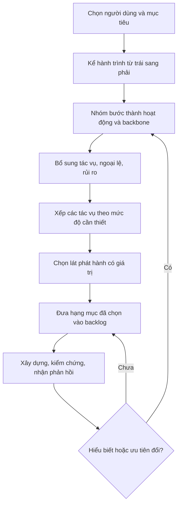
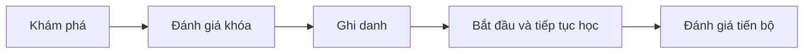

# Lập bản đồ câu chuyện để nhìn hành trình và các lát phát hành

## Mục tiêu học tập

Sau bài học này, bạn có thể:

- Giải thích **user story mapping (lập bản đồ câu chuyện người dùng)** giúp nhóm nhìn thấy hành trình sử dụng sản phẩm và các phần giá trị cần giao như thế nào.
- Phân biệt **hoạt động (activities), bước công việc (steps/tasks), user story**, **backbone** và **lát phát hành (release slices)** trên bản đồ.
- Cùng người liên quan tạo một bản đồ từ mục tiêu người dùng, sắp xếp công việc theo trình tự và mức độ quan trọng, rồi xác định phiên bản đầu tiên có thể kiểm chứng.
- Chia user story thành **lát cắt giá trị xuyên suốt** thay vì tách theo các tầng giao diện, API và cơ sở dữ liệu.
- Kết nối bản đồ với **product backlog, Sprint, Kanban, kiểm thử và phản hồi sau phát hành** mà không xem bản đồ là một kế hoạch cố định.
- Dùng một ví dụ nền tảng học trực tuyến để nhận diện phụ thuộc, lựa chọn phạm vi, kiểm soát chất lượng và đánh giá kết quả của từng lần phát hành.

## 1. Vì sao danh sách backlog chưa kể được toàn bộ câu chuyện?

Giả sử một nhóm phát triển nền tảng học trực tuyến có danh sách công việc:

- Tìm kiếm khóa học.
- Đăng nhập.
- Ghi danh.
- Thanh toán.
- Xem bài học.
- Đánh dấu hoàn thành.
- Lưu tiến độ.
- Làm bài kiểm tra.
- Cấp chứng chỉ.
- Báo cáo tiến độ học tập.

Danh sách này giúp quản lý việc cần làm, nhưng người mới nhìn vào vẫn khó trả lời:

- **Người học định thực hiện hành trình nào**, từ lúc muốn học đến lúc đạt mục tiêu?
- Những công việc nào nối tiếp nhau, công việc nào chỉ xảy ra trong tình huống ngoại lệ?
- Nếu chỉ có thể giao một phiên bản nhỏ, cần **ghép những phần nào với nhau** để người dùng hoàn thành một việc có ý nghĩa?
- Vì sao tính năng “tự động gửi email chứng chỉ” có thể ít cấp thiết hơn khả năng **bắt đầu bài học sau khi ghi danh**?
- Phần nào cần được kiểm chứng sớm vì nhóm còn nhiều giả định?

Backlog dạng danh sách có thứ tự là công cụ quan trọng để lựa chọn công việc tiếp theo. Tuy nhiên, khi chứa hàng chục hoặc hàng trăm hạng mục, **mối liên hệ giữa hạng mục và trải nghiệm tổng thể** có thể bị mất. Nếu nhóm chỉ ưu tiên từng dòng đơn lẻ, họ có thể hoàn thành nhiều chức năng riêng biệt nhưng chưa tạo ra một hành trình sử dụng được.

**User story mapping** giúp khôi phục bức tranh đó. Nhóm đặt các hoạt động của người dùng theo trình tự, xếp những bước và câu chuyện liên quan dưới mỗi hoạt động, rồi cắt phạm vi thành những **lát phát hành** có mục đích rõ ràng.

Ý tưởng được phổ biến rộng rãi bởi **Jeff Patton**. Đây là một kỹ thuật khám phá và lập kế hoạch sản phẩm dựa trên việc kể câu chuyện người dùng, không phải một biểu mẫu hoặc nghi thức bắt buộc của Scrum.

> **Câu hỏi định hướng:** Người dùng sẽ làm gì từ đầu đến cuối, và tập hợp nhỏ nhất của các hành vi nào giúp họ đạt được kết quả có thể kiểm chứng?

## 2. Cấu trúc cơ bản của bản đồ câu chuyện

Bản đồ câu chuyện có hai chiều quan trọng:

- **Từ trái sang phải:** trình tự hoạt động và các bước trong hành trình người dùng.
- **Từ trên xuống dưới:** những việc quan trọng, phổ biến hoặc cần sớm hơn thường được đặt phía trên; các lựa chọn nâng cao, ngoại lệ hoặc phần mở rộng thường nằm phía dưới. Thứ tự này cần được nhóm thỏa thuận, không phải một phép đo tự động.

Mô hình minh họa:

```text
TRÁI → PHẢI: HÀNH TRÌNH NGƯỜI HỌC

   Khám phá khóa học       Ghi danh               Học tập             Hoàn thành
   ------------------      ------------------     ------------------  ----------------
   Tìm khóa phù hợp        Ghi danh khóa mở       Xem bài đầu tiên    Xem tiến độ
   Xem nội dung khóa       Biết kết quả ghi danh  Chuyển sang bài sau Hoàn thành khóa
   Lọc theo chủ đề         Ghi danh có phí        Lưu điểm đang học   Làm bài kiểm tra
   So sánh khóa học        Danh sách chờ          Học offline         Nhận chứng chỉ
   ----------------------- LÁT PHÁT HÀNH 1: luồng cơ bản -----------------------------
   ----------------------- LÁT PHÁT HÀNH 2: tiếp tục học và đánh giá -----------------
   ----------------------- LÁT PHÁT HÀNH 3: tùy chọn nâng cao ------------------------

   (Vị trí thực tế và đường chia giữa các phần phụ thuộc vào mục tiêu từng lần phát hành.)
```

Sơ đồ chữ trên giới thiệu các thành phần; **không có nghĩa tất cả hạng mục ở cùng một hàng đều thuộc cùng bản phát hành**. Khi làm workshop, nhóm đặt thẻ theo hoạt động, sắp ưu tiên dưới từng hoạt động và vẽ các đường chia để cho thấy tập hợp công việc thuộc từng phiên bản.

### 2.1. Các thành phần cần phân biệt

| Thành phần | Ý nghĩa | Ví dụ trong nền tảng học |
| --- | --- | --- |
| **Người dùng/ngữ cảnh** | Ai đang thực hiện hành trình và vì sao? | Học viên mới muốn học Java cơ bản. |
| **Mục tiêu/kết quả** | Người dùng muốn đạt được điều gì, tổ chức muốn kiểm chứng điều gì? | Tìm khóa phù hợp, ghi danh và bắt đầu học mà không cần hỗ trợ thủ công. |
| **Hoạt động (activity)** | Một phần lớn của hành trình, thường dùng để tạo khung tổng thể. | Khám phá khóa học, ghi danh, học tập, hoàn thành. |
| **Bước/tác vụ người dùng (task)** | Hành động cụ thể trong một hoạt động. | Xem mô tả khóa; xác nhận ghi danh; mở bài đầu tiên. |
| **User story hoặc hạng mục chi tiết** | Phần giá trị cần triển khai và kiểm chứng; thường nằm dưới tác vụ tương ứng. | Học viên xem được điều kiện tiên quyết trước khi ghi danh. |
| **Backbone** | Chuỗi hoạt động/bước cấp cao ở phía trên, giúp giữ mạch kể chuyện. | Khám phá → Quyết định → Ghi danh → Học → Đánh giá. |
| **Lát phát hành (release slice)** | Nhóm hạng mục được chọn cho một lần đưa giá trị tới người dùng hoặc thử nghiệm. | Bản đầu cho phép tìm, ghi danh khóa miễn phí và bắt đầu bài học. |

Các từ **activity, task, story** có thể được dùng ở mức chi tiết hơi khác nhau trong từng đội. Điều quan trọng là nhóm thống nhất ý nghĩa và **giữ được kết nối giữa việc nhỏ với hành trình lớn**, không phải ép mọi thẻ vào một hệ phân cấp cứng nhắc.

### 2.2. Bản đồ không đồng nghĩa một danh sách tính năng có nhiều cột

Nếu chỉ chia backlog thành cột “Frontend”, “Backend”, “QA”, đó là cách phân chia theo chuyên môn. Nó chưa cho thấy người dùng làm gì và không giúp quyết định phiên bản nhỏ nhất có giá trị.

Một bản đồ câu chuyện cần được xây quanh **hành vi người dùng hoặc luồng giá trị**. Hạng mục kỹ thuật vẫn cần tồn tại, nhưng nên được nối với câu chuyện, rủi ro hoặc năng lực sản phẩm mà chúng phục vụ.

## 3. Phân biệt user story map với các công cụ liên quan

Các công cụ sau có thể bổ sung cho nhau; không công cụ nào thay hoàn toàn công cụ khác.

| Công cụ | Câu hỏi chính | Điểm khác biệt |
| --- | --- | --- |
| **User story** | Ai muốn điều gì để đạt lợi ích gì? | Là một đơn vị mô tả nhu cầu; không cho thấy toàn bộ hành trình. |
| **Product backlog** | Những việc nào được xem xét và sắp thứ tự để cải thiện sản phẩm? | Danh sách động có thứ tự ưu tiên và thông tin cần để thực hiện. |
| **User story map** | Người dùng đi qua hành trình nào, và nên giao từng phần giá trị nào? | Thể hiện **quan hệ theo hành trình** và **lát phát hành** cùng lúc. |
| **User journey map** | Trải nghiệm người dùng qua các điểm chạm, suy nghĩ và cảm xúc ra sao? | Thường mô tả trải nghiệm hiện tại/đích, đau điểm và cảm xúc; không nhất thiết chia backlog thành lần phát hành. |
| **Roadmap sản phẩm** | Sản phẩm sẽ theo đuổi mục tiêu hoặc hướng phát triển nào theo thời gian? | Truyền đạt định hướng/đầu tư; không liệt kê đầy đủ các bước của hành trình. |
| **Sơ đồ quy trình nghiệp vụ** | Quy trình có bước, điều kiện rẽ nhánh và tác nhân nào? | Có thể mô tả luồng nghiệp vụ rất chính xác, nhưng không tự quyết định độ ưu tiên và phạm vi phát hành. |

Story map có thể là **đầu vào giúp tinh chỉnh backlog**: sau khi chọn lát phát hành, các user story tương ứng được làm rõ, ước lượng hoặc chia nhỏ thêm trong công cụ quản lý công việc. Không nhất thiết duy trì hai bản ghi chi tiết trùng nhau; nhóm nên có cách liên kết hoặc đối chiếu rõ ràng.

## 4. Chuẩn bị workshop: chọn đúng người, đúng hành trình

Bản đồ hữu ích nhất khi được **cùng xây dựng** bởi những người có góc nhìn cần thiết. Một người có thể phác thảo trước, nhưng bản đồ chỉ thật sự phát hiện giả định sai khi có trao đổi giữa người hiểu nghiệp vụ, người xây sản phẩm và người kiểm chứng chất lượng.

### 4.1. Làm rõ mục đích trước khi dán thẻ

Trước khi bắt đầu, người điều phối nên giúp nhóm trả lời:

1. **Ai là người dùng chính?** Người học mới, người học quay lại, giảng viên hay quản trị viên?
2. **Họ muốn đạt kết quả nào?** Ví dụ: có thể tự tìm, ghi danh và bắt đầu một khóa học.
3. **Ta xét hành trình nào?** Chỉ từ khám phá đến bắt đầu học, hay cả quá trình hoàn thành và nhận chứng chỉ?
4. **Đây là quy trình hiện tại hay trải nghiệm muốn tạo?** Đừng trộn hai loại nếu không đánh dấu.
5. **Điều gì cần quyết định sau workshop?** Chọn MVP, xác định rủi ro, chuẩn bị release plan hoặc làm rõ backlog?

Nên chọn **một người dùng và một mục tiêu cụ thể** cho lần lập bản đồ đầu. Nếu trộn hành trình học viên, giảng viên và quản trị viên vào một bản đồ lớn, các bước và thứ tự có thể trở nên khó hiểu. Các vai trò có thể được thể hiện bằng làn riêng hoặc bản đồ khác khi cần.

### 4.2. Thành phần tham gia và vai trò

| Góc nhìn | Đóng góp | Câu hỏi nên đặt |
| --- | --- | --- |
| Người phụ trách sản phẩm/nghiệp vụ | Mục tiêu, giá trị, chính sách và ưu tiên. | Người dùng thực sự cần kết quả gì? |
| Người dùng đại diện hoặc người hiểu người dùng | Hành vi, khó khăn, ngữ cảnh thực tế. | Bước nào đang khó hiểu hoặc dễ bị bỏ dở? |
| Thiết kế trải nghiệm | Hành trình, thông tin, khả năng tiếp cận. | Người dùng cần biết gì để đi bước tiếp theo? |
| Phát triển | Giải pháp khả thi, tích hợp, phụ thuộc và độ bất định kỹ thuật. | Có thể làm một lát cắt xuyên suốt nào trước? |
| Kiểm thử/chất lượng | Ngoại lệ, dữ liệu biên, cách kiểm chứng. | Khi nào hành vi bị coi là sai? |
| Vận hành, bảo mật hoặc chuyên gia khác khi cần | Yêu cầu bắt buộc và rủi ro ngoài luồng chính. | Ràng buộc nào phải có ngay trong bản đầu? |

Không cần triệu tập tất cả bộ phận vào mọi buổi làm việc. Nhóm nhỏ có đủ góc nhìn và **quyền quyết định phù hợp** thường hiệu quả hơn một cuộc họp đông nhưng không thể chốt phạm vi.

### 4.3. Công cụ tối thiểu

Giấy lớn và thẻ giấy, bảng trắng hay công cụ trực tuyến đều phù hợp. Cần có không gian **xếp thẻ theo hai chiều**, cho phép di chuyển và vẽ đường phân cách. Công cụ không tạo ra sự thấu hiểu thay cho việc kể câu chuyện và trao đổi.

## 5. Sáu bước lập bản đồ câu chuyện

### Bước 1: Kể hành trình từ đầu đến cuối

Bắt đầu bằng câu đơn giản: “Người dùng muốn đạt mục tiêu X. Họ làm gì trước, tiếp theo và sau đó?”. Người điều phối ghi các hành vi theo trình tự, ưu tiên dùng **động từ và danh từ**: “tìm khóa”, “xem thông tin”, “ghi danh”, “mở bài học”.

Tránh bắt đầu bằng “phải có microservice tìm kiếm”, “xây database khóa học” hoặc “thiết kế trang chủ”. Chúng là khả năng/giải pháp kỹ thuật, chưa phải hành vi người dùng.

### Bước 2: Gom các bước thành hoạt động và tạo backbone

Nhóm gom những bước liên quan thành hoạt động lớn. Với người học: **Khám phá → Chọn khóa → Ghi danh → Học → Hoàn thành**. Đây là khung kể chuyện từ trái sang phải. Một số bước có thể lặp lại hoặc rẽ nhánh; story map không buộc mọi hành trình phải là một đường thẳng duy nhất.

Ví dụ: người học có thể tìm nhiều khóa, xem mô tả rồi quay lại tìm kiếm. Nhóm ghi đường đi phổ biến trước, sau đó bổ sung luồng thay thế quan trọng.

### Bước 3: Đi sâu vào mỗi hoạt động và tìm trường hợp khác nhau

Dưới “Ghi danh”, thêm những tác vụ như:

- Xem điều kiện tham gia.
- Chọn ghi danh khóa miễn phí.
- Nhận thông báo thành công.
- Xử lý khi khóa đã đầy.
- Thanh toán với khóa có phí.
- Xử lý yêu cầu gửi trùng.

Kể **một ngày trong đời người dùng** hoặc đi qua các câu hỏi “Nếu… thì sao?” để nhìn thấy tác vụ bị thiếu. Có thể dùng ví dụ cụ thể và thảo luận ba góc nhìn nghiệp vụ – phát triển – kiểm thử khi quy tắc chưa rõ.

### Bước 4: Xếp chiều dọc theo mức độ cần thiết

Tại mỗi hoạt động, đặt các bước cần để hành trình cơ bản hoạt động lên trên; các lựa chọn mở rộng, tối ưu hoặc trường hợp có thể hoãn xuống dưới. Xếp hạng dựa trên **mục tiêu, tần suất, rủi ro, tính bắt buộc và kiến thức cần kiểm chứng**.

Đây không phải lời khuyên loại bỏ trường hợp lỗi, bảo mật hoặc chất lượng ở bản đầu. Một yêu cầu an toàn hoặc dữ liệu bắt buộc phải có **ngay trong lát đầu tương ứng** dù người dùng không “nhìn thấy” nó như một tính năng riêng.

### Bước 5: Vẽ lát phát hành theo mục tiêu

Chọn một **đường cắt ngang** để thể hiện phần giá trị sẽ làm trong lần giao đầu. Đi qua bản đồ từ trái sang phải và hỏi:

- Người học có thể đi từ ý định đến kết quả có ý nghĩa chưa?
- Ta có thể kiểm chứng giả thuyết quan trọng nào từ phiên bản này?
- Có bước thiết yếu nào đang thiếu khiến hành trình bị đứt?
- Có phần nào chưa cần cho phiên bản này và có thể đưa xuống lát sau?
- Phụ thuộc kỹ thuật, pháp lý, dữ liệu và vận hành nào là điều kiện bắt buộc?

Tiếp tục chia các lát tiếp theo dựa trên **mục tiêu riêng và kiến thức mới**. Những đường cắt là lựa chọn tại thời điểm hiện tại, có thể thay đổi sau phản hồi.

### Bước 6: Chuyển lát đã chọn thành backlog có thể thực hiện

Với hạng mục thuộc lát đầu, nhóm làm rõ giá trị, ví dụ, tiêu chí chấp nhận, phụ thuộc và cách kiểm chứng. Hạng mục quá lớn tiếp tục được **tách thành các phần có thể hoàn thành**. Product backlog sẽ được sắp thứ tự dựa trên mục tiêu sản phẩm và phát hiện mới; story map giữ bức tranh để nhóm không quên hành trình.



## 6. Ví dụ xuyên suốt: bản đồ cho nền tảng học trực tuyến

Giả định một đội phát triển sản phẩm **học Java cho người mới**.

- **Người dùng chính:** học viên tự học, chưa quen nền tảng.
- **Mục tiêu người học:** tìm một khóa phù hợp, ghi danh và bắt đầu học được; sau đó có thể tiếp tục học và kiểm chứng tiến bộ.
- **Mục tiêu sản phẩm ban đầu:** giúp học viên mới tự đi từ khám phá tới bài học đầu tiên với ít trở ngại.
- **Giả định cần kiểm chứng:** người học hiểu mô tả khóa, biết cách ghi danh và dễ bắt đầu học mà không cần nhân viên hướng dẫn.

### 6.1. Dựng backbone



Backbone này có góc nhìn **học viên**. Một bản đồ riêng cho giảng viên tạo khóa, hay quản trị viên duyệt nội dung, có thể được xây sau nếu đó là luồng quyết định trọng yếu.

### 6.2. Thêm các bước công việc

| Hoạt động | Hành vi thường gặp và cần sớm | Hành vi mở rộng hoặc tình huống khác |
| --- | --- | --- |
| **Khám phá** | Xem danh mục; tìm khóa Java nhập môn. | Lọc theo cấp độ; lưu khóa yêu thích; nhận gợi ý cá nhân. |
| **Đánh giá khóa** | Xem nội dung chính, đối tượng phù hợp, thời lượng. | So sánh các khóa; đọc đánh giá; học thử một số bài. |
| **Ghi danh** | Đăng nhập/xác thực phù hợp; ghi danh khóa miễn phí; biết kết quả. | Thanh toán khóa có phí; mã giảm giá; danh sách chờ. |
| **Bắt đầu và tiếp tục học** | Mở bài đầu tiên; điều hướng bài tiếp theo. | Lưu vị trí; tiếp tục trên thiết bị khác; tải bài ngoại tuyến. |
| **Đánh giá tiến bộ** | Biết mình đã bắt đầu học; thấy bài đã hoàn thành theo quy tắc đơn giản. | Bài kiểm tra, điểm số, thống kê chi tiết, chứng chỉ. |

Bảng cho thấy **những việc có thể làm**. Nó chưa tự quyết việc nào nằm trong bản phát hành đầu. Nhóm phải chọn theo mục tiêu và giới hạn thực tế.

### 6.3. Chọn lát phát hành 1: tự ghi danh và bắt đầu học

**Mục tiêu lát 1:** một học viên mới có thể tìm khóa Java miễn phí, xem đủ thông tin để quyết định, ghi danh hợp lệ và mở bài đầu tiên.

| Hoạt động | Phạm vi nằm trong lát 1 | Tạm để sau |
| --- | --- | --- |
| Khám phá | Xem danh sách các khóa đang mở và chọn một khóa. | Tìm kiếm nâng cao, cá nhân hóa gợi ý. |
| Đánh giá khóa | Xem mô tả, nội dung chính, điều kiện tham gia. | So sánh nhiều khóa, nhận xét cộng đồng. |
| Ghi danh | Xác thực phù hợp, ghi danh khóa miễn phí, ngăn ghi danh trùng và thông báo trạng thái. | Thanh toán, mã giảm giá, danh sách chờ. |
| Học tập | Mở bài đầu tiên sau khi ghi danh; điều hướng cơ bản. | Đồng bộ vị trí nhiều thiết bị, học ngoại tuyến. |
| Đánh giá tiến bộ | Chưa cần hệ thống đánh giá toàn khóa; trạng thái truy cập bài phải nhất quán. | Điểm số, chứng chỉ, thống kê tiến độ. |

Lát 1 **không phải toàn bộ sản phẩm “hoàn chỉnh”**. Nó là một **kết quả xuyên suốt** có thể đưa tới người dùng thử để kiểm chứng giả định. Tuy nhiên, mọi việc nằm trong lát 1 vẫn phải đạt mức chất lượng cần thiết: quyền truy cập đúng, dữ liệu nhất quán, kiểm thử luồng chính và lỗi, khả năng vận hành thích hợp.

**Ví dụ tiêu chí đánh giá kết quả:** người học có thể tự hoàn tất ghi danh và bắt đầu bài trong một phiên sử dụng; tỷ lệ ghi danh thành công, tỷ lệ mở bài đầu và số trường hợp cần hỗ trợ cho thấy hành trình có đang hoạt động tốt không. Các ngưỡng chấp nhận phải dựa trên bối cảnh, không tự mặc định từ ví dụ này.

### 6.4. Lát phát hành 2: quay lại học và nhìn thấy tiến bộ

**Mục tiêu lát 2:** người học đang học dở có thể quay lại đúng nội dung và biết phần mình đã hoàn thành.

| Hoạt động | Phần được bổ sung hoặc cải thiện |
| --- | --- |
| Khám phá/Đánh giá | Không cần thêm tính năng nếu dữ liệu cho thấy hành trình hiện tại đã đủ cho mục tiêu lần này. |
| Ghi danh | Hiển thị các khóa đã ghi danh trong khu vực học của tôi. |
| Học tập | Lưu trạng thái bài đã học; “Tiếp tục học” tại bài chưa hoàn tất; xử lý khi người học quay lại. |
| Đánh giá tiến bộ | Hiển thị phần đã hoàn thành và bước học tiếp theo theo quy tắc đã thống nhất. |

Phần này tạo giá trị riêng cho người dùng cũ, không chỉ “thêm trường dữ liệu tiến độ”. Nhóm có thể thử xem tính năng này có tăng tỷ lệ quay lại và giảm thời gian tìm bài đang dở hay không.

### 6.5. Lát phát hành 3: kiểm chứng kết quả học tập và mở rộng mô hình

**Mục tiêu có thể chọn cho lát 3:** cho phép học viên làm bài kiểm tra và nhận phản hồi có ý nghĩa về kết quả học tập. Các khả năng khác như **chứng chỉ** hoặc **thanh toán** chỉ nên được đưa vào cùng lát này nếu chúng phục vụ một mục tiêu cụ thể và có đủ năng lực thực hiện.

| Hạng mục có thể xem xét | Câu hỏi trước khi đưa vào lát 3 |
| --- | --- |
| Bài kiểm tra cuối chương | Có cần để học viên biết mình nắm kiến thức đến đâu? Quy tắc đạt là gì? |
| Phản hồi câu trả lời | Người học cần giải thích lỗi ở mức nào để tiếp tục học? |
| Chứng chỉ hoàn thành | Khách hàng có giá trị thực tế từ chứng chỉ hay chỉ là ý tưởng chưa kiểm chứng? |
| Khóa học có phí | Đã sẵn sàng xử lý giao dịch, hoàn tiền và quyền truy cập an toàn chưa? |
| Báo cáo cho giảng viên | Ai sử dụng, ra quyết định gì từ báo cáo và có cần trong hành trình hiện tại không? |

Lát 3 là **ứng viên**, chưa phải một cam kết cố định. Khi đã có dữ liệu từ lát 1 và lát 2, nhóm có thể đổi thứ tự, tách thêm một lát hoặc bỏ hạng mục không còn phù hợp.

### 6.6. Đọc toàn bộ các lát theo bức tranh sản phẩm

| Kết quả/cột hành trình | Khám phá | Đánh giá | Ghi danh | Học tập | Tiến bộ |
| --- | --- | --- | --- | --- | --- |
| **Lát 1 — Bắt đầu học** | Danh sách khóa | Thông tin tối thiểu | Ghi danh miễn phí | Bài đầu tiên | Trạng thái truy cập |
| **Lát 2 — Quay lại học** | Giữ luồng hiện có | Giữ luồng hiện có | Khóa của tôi | Tiếp tục bài dở | Tiến độ cơ bản |
| **Lát 3 — Đánh giá học tập (dự kiến)** | Tùy phản hồi | Tùy phản hồi | Giữ nghiệp vụ cần thiết | Bài kiểm tra | Kết quả, phản hồi |

Bảng này thể hiện cách một bản đồ có thể được **cắt ngang thành các nhóm giá trị**. Những ô “giữ luồng hiện có” nghĩa là tái sử dụng năng lực đã tạo trước đó, không phải xây lại từ đầu. Các lát là **phạm vi giá trị tích lũy** theo hành trình, chứ không phải các bộ tính năng tách biệt và không liên quan.

## 7. Lát phát hành khác gì một story hoặc một Sprint?

Ba mức thường bị nhầm:

| Mức | Nội dung | Ví dụ |
| --- | --- | --- |
| **User story / Product Backlog Item** | Một hạng mục giá trị có thể làm rõ, triển khai và kiểm chứng. | Học viên đã ghi danh mở được bài đầu tiên. |
| **Lát phát hành** | Tập hợp các hạng mục tạo thành kết quả lớn hơn để thử nghiệm hoặc giao cho người dùng. | Tìm khóa → xem thông tin → ghi danh → mở bài đầu. |
| **Sprint (nếu dùng Scrum)** | Khoảng thời gian cố định mà Scrum Team hướng tới Sprint Goal và tạo một hoặc nhiều Increment hữu dụng. | Sprint tập trung tạo luồng ghi danh cơ bản đáp ứng DoD. |

**Một lát phát hành không nhất thiết trùng một Sprint.** Một Sprint có thể tạo Increment hữu dụng phục vụ một phần của mục tiêu phát hành; nhiều Sprint có thể góp phần vào một lát, và một lát nhỏ cũng có thể phát hành sớm hơn kế hoạch nếu điều kiện phù hợp. Trong Scrum, **Sprint Review không phải cổng phê duyệt bắt buộc để phát hành**; quyết định phát hành dựa trên sản phẩm và chính sách liên quan.

Cũng không nên dùng lát phát hành như một cam kết thời gian chính xác chỉ dựa vào việc vẽ đường trên bảng. Cần cân nhắc năng lực, phụ thuộc, độ bất định, chất lượng và phản hồi thực tế.

### 7.1. MVP, bản thử nghiệm và walking skeleton

Các thuật ngữ liên quan nhưng không giống nhau:

- **MVP (Minimum Viable Product):** phiên bản đủ để kiểm chứng một giả thuyết có giá trị với đối tượng phù hợp. MVP có thể bao gồm phần mềm, hoặc thử nghiệm có phạm vi hẹp tùy câu hỏi cần học.
- **Walking skeleton:** một lát kỹ thuật tối thiểu đi qua các lớp tích hợp chính để kiểm tra khả năng xây dựng và vận hành đường đi xuyên suốt. Nó có thể rất ít chức năng nghiệp vụ.
- **Bản phát hành dùng được:** tập hợp chức năng đạt mức chất lượng và điều kiện cần để đối tượng dự kiến có thể sử dụng.

Walking skeleton giúp phát hiện rủi ro tích hợp, nhưng **chưa chắc đã là MVP có giá trị với người dùng**. Một bản thử nghiệm MVP cũng không có nghĩa bỏ tiêu chuẩn bảo mật hay xử lý dữ liệu. Hãy chọn thuật ngữ theo mục tiêu kiểm chứng và mức sẵn sàng thực tế.

## 8. Chia lát dọc: giao hành vi hoàn chỉnh thay vì hoàn thành từng tầng

Giả sử nhóm chọn user story “Học viên ghi danh một khóa miễn phí”.

Cách chia theo **tầng kỹ thuật**:

- Thiết kế cơ sở dữ liệu ghi danh.
- Xây API ghi danh.
- Xây màn hình ghi danh.
- Viết kiểm thử.
- Tích hợp cuối giai đoạn.

Những tác vụ này có thể cần để triển khai, nhưng **không nên được nhầm với các lát giá trị độc lập**. Sau khi xong cơ sở dữ liệu và API, học viên có thể vẫn chưa thực hiện được điều gì.

Cách chia theo **lát dọc**:

1. Người học ghi danh thành công một khóa **miễn phí, còn mở, còn chỗ**, hệ thống lưu đúng và hiển thị kết quả.
2. Người học đã ghi danh bấm lại **không tạo bản ghi trùng**.
3. Người học không đủ điều kiện **nhận thông báo lý do phù hợp**.
4. Người học có thể đăng ký khóa **có điều kiện tiên quyết** khi quy tắc đã rõ.
5. Người học đăng ký khóa **có phí** thông qua luồng thanh toán an toàn khi sản phẩm cần.

Mỗi lát mang **hành vi nghiệp vụ có thể kiểm chứng** và có thể đi qua giao diện, API, dữ liệu, kiểm thử. Những lát đầu vẫn phải xử lý tối thiểu các lỗi, an toàn và ràng buộc bắt buộc của phạm vi đã chọn. Không thể dựa vào việc “sẽ làm bảo mật ở lát sau” để bỏ qua kiểm soát cần thiết ở lát hiện tại.

### 8.1. Từ bản đồ đến tiêu chí chấp nhận

Ví dụ user story trong lát 1:

> Là một học viên đã đăng nhập, tôi muốn ghi danh một khóa miễn phí đang mở để có thể bắt đầu học mà không phải gửi yêu cầu thủ công.

Nhóm có thể diễn đạt hành vi quan trọng bằng Given–When–Then:

```gherkin
Feature: Ghi danh khóa miễn phí đang mở

  Scenario: Học viên ghi danh thành công
    Given Lan đã đăng nhập và chưa ghi danh khóa "Java nhập môn"
    And khóa "Java nhập môn" đang mở đăng ký và còn chỗ
    When Lan xác nhận ghi danh khóa đó
    Then hệ thống tạo một lượt ghi danh hợp lệ cho Lan
    And Lan thấy thông báo ghi danh thành công
    And Lan có thể mở bài học đầu tiên của khóa

  Scenario: Học viên gửi lại yêu cầu ghi danh
    Given Lan đã đăng nhập và đã ghi danh khóa "Java nhập môn"
    When Lan gửi lại yêu cầu ghi danh khóa đó
    Then hệ thống không tạo thêm lượt ghi danh
    And Lan thấy trạng thái đã ghi danh
```

Các kịch bản chỉ minh họa; nhóm cần làm rõ sức chứa, quyền truy cập, thời hạn và trường hợp đồng thời nếu thuộc phạm vi rủi ro của lát 1.

**Tiêu chí chấp nhận** nêu hành vi phải đúng của câu chuyện. **Definition of Done** (nếu dùng Scrum hoặc được nhóm thỏa thuận) nêu chuẩn chất lượng cần đạt, chẳng hạn mã đã tích hợp, kiểm thử phù hợp đạt, kiểm soát quyền truy cập và khả năng theo dõi vận hành. Bản đồ không thay hai loại tiêu chí này.

## 9. Ưu tiên lát phát hành theo giá trị, rủi ro và hiểu biết

Nhóm thường muốn đưa nhiều tính năng hấp dẫn vào bản đầu. Bản đồ giúp nhìn thấy đánh đổi, nhưng **thứ tự ưu tiên vẫn cần quyết định sản phẩm**. Nên đánh giá từng khả năng bằng câu hỏi:

| Tiêu chí | Câu hỏi cụ thể |
| --- | --- |
| Giá trị người dùng | Nếu chưa có phần này, người dùng có hoàn thành hành trình mục tiêu được không? |
| Giá trị cho tổ chức | Nó tác động tới kết quả nào: chuyển đổi, duy trì học tập, chất lượng, doanh thu? |
| Độ bất định | Giả định nào rủi ro nhất và có thể kiểm chứng sớm bằng lát nhỏ nào? |
| Tính bắt buộc | Có yêu cầu pháp lý, bảo mật, quyền truy cập hoặc vận hành cần đáp ứng từ đầu không? |
| Phụ thuộc | Phần nào phải tồn tại để phần khác hoạt động được, và có cách giảm phụ thuộc không? |
| Nỗ lực/chi phí cơ hội | Chọn phần này sẽ làm lùi hạng mục nào? Có cách đơn giản hơn vẫn cho kết quả hữu ích không? |
| Khả năng đo lường | Sau phát hành, nhóm sẽ biết đã tạo giá trị nhờ dữ liệu hoặc phản hồi nào? |

Không nhất thiết chấm điểm tất cả theo một công thức. Trong những trường hợp có bằng chứng chưa chắc chắn, ghi rõ **giả định và mức tin cậy** hữu ích hơn gán con số có vẻ chính xác.

### 9.1. Hạn chế tư duy “đủ mọi tính năng trong bản đầu”

Một bản đầu có thể **không cần** gợi ý khóa cá nhân hóa, học offline, thanh toán hoặc chứng chỉ nếu mục tiêu lúc đó là xác nhận học viên có thể tự ghi danh và bắt đầu học. Nhưng nó **cần** quyền truy cập đúng, dữ liệu ghi danh nhất quán và một luồng đủ rõ để học viên thực hiện thành công.

Một lát phát hành có giá trị nên mô tả **kết quả mà người dùng đạt được**, không chỉ liệt kê “đã có 10 trang giao diện”.

### 9.2. Đường cắt có thể thay đổi

Giả sử sau lát 1, nhiều học viên ghi danh nhưng không bắt đầu học. Nhóm có thể nhận ra nút “Bắt đầu học” khó tìm và quyết định cải thiện điều hướng trước khi xây tính năng tiến độ nâng cao.

Nếu bản đồ bị coi là hợp đồng cố định, nhóm sẽ bỏ qua kiến thức mới. Nếu nó được xem là **hiện vật sống**, đội sẽ cập nhật lát 2 theo phản hồi mà vẫn giữ được mục tiêu chung.

## 10. Kết nối story map với Scrum, Kanban và XP

### 10.1. Scrum: từ lát phát hành đến Sprint Goal

Trong Scrum, **Product Owner** chịu trách nhiệm tối đa hóa giá trị sản phẩm và quản lý hiệu quả Product Backlog. Story map có thể giúp Product Owner và các bên cùng nhìn hành trình, chọn thứ tự ưu tiên và làm rõ hạng mục. **Developers** chọn công việc và lập kế hoạch để đạt Sprint Goal trong Sprint Planning; Product Owner cộng tác để làm rõ mục tiêu.

Ví dụ:

- **Product Goal:** học viên mới có thể tự bắt đầu một khóa học trên nền tảng.
- **Lát phát hành mục tiêu:** khám phá → ghi danh khóa miễn phí → mở bài đầu.
- **Sprint Goal minh họa:** người học đã chọn khóa miễn phí có thể ghi danh hợp lệ và bắt đầu bài đầu tiên.
- **Increment:** phần mềm hữu dụng đáp ứng Definition of Done, có thể được kiểm chứng với người liên quan.

**Story map không phải một sự kiện hay hiện vật bắt buộc của Scrum.** Nó là công cụ hỗ trợ khám phá và truyền đạt, không thay Product Backlog, Sprint Goal hoặc Increment.

### 10.2. Kanban: nhìn hành trình và đo dòng công việc

Kanban hỗ trợ nhóm đưa các hạng mục đã chọn qua workflow minh bạch, giới hạn **WIP** và xem xét thời gian hoàn thành. Story map hỗ trợ quyết định **đang xây điều gì để tạo giá trị**; bảng Kanban giúp hiểu **công việc đang chảy qua hệ thống như thế nào**.

Ví dụ nếu đội đã có nhiều story thuộc lát 1 nhưng phần lớn kẹt ở kiểm thử, kéo thêm các story từ lát 2 có thể khiến giá trị đến với người dùng còn chậm hơn. Nhóm nên hoàn thành các lát còn dở và xử lý tắc nghẽn trước khi mở rộng phạm vi.

### 10.3. XP: giúp các lát dọc có chất lượng

Các thực hành **Extreme Programming (XP)** như kiểm thử tự động, TDD, tích hợp liên tục, tái cấu trúc mã và làm việc cùng nhau giúp nhóm thay đổi từng phần nhỏ mà không liên tục phá vỡ phần đã tạo trước đó.

Một story map có các đường cắt đẹp trên bảng nhưng đội **không thể tích hợp hay kiểm thử phần mềm thường xuyên** thì vẫn khó giao giá trị tăng dần. Năng lực kỹ thuật và cộng tác xuyên chức năng là điều kiện quan trọng để những lát phát hành trở thành phần mềm hữu dụng.

## 11. Đo lường bản đồ có giúp chọn đúng sản phẩm không

Hoàn thành một lát phát hành là **đầu ra (output)**. Để biết có tạo **kết quả (outcome)**, nhóm phải quan sát người dùng và tiếp tục học hỏi.

Với lát 1 “tự ghi danh và bắt đầu học”:

| Nhóm tín hiệu | Ví dụ chỉ số/câu hỏi | Điều cần lưu ý |
| --- | --- | --- |
| Hành vi người học | Tỷ lệ người xem chi tiết khóa chuyển sang ghi danh hợp lệ. | Có thể thay đổi do chất lượng nội dung hoặc nguồn người dùng. |
| Hoàn tất hành trình | Tỷ lệ học viên ghi danh mở được bài đầu tiên trong phiên. | Cần định nghĩa rõ cửa sổ thời gian và đối tượng đo. |
| Trở ngại | Số người cần hỗ trợ, thông báo lỗi phổ biến, bước bị rời bỏ. | Kết hợp định lượng với quan sát thực tế. |
| Khả năng giao sản phẩm | Lead time, cycle time, WIP, throughput theo loại hạng mục. | Cần thống nhất mốc đo; không chỉ nhìn tốc độ. |
| Chất lượng | Lỗi ghi danh trùng, lỗi quyền truy cập, sự cố triển khai và thời gian khôi phục. | Không tăng tốc bằng cách giảm an toàn và chất lượng. |
| Khả năng học hỏi | Giả định nào được xác nhận hoặc bác bỏ sau bản dùng thử? | Một giả định sai được phát hiện sớm vẫn là kiến thức hữu ích. |

Có thể thiết lập **mục tiêu đo lường** trước khi phát hành, ví dụ muốn giảm tỷ lệ học viên phải liên hệ hỗ trợ để ghi danh. Không nên tự bịa một ngưỡng thành công áp dụng cho mọi sản phẩm. Cần có dữ liệu cơ sở, đối tượng đo và thời gian quan sát phù hợp.

Nếu nhóm phát hiện nhiều người tìm được khóa nhưng bỏ dở ở bước xem thông tin, họ có thể sửa cách diễn đạt mô tả khóa hoặc điều kiện tham gia trong lát tiếp theo. Nếu tỷ lệ ghi danh cao nhưng bài học đầu ít được mở, họ cần điều tra luồng sau ghi danh. **Bản đồ kể câu chuyện; dữ liệu và phản hồi cho biết câu chuyện có xảy ra như giả định không.**

## 12. Những sai lầm thường gặp khi lập bản đồ

### 12.1. Vẽ bản đồ theo cấu trúc phòng ban

**Dấu hiệu:** các cột có tên “Thiết kế”, “Backend”, “Frontend”, “Kiểm thử”, còn người dùng không xuất hiện.

**Cách điều chỉnh:** bắt đầu bằng **người dùng và hành động**. Các tác vụ chuyên môn là công việc triển khai nằm dưới story, không phải cấu trúc chính của bản đồ.

### 12.2. Không có mục tiêu người dùng rõ ràng

**Dấu hiệu:** bản đồ chứa rất nhiều tính năng nhưng nhóm không trả lời được vì sao phải phát hành phần nào trước.

**Cách điều chỉnh:** đặt mục tiêu như “Học viên mới có thể tự đăng ký và bắt đầu học” ở đầu bản đồ; xem mỗi lát có phục vụ mục tiêu đó không.

### 12.3. Cho tất cả trường hợp vào bản đầu

**Dấu hiệu:** lát 1 gồm thanh toán, gamification, chứng chỉ, báo cáo nâng cao và cá nhân hóa dù người học chưa thể dùng được luồng cơ bản.

**Cách điều chỉnh:** chọn **hành trình nhỏ nhất có ý nghĩa và có thể kiểm chứng**, tách trường hợp nâng cao xuống dưới. Giữ những yêu cầu chất lượng, bảo mật và nghiệp vụ bắt buộc trong phạm vi lát đang triển khai.

### 12.4. Chia lát theo tầng kỹ thuật

**Dấu hiệu:** “phát hành 1: database; phát hành 2: API; phát hành 3: UI”.

**Cách điều chỉnh:** các hoạt động kỹ thuật có thể được tổ chức theo tác vụ, nhưng lần giao giá trị nên hướng đến **hành vi người dùng xuyên suốt**.

### 12.5. Coi bản đồ là kế hoạch không được phép đổi

**Dấu hiệu:** sau khi người dùng phản hồi, nhóm vẫn buộc làm đúng thứ tự các thẻ đã xếp từ nhiều tháng trước.

**Cách điều chỉnh:** dùng bản đồ trong các buổi đánh giá định kỳ, xem lại giả định và điều chỉnh các lát tiếp theo. Ghi rõ quyết định và tác động đến phạm vi nếu đã có cam kết bên ngoài.

### 12.6. Một người tự vẽ toàn bộ và không kiểm chứng

**Dấu hiệu:** Product Owner hoặc kỹ sư tự điền hành trình dựa vào suy đoán; khi triển khai mới phát hiện giảng viên và học viên hiểu khác.

**Cách điều chỉnh:** mời đúng góc nhìn, quan sát người dùng, đặt ví dụ cụ thể và cùng xác nhận các quy tắc quan trọng. Bản đồ có giá trị như **công cụ tạo hiểu biết chung**.

### 12.7. Đo “hoàn thành thẻ” thay cho kết quả

**Dấu hiệu:** nhóm xóa nhiều thẻ khỏi bảng nhưng người học vẫn gặp khó khăn ở bước ghi danh.

**Cách điều chỉnh:** đặt tín hiệu kết quả cho từng lát, chẳng hạn tỷ lệ bắt đầu học thành công hoặc thời gian quay lại bài đang dở. Giao phần mềm và quan sát để điều chỉnh.

## 13. Workshop thực hành: từ bản đồ đến ba lát phát hành

### Đề bài

Một trung tâm đào tạo muốn số hóa việc học. Người học hiện phải gọi điện hỏi thông tin khóa và gửi email để ghi danh. Sau khi được nhân viên xác nhận, họ nhận đường dẫn bài học riêng. Trung tâm muốn giảm thao tác thủ công nhưng chưa biết tính năng nào nên làm trước.

**Giới hạn mô phỏng:** nhóm có 5–6 thành viên, được phép lập kế hoạch một phiên bản dùng thử nhỏ cho các khóa miễn phí. Các tình huống thanh toán, chứng chỉ và gợi ý khóa nâng cao có thể được xem xét ở những bản sau, trừ khi nhóm chứng minh được chúng là điều kiện bắt buộc.

### Nhiệm vụ nhóm

1. Viết **một người dùng và một mục tiêu** cho bản đồ, tránh trộn mục tiêu học viên với mục tiêu nhân viên quản trị.
2. Sắp xếp **5–7 hoạt động** từ lúc người học có ý định học đến lúc bắt đầu hoặc tiếp tục học.
3. Với mỗi hoạt động, viết **ít nhất ba bước công việc** và đặt bước quan trọng hơn phía trên.
4. Tìm **hai luồng thay thế hoặc trường hợp biên**, ví dụ học viên đã ghi danh hoặc khóa chưa mở.
5. Chọn **lát phát hành 1** để người học có thể hoàn thành một kết quả hữu dụng mà không cần nhân viên thao tác thay.
6. Chọn **lát phát hành 2** mở rộng giá trị dựa trên giả định cần kiểm chứng sau lát 1.
7. Đề xuất **lát phát hành 3** nhưng ghi rõ phần nào chỉ là giả thuyết, chưa nên cam kết.
8. Chọn **hai user story** trong lát 1, viết mục tiêu và một vài tiêu chí chấp nhận cụ thể.
9. Nêu **ba rủi ro hoặc phụ thuộc** có thể khiến lát 1 chưa đủ an toàn/hữu dụng khi phát hành.
10. Chọn **hai tín hiệu kết quả người dùng** và **một tín hiệu dòng công việc** để đánh giá nhóm.

### Một phương án tham khảo

**Backbone:** Khám phá → Xem thông tin → Ghi danh → Truy cập khóa → Học → Theo dõi tiến độ.

**Lát 1:** xem khóa miễn phí, biết điều kiện, ghi danh hợp lệ, nhận trạng thái và mở bài đầu. **Lát 2:** quay lại học, lưu tiến độ và mở bài dở. **Lát 3 giả định:** bài kiểm tra, chứng chỉ hoặc thanh toán tùy mục tiêu và bằng chứng.

**Rủi ro:** ghi danh trùng, người chưa có quyền truy cập tài liệu, lỗi đồng bộ trạng thái ghi danh. Các rủi ro này cần được xử lý phù hợp ngay khi lát liên quan được đưa vào sử dụng.

**Tín hiệu kết quả:** tỷ lệ ghi danh thành công và tỷ lệ học viên mở bài đầu; **tín hiệu dòng công việc:** lead time từ lúc story được nhận triển khai đến khi đạt điều kiện hoàn thành (theo định nghĩa thống nhất của nhóm).

**Câu hỏi phản biện:** Nếu nhóm hoàn thành toàn bộ API nhưng người dùng chưa thể mở bài học, có nên nói lát 1 đã giao xong không? Nếu người học thử không tìm thấy nút ghi danh, bản đồ và ưu tiên của lần kế tiếp nên thay đổi thế nào?

### Tiêu chí tự đánh giá bản đồ

| Tiêu chí | Có thể tự kiểm tra bằng câu hỏi |
| --- | --- |
| Hành trình rõ ràng | Người mới có thể đọc từ trái sang phải và kể lại việc người dùng làm không? |
| Mức chi tiết phù hợp | Các thẻ dưới hoạt động mô tả hành vi hay chỉ là tên module kỹ thuật? |
| Lát phát hành có giá trị | Lát 1 có mang đến một kết quả người dùng kiểm chứng được không? |
| Ưu tiên minh bạch | Nhóm giải thích được vì sao một phần ở lát 1 và phần khác để sau không? |
| Chất lượng và phụ thuộc | Những kiểm soát bắt buộc đã được tính vào các lát liên quan chưa? |
| Có thể thích ứng | Nhóm biết dùng phản hồi lát 1 để sửa lát 2 và lát 3 như thế nào không? |

## 14. Ghi nhớ cốt lõi

- **User story mapping** cho thấy **hành trình người dùng từ trái sang phải** và cách các hạng mục được ưu tiên, chia thành **lát phát hành**.
- **Backbone** giúp cả nhóm giữ câu chuyện lớn; tác vụ và user story nằm dưới các hoạt động giúp hiểu phần việc cụ thể.
- **Lát phát hành là tập hợp giá trị**, hướng tới một kết quả có thể kiểm chứng; không nhất thiết trùng một Sprint và không phải cam kết cố định bất chấp phản hồi.
- **Chia lát dọc** giúp giao hành vi xuyên suốt qua các lớp sản phẩm. Các tác vụ backend, frontend hay kiểm thử vẫn cần làm nhưng chưa tự tạo thành một kết quả cho người dùng.
- Story map bổ sung cho **product backlog, Scrum, Kanban và XP**: bản đồ giúp chọn *điều có giá trị để xây*, còn các cơ chế thực hiện và chất lượng giúp biến lựa chọn thành phần mềm hữu dụng.
- Cần **đo kết quả người dùng và cải tiến liên tục**. Bản đồ phải được cập nhật khi xuất hiện hiểu biết mới.

Khi muốn thêm một tính năng, hãy đặt nó vào câu chuyện lớn: **“Người dùng đang ở bước nào, nó giúp họ vượt qua trở ngại gì, và nếu thiếu tính năng ấy trong lát phát hành gần nhất thì hành trình có còn tạo được giá trị không?”**

## Nguồn tham khảo

- Jeff Patton, *User Story Mapping: Discover the Whole Story, Build the Right Product*, O’Reilly Media (2014) — nguồn hệ thống hóa cách kể câu chuyện người dùng và tổ chức sản phẩm theo lát phát hành.
- [Jeff Patton Associates](https://www.jpattonassociates.com/) — các bài viết và tài nguyên về story mapping, khám phá sản phẩm và cách tổ chức công việc theo trải nghiệm người dùng.
- [Manifesto for Agile Software Development](https://agilemanifesto.org/) — các giá trị Agile về cộng tác, phần mềm hoạt động được và phản ứng với thay đổi.
- [Principles behind the Agile Manifesto](https://agilemanifesto.org/principles.html) — các nguyên tắc giao sản phẩm sớm, thường xuyên và cộng tác với người làm nghiệp vụ.
- [The Scrum Guide (2020)](https://scrumguides.org/scrum-guide.html) — Product Goal, Product Backlog, Sprint Goal, Increment và Definition of Done trong Scrum.
- [The Kanban Guide](https://kanbanguides.org/the-kanban-guide/) — workflow, WIP và các thước đo dòng công việc.
